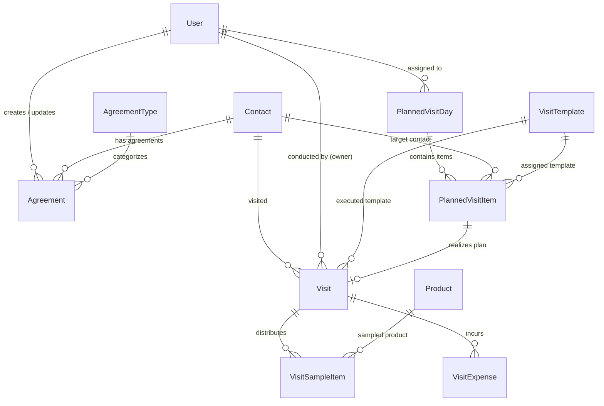

# Activities Module Database Design

This document details the database schema, models, fields, constraints, relationships, and default seed data designed for the Activities module.

---

## 1. Entity Relationship Diagram (ERD)

---

## 2. Models Specification

### 2.1 `AgreementType`
- `name`: `CharField(max_length=100, unique=True)`
- `display_name_ar`: `CharField(max_length=150, blank=True)`
- `is_active`: `BooleanField(default=True)`
- **Pre-seeded data:**
  1. `Conference` (مؤتمرات)
  2. `Cash money` (نقدي)
  3. `Devices` (أجهزة طبية)
  4. `Gifts` (هدايا عينية)
  5. `RTD` (طاولة نقاش مستديرة)
  6. `Rx` (روشتات / وصفات)
  7. `Others` (أخرى)

### 2.2 `Agreement`
- `serial_num`: `IntegerField(unique=True, db_index=True)` (Auto-incrementing reference serial `#222`)
- `title`: `CharField(max_length=255)`
- `description`: `TextField(blank=True, default='')` (Rich text/HTML terms and conditions)
- `type`: `ForeignKey(AgreementType, on_delete=models.PROTECT, related_name='agreements')`
- `amount`: `DecimalField(max_digits=12, decimal_places=2, default=0.00)`
- `status`: `CharField(max_length=30, choices=STATUS_CHOICES, default='new', db_index=True)`
  - Choices: `new` (New / جديد), `approved` (Approved / معتمد), `disapproved` (Disapproved / مرفوض), `done` (Done / منجز)
- `customer`: `ForeignKey('contacts.Contact', on_delete=models.CASCADE, related_name='agreements')`
- `date`: `DateField(default=timezone.now, db_index=True)`
- `created_by`: `ForeignKey(settings.AUTH_USER_MODEL, on_delete=models.SET_NULL, null=True, related_name='agreements_created')`
- `updated_by`: `ForeignKey(settings.AUTH_USER_MODEL, on_delete=models.SET_NULL, null=True, related_name='agreements_updated')`
- `created_at`: `DateTimeField(auto_now_add=True)`
- `updated_at`: `DateTimeField(auto_now=True)`

### 2.3 `VisitTemplate`
- `name`: `CharField(max_length=100, unique=True)`
- `display_name_ar`: `CharField(max_length=150)`
- `display_name_en`: `CharField(max_length=150)`
- `active`: `BooleanField(default=True)`
- `restrict_account_types`: `JSONField(default=list, blank=True)`
- `questionnaire`: `JSONField(default=dict, blank=True)` (Questions list with types: narrative, mcq_single, true_false)
- **Pre-seeded Templates:**
  1. `Single visit (Pharmacy)`
  2. `Single visit (DR)`
  3. `Coaching visit (Pharmacy)`
  4. `Coaching visit (DR)`
  5. `Store & Distributor visit`
  6. `Healthy day`

### 2.4 `PlannedVisitDay`
- `assignee`: `ForeignKey(settings.AUTH_USER_MODEL, on_delete=models.CASCADE, related_name='planned_visit_days')`
- `date`: `DateField(db_index=True)`
- `status`: `CharField(max_length=30, default='new', choices=[('new', 'New'), ('completed', 'Completed'), ('cancelled', 'Cancelled')])`
- `created_by`: `ForeignKey(settings.AUTH_USER_MODEL, on_delete=models.SET_NULL, null=True)`
- `created_at`: `DateTimeField(auto_now_add=True)`
- `updated_at`: `DateTimeField(auto_now=True)`
- **Constraint:** `unique_together = ('assignee', 'date')`

### 2.5 `PlannedVisitItem`
- `plan_day`: `ForeignKey(PlannedVisitDay, on_delete=models.CASCADE, related_name='items')`
- `order`: `PositiveIntegerField(default=1)`
- `contact`: `ForeignKey('contacts.Contact', on_delete=models.CASCADE, related_name='planned_visits')`
- `template`: `ForeignKey(VisitTemplate, on_delete=models.SET_NULL, null=True, blank=True)`
- `is_executed`: `BooleanField(default=False)`
- `visit`: `OneToOneField('Visit', on_delete=models.SET_NULL, null=True, blank=True, related_name='planned_source_item')`
- `notes`: `TextField(blank=True, default='')`
- `created_at`: `DateTimeField(auto_now_add=True)`

### 2.6 `Visit`
- `serial_num`: `IntegerField(unique=True, db_index=True)`
- `contact`: `ForeignKey('contacts.Contact', on_delete=models.CASCADE, related_name='visits')`
- `template`: `ForeignKey(VisitTemplate, on_delete=models.SET_NULL, null=True, blank=True, related_name='visits')`
- `owner`: `ForeignKey(settings.AUTH_USER_MODEL, on_delete=models.CASCADE, related_name='visits_conducted')` (Medical representative)
- `is_planned`: `BooleanField(default=False, db_index=True)`
- `date`: `DateField(default=timezone.now, db_index=True)`
- `visit_time`: `DateTimeField(default=timezone.now)`
- `started_at`: `DateTimeField(null=True, blank=True)`
- `ended_at`: `DateTimeField(null=True, blank=True)`
- `duration`: `IntegerField(default=0, help_text='Duration in milliseconds or seconds')`
- `status`: `CharField(max_length=30, default='finished', choices=[('planned', 'Planned'), ('started', 'Started'), ('finished', 'Finished')])`
- `approval_status`: `CharField(max_length=30, default='pending', choices=[('pending', 'Pending'), ('approved', 'Approved'), ('disapproved', 'Disapproved')])`
- `is_successful`: `BooleanField(default=True)`
- `doubled`: `BooleanField(default=False)`
- `mode`: `CharField(max_length=50, default='checkin_checkout')`
- `feedback`: `TextField(blank=True, default='')`
- `questionnaire_answers`: `JSONField(default=dict, blank=True)`
- `latitude`: `DecimalField(max_digits=9, decimal_places=6, null=True, blank=True)`
- `longitude`: `DecimalField(max_digits=9, decimal_places=6, null=True, blank=True)`
- `location_verified`: `BooleanField(default=True)`
- `approval_notes`: `TextField(blank=True, default='')`
- `approved_by`: `ForeignKey(settings.AUTH_USER_MODEL, on_delete=models.SET_NULL, null=True, blank=True, related_name='visits_approved')`
- `created_by`: `ForeignKey(settings.AUTH_USER_MODEL, on_delete=models.SET_NULL, null=True, related_name='visits_created')`
- `created_at`: `DateTimeField(auto_now_add=True)`
- `updated_at`: `DateTimeField(auto_now=True)`

### 2.7 `VisitSampleItem`
- `visit`: `ForeignKey(Visit, on_delete=models.CASCADE, related_name='samples')`
- `product`: `ForeignKey('catalog.Product', on_delete=models.CASCADE, related_name='visit_samples')`
- `quantity`: `PositiveIntegerField(default=1)`
- `notes`: `CharField(max_length=255, blank=True, default='')`

### 2.8 `VisitExpense`
- `visit`: `ForeignKey(Visit, on_delete=models.CASCADE, related_name='expenses')`
- `expense_type`: `CharField(max_length=100)`
- `amount`: `DecimalField(max_digits=10, decimal_places=2, default=0.00)`
- `notes`: `TextField(blank=True, default='')`
