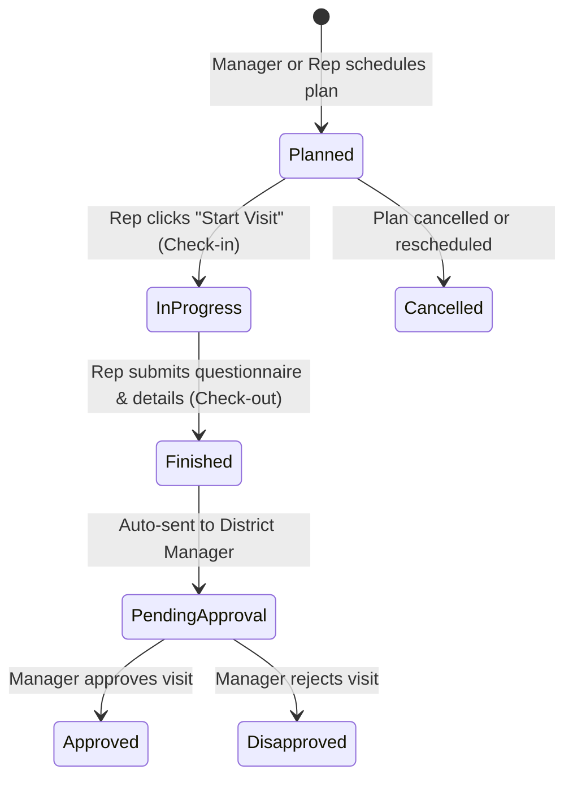
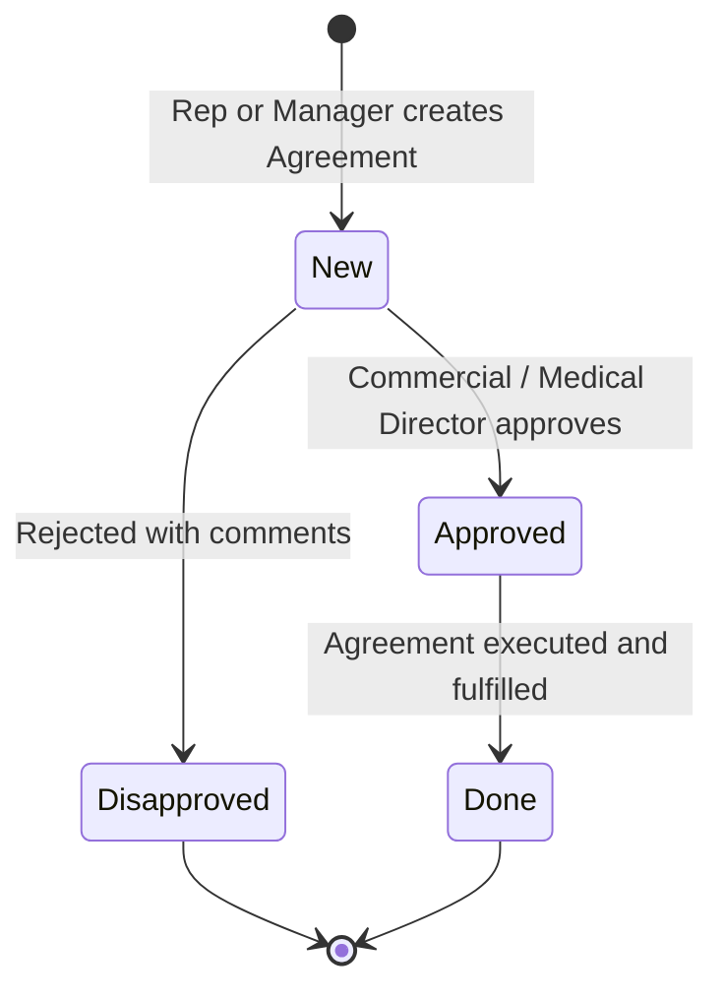

# Activities Module Workflows & Business Rules

This document specifies the exact business workflows, status transitions, validation logic, and policies discovered in the reference ERP (`weapharma.bricks-rep.com`).

---

## 1. Planned Visits Lifecycle & Workflow

### 1.1 Planning Architecture
- Plans are grouped by **Assignee (Representative)** and **Date**.
- A medical representative or district manager plans visits for a given calendar day or multi-week cycle.
- Each planned visit specifies:
  - `date`: Scheduled date of the visit.
  - `assignee`: Representative assigned to execute the visit.
  - `contact`: Target customer (Doctor, Clinic, Pharmacy, Hospital, etc.).
  - `template`: Visit template to execute (e.g. `Single visit (DR)`, `Single visit (Pharmacy)`).
  - `order`: Integer sequence order in the rep's daily route (1, 2, 3, ...).

### 1.2 Status Progression:

### 1.3 Conversion from Planned Visit to Actual Visit
1. A planned record initially exists in `Visit` with `is_planned=True` and `status='planned'`.
2. When the representative begins the visit:
   - System records `started_at = now()`.
   - System updates `status = 'started'`.
   - If GPS/geofence is enabled, records representative's check-in coordinates and compares distance against customer's registered address.
3. Upon completion:
   - System records `ended_at = now()`.
   - Calculates `duration = (ended_at - started_at)`.
   - Attaches questionnaire responses (answers to template questions).
   - Records sample items distributed from rep's assigned warehouse car/trunk stock.
   - Updates `status = 'finished'`.
   - Sets `approval_status = 'pending'`.

---

## 2. Visits Workflow & Policies

### 2.1 Unplanned Visits (`الزيارات غير المخططة`)
- The system setting `non_planned_enabled: true` allows medical representatives to perform unplanned visits directly in the field.
- Unplanned visits are created with `is_planned = False`, `status = 'finished'`.
- By default policy `non_planned_auto_approved`:
  - Standard visits undergo manager review (`approval_status = 'pending'`).
  - Or can be configured for auto-approval.

### 2.2 Minimum Days Policy (`سياسة الحد الأدنى للأيام بين الزيارات`)
The ERP enforces a visit cadence policy per account type to avoid over-visiting or under-visiting:
| Account Type | Minimum Days Rule | Enforcement Mode |
| :--- | :--- | :--- |
| **Clinic / Polyclinic (PM Visits)** | **6 Days** between visits | Warn / Block |
| **Pharmacy / Drug Store / Distributor** | **1 Day** between visits | Warn / Block |
| **All Other Entities** | **1 Day** (Global Fallback) | Warn |

*Validation Rule:* When planning or executing a visit to a contact, if `last_visit_date + min_days > target_date`, a warning or validation error is surfaced showing: `"يوجد زيارة سابقة لنفس العميل في تاريخ X، والحد الأدنى المسموح به هو Y أيام"`.

### 2.3 Double Visits (`الزيارات المزدوجة`)
- When a District Manager or Supervisor accompanies a Medical Representative on a visit, the flag `doubled = True` is set.
- Allows manager coaching questionnaires (e.g., `Coaching visit (DR)` or `Coaching visit (Pharmacy)`).
- Both the rep and accompanying manager are linked in the audit log.

### 2.4 Visit Approval Lifecycle
- States:
  1. `pending` (Display: `Pending` / `معلقة`, Order 3, Todo)
  2. `approved` (Display: `Approved` / `معتمدة`, Order 4, Done)
  3. `disapproved` (Display: `Disapproved` / `مرفوضة`, Order 5, Cancelled)
- Only users with managerial privileges (District Manager, Area Manager, Admin) can execute `Approve` or `Disapprove` actions.
- Rejection allows recording a rejection reason note.

---

## 3. Agreements Workflow & Lifecycle

### 3.1 Agreement States & Transitions

### 3.2 State Definitions:
| Status Key | Display Name (EN) | Display Name (AR) | Progress State | Allowed Actions |
| :--- | :--- | :--- | :--- | :--- |
| `new` | New | جديد | `todo` | Edit, Approve, Disapprove, Delete |
| `approved` | Approved | معتمد | `in_progress` | Mark as Done, Cancel, View Details |
| `disapproved` | Disapproved | مرفوض | `cancelled` | Re-open to New, View Details |
| `done` | Done | منجز | `done` | View Details, Export |

### 3.3 Agreement Types:
- `Cash money`: Direct monetary compensation or sponsorship.
- `Conference`: Sponsoring conference attendance, travel, or registration.
- `Devices`: Medical equipment or office hardware provision.
- `Gifts`: Commercial or promotional items.
- `RTD`: Round Table Discussion sponsorships.
- `Rx`: Prescription-tied commercial agreements.
- `Others`: Custom agreements.

### 3.4 Aggregation & Financial Summary
- The agreements list displays aggregated summary metrics:
  - Total count of agreements matching active filters.
  - Sum of agreement amounts (`amount__sum`) matching active filters.
- Supports filtering by Contact, Contact Assignee, Type, Date range, and Status.
