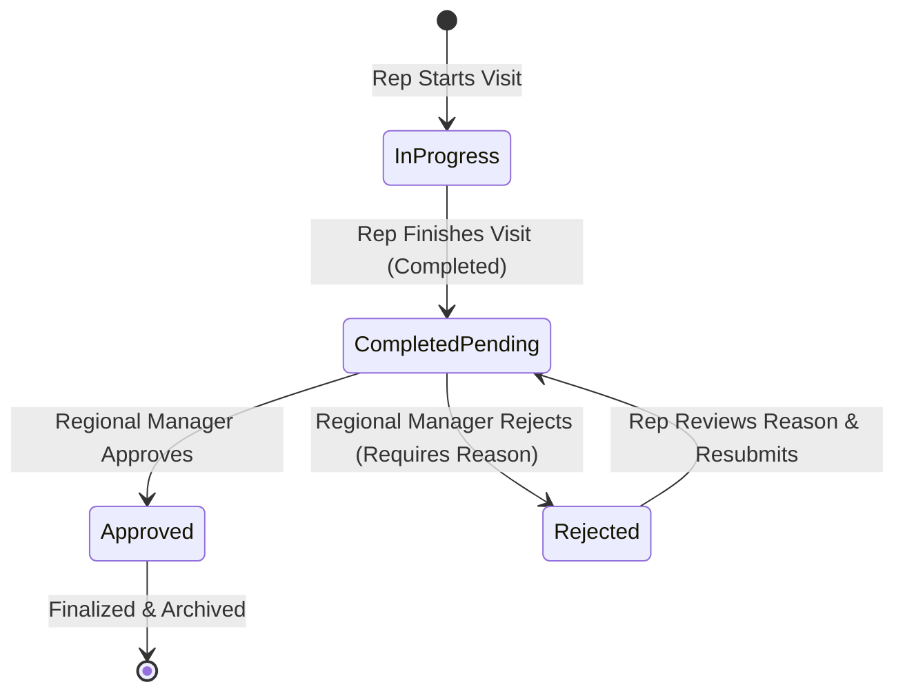
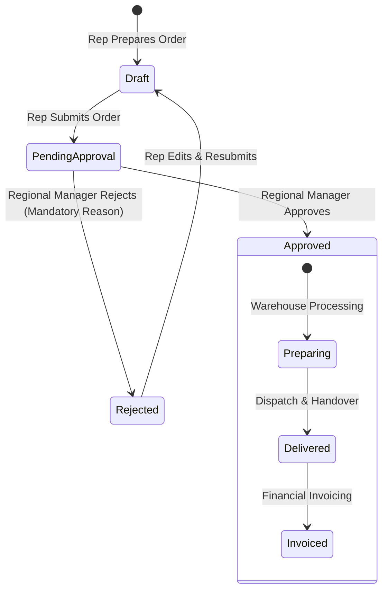

# Approval Workflows & Multi-Tier Review Infrastructure

**Module:** Activities, Sales, and Treasury  
**Status:** IMPLEMENTED & PRODUCTION-READY  
**Date:** 2026-10-24  

---

## 1. Business Requirements & Philosophy

In regulated pharmaceutical distribution, field rep submissions—such as physician/pharmacy visit reports and commercial sales orders—represent legal, clinical, and financial commitments.

The ERP implements a **Zero-Bypass Dual-Control** approval engine:
1. **Field Representative Submission:** A representative executes and submits a visit or sales order.
2. **Pending State Entry:** The record immediately enters a pending review state (`pending_approval` / `pending`).
3. **Manager Territorial Review:** The regional manager supervising that representative reviews the submission in the Approvals Hub.
4. **Binary Decision Point:**
   - **Approve:** State transitions to `approved`, stamping the approver and timestamp. Downstream operational processing is unlocked.
   - **Reject:** Requires a **mandatory rejection reason**. Downstream processing remains blocked. The representative receives immediate visual notice with the rationale, corrects the record, and resubmits it for review.
5. **No Self-Approval:** Neither representatives nor regional managers can approve their own submissions.

---

## 2. Visit Approval Lifecycle

### 2.1 State Model (`activities.models.Visit`)
- `status`: `'planned'`, `'in_progress'`, `'completed'`, `'cancelled'`.
- `manager_approval`: `'pending'`, `'approved'`, `'rejected'`.
- `rejection_reason`: Free-text field documenting the operational or clinical deficiency.
- `approved_at`: DateTime of manager approval.

### 2.2 Operational Actions (`activities.views:visit_action`)
- **`approve`:** Validates manager's territorial scope and verifies `user != visit.owner`. Sets `manager_approval = 'approved'`, `approved_at = now()`, records audit log.
- **`reject`:** Validates mandatory non-empty `rejection_reason`. Sets `manager_approval = 'rejected'`, records audit log.
- **`resubmit`:** Authorized for the visit owner when `manager_approval == 'rejected'`. Resets `manager_approval = 'pending'`, clears previous rejection reason, records audit log.

---

## 3. Sales Order Approval Lifecycle & Downstream Enforcement

### 3.1 State Model (`sales.models.SalesOrder`)
- `status`: `'draft'`, `'pending_approval'`, `'approved'`, `'rejected'`, `'confirmed'`, `'processing'`, `'delivered'`, `'cancelled'`.
- `rejection_reason`: Explicit reason provided by the manager.
- `approved_by`: ForeignKey to `User` who authorized the order.
- `approved_at`: DateTime of authorization.

### 3.2 Downstream Enforcement (`sales.services.SalesOrderService`)
The ERP prevents unapproved orders from proceeding through warehouse fulfillment or accounting:
- **`prepare_order(order)`:** Raises `ValidationError("لا يمكن تجهيز أو توصيل الطلب قبل اعتماده من المدير المباشر.")` if order status is not `'approved'`.
- **`deliver_order(order)`:** Raises `ValidationError` if not approved.
- **`invoice_order(order)`:** Raises `ValidationError` if not approved.

---

## 4. Centralized Approvals Hub (`/approvals/`)

The Approvals Hub (`activities/approvals_views.py:approvals_hub`) provides a single, unified command center for managers and super administrators.

### 4.1 Multi-Tab Structure
1. **Visits Queue (`tab=visits`):** All field visits within the manager's territorial jurisdiction, filterable by status (`pending`, `approved`, `rejected`), representative, area, and date.
2. **Sales Orders Queue (`tab=orders`):** All customer orders within jurisdiction, displaying customer, rep, area, item count, grand total, and approval status.
3. **Audit History (`tab=audit`):** Complete chronological audit trail of all submission, approval, rejection, and resubmission events.

### 4.2 Modal Dialogs & Action Controls
- **Approve Modal:** Confirms action and records the approving authority.
- **Reject Modal:** Enforces a non-empty Arabic rejection reason textarea before allowing form submission.
- **Mobile Card Layout:** Full parity with desktop tables, offering tap-friendly buttons ($\ge 44$px) and card layouts for screens down to 320px.

---

## 5. Audit Logging Architecture (`ApprovalAuditLog`)

Every lifecycle transition is immutably recorded in `activities.models.ApprovalAuditLog`:

| Field | Type | Description |
|:---|:---|:---|
| `entity_type` | `CharField` | `'visit'` or `'sales_order'` |
| `entity_id` | `PositiveIntegerField` | Primary key of the audited record |
| `action` | `CharField` | `'submit'`, `'approve'`, `'reject'`, `'resubmit'` |
| `actor` | `ForeignKey(User)` | The user performing the action |
| `rejection_reason` | `TextField` | Mandatory text on rejection events |
| `notes` | `TextField` | Additional context or resubmission notes |
| `created_at` | `DateTimeField` | Automatically stamped timestamp |

---

## 6. Automated Test Coverage

Verified in `activities/tests_approval_and_regional.py`:
- `test_visit_approval_and_rejection_workflow`: Tests transition to pending, rejection with reason, and resubmission.
- `test_sales_order_approval_lifecycle_and_downstream_enforcement`: Tests pending state, rejection, approval, and downstream blocks on `prepare_order` and `deliver_order` when not approved.
- `test_approvals_hub_filtering_and_pagination`: Asserts queue tab filtering and search functionality.
