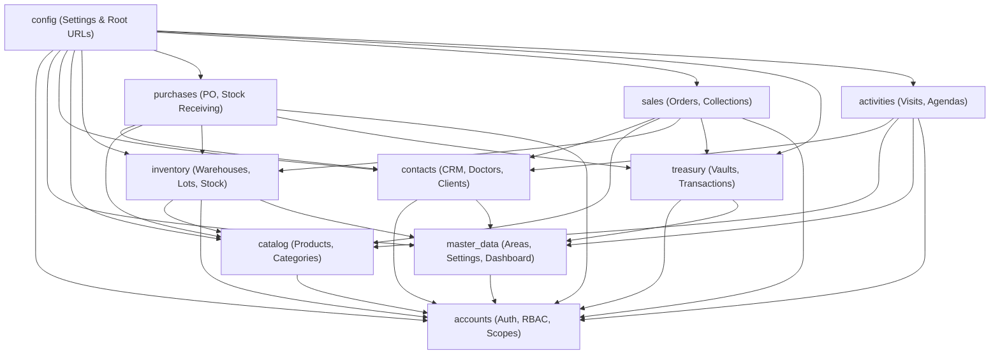
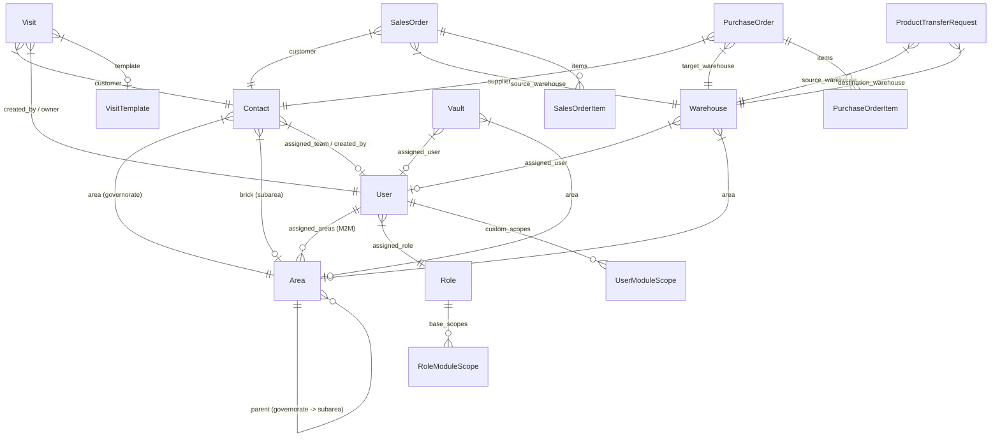

# System Architecture

This document describes the concrete system architecture and technical design of the WEA Pharma ERP application.

---

## 1. Directory Structure

```text
ERP/
├── accounts/               # Users, canonical roles, granular permissions, RBAC/ABAC scope resolution, security audit trail
├── activities/             # Field visits, visit templates, GPS verification, agenda, approval workflows
├── catalog/                # Pharmaceutical products, categories, volume discounts, packaging units
├── contacts/               # Healthcare professionals (doctors), pharmacies, suppliers, UDF, timeline, todos
├── inventory/              # Multi-warehouse management, lot/batch tracking, transfers, stock in/out memos
├── master_data/            # Territorial hierarchy (governorate/brick), singleton system settings, executive dashboard
├── purchases/              # Purchase orders, stock receiving, supplier invoice settlement, return orders
├── sales/                  # Sales orders, collections, customer ledgers, payment terms, returns
├── treasury/               # Cash vaults, deposits, withdrawals, internal transfers, vendor payments
├── config/                 # Django settings, root URL routing, WSGI/ASGI handlers
├── templates/              # Server-rendered HTML templates (Tailwind RTL, components, layouts)
├── static/                 # Static assets (JS table column manager, styles)
├── media/                  # User uploads (avatars, product imagery, visit attachments)
└── docs/                   # Authoritative technical documentation
```

### Application Dependencies and Layering



---

## 2. Core Domain Models & Relationships



### Key Entity Invariants

1. **User (`accounts.User`)**:
   - Custom user model extending `AbstractUser`.
   - Single canonical `Role` (`superadmin`, `manager`, `accountant`, `rep`, `medical_rep`).
   - Many-to-Many `assigned_areas` representing authorized territorial boundaries.
   - `has_custom_permissions` boolean determining whether permissions are inherited from `Role` or directly from `user_permissions`.
   - Automatically provisions dedicated warehouse and cash vault for representatives on user creation or role assignment (`ensure_representative_resources`).

2. **Area (`master_data.Area`)**:
   - Two-level hierarchical geographical model:
     - **Governorate / Main Area**: `parent is None` (`area_type='governorate'`).
     - **Brick / Subarea**: `parent is not None` (`area_type='subarea'`).
   - Represents the fundamental unit of organizational scoping and data isolation.

3. **Contact (`contacts.Contact`)**:
   - Real database ForeignKeys to both `area` (governorate) and `brick` (subarea).
   - Dynamic classification (`lead`, `customer`, `vendor`).
   - Support for dynamic User-Defined Fields (UDF), customer todos, and interaction timeline.

4. **Visit (`activities.Visit`)**:
   - Workflow state: `planned` → `started` → `finished`.
   - Approval state: `pending` → `approved` / `disapproved`.
   - Unplanned visits created directly via `/visits/create/` (`is_planned=False`).
   - Planned visits generated directly by bulk daily planning (`/planned-visits/bulk-add/`) creating linked `PlannedVisitItem` and `Visit(is_planned=True, status='planned')` records atomically, with fallback execution support for legacy unlinked items.
   - Stores scheduled `time` (`TimeField`) and localized 12-hour formatted representation.
   - GPS coordinates with distance verification against client address within configurable tolerance; OpenStreetMap Leaflet tile rendering with `SECURE_REFERRER_POLICY = 'strict-origin-when-cross-origin'` and automatic fallback tiles.

5. **SalesOrder (`sales.SalesOrder`)**:
   - Multi-stage pipeline: `pending` → `manager_approval` → `preparing` → `delivered` → `invoiced`.
   - Server-side available stock validation (`qty_on_hand - qty_reserved`) at creation and delivery.
   - Item-level and order-level discount and tax calculations.
   - Delivers inventory atomically and posts customer ledger balance for collections.

6. **PurchaseOrder (`purchases.PurchaseOrder`)**:
   - Pipeline: `pending` → `approved` → `picked` → `settled`.
   - Receipt of inventory creates atomic inward inventory memos and recalculates weighted average unit cost.
   - Settlement records vendor ledger liabilities.

7. **ProductTransferRequest (`inventory.ProductTransferRequest`)**:
   - Moves inventory between warehouses within the same canonical root Main Area.
   - Validates available stock strictly before reserving and executing transfer.
   - Creates balanced, immutable Stock In and Stock Out memos upon completion.

---

## 3. Layered Design and Separation of Concerns

```text
[ Browser / HTTP Client ]
         │
         ▼
[ URL Routing (config/urls.py & app/urls.py) ]
         │
         ▼
[ Authentication & Authorization Layer ]
  - @require_permission / RequirePermissionMixin
  - get_scoped_queryset(qs, user, model_name)
  - can_user_access_object(user, obj, action)
         │
         ▼
[ Views (app/views.py) ]
  - Validates request payload & form inputs
  - Orchestrates domain services
  - Handles HTTP status codes & template rendering
         │
         ▼
[ Service Layer (app/services.py) ]
  - Business rules, invariants, and mathematical calculations
  - Multi-table database operations inside @transaction.atomic
  - Concurrency control via select_for_update()
  - Emits SecurityAuditLog and ApprovalAuditLog entries
         │
         ▼
[ Persistence Layer (app/models.py & ORM) ]
  - Schema constraints, indexes, cascade policies
  - Model properties and helper queries
```

---

## 4. Centralized Settings Architecture (`SettingsService`)

Singleton configuration records are managed through `master_data.services.SettingsService`:
- `CompanyProfile`: Enterprise profile, tax configuration, packaging units, memo role permissions.
- `LocationSettings`: GPS visit tolerance, distance verification enforcement, bypass permissions.
- `SalesSettings`: Order creation flags, mandatory manager approval requirement.
- `PurchaseSettings`: Purchase creation flags, supplier approval requirement.
- `UserSettings`: Representative auto-provisioning flags for warehouses and cash vaults.

**Thread-Safe Request Caching:**
- Settings instances are resolved and cached per thread in `threading.local()`.
- Automatically cleared on Django's `request_started` and `request_finished` signals.
- Cleanly invalidated on database save/delete signals (`post_save`, `post_delete`).
- Non-request execution (e.g. CLI management commands and unit tests) bypasses cache, ensuring zero cross-test state pollution.

---

## 5. Audit Logging Infrastructure

The system maintains two distinct, non-overlapping audit stores:

1. **`accounts.SecurityAuditLog`** (Managed by `AuditLogService`):
   - System-wide enterprise security trail.
   - Add/Change/Delete disabled in Django Admin to prevent tampering.
   - Captures actor, IP address, timestamp, action type (`USER_LOGIN`, `PERMISSION_CHANGED`, `ORDER_CREATED`, `AGREEMENT_APPROVED`, `SETTINGS_UPDATED`, etc.), record ID, and JSON payload of `previous_values` and `new_values`.

2. **`activities.ApprovalAuditLog`**:
   - Operational workflow history specifically for state machines (Visits, Sales Orders, Purchase Orders).
   - Tracks transition timestamps, approving manager, previous status, next status, and optional decision notes.
