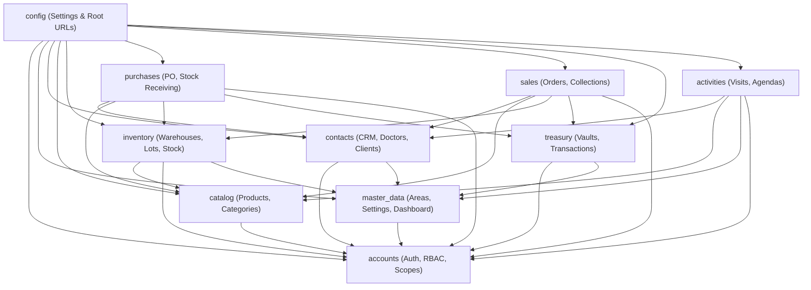
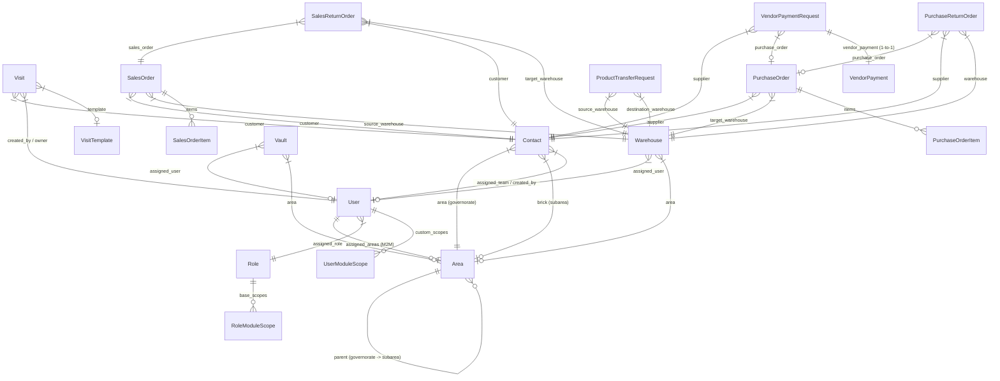

# System Architecture

This document describes the concrete system architecture and technical design of the WEA Pharma ERP application.

---

## 1. Directory Structure

```text
ERP/
├── accounts/               # Users, canonical roles, granular permissions, RBAC/ABAC scope resolution, security audit trail
├── activities/             # Field visits, visit templates, GPS verification, agenda, approval workflows
├── catalog/                # Pharmaceutical products, categories, volume discounts, packaging units
├── contacts/               # Healthcare professionals (doctors), pharmacies, suppliers, UDF, timeline, todos
├── inventory/              # Multi-warehouse management, lot/batch tracking, transfers, stock in/out memos
├── master_data/            # Territorial hierarchy (governorate/brick), singleton system settings, executive dashboard
├── purchases/              # Purchase orders, stock receiving, supplier invoice settlement, return orders
├── sales/                  # Sales orders, collections, customer ledgers, payment terms, returns
├── treasury/               # Cash vaults, deposits, withdrawals, internal transfers, vendor payments
├── config/                 # Django settings, root URL routing, WSGI/ASGI handlers
├── templates/              # Server-rendered HTML templates (Tailwind RTL, components, layouts)
├── static/                 # Static assets (JS table column manager, styles)
├── media/                  # User uploads (avatars, product imagery, visit attachments)
└── docs/                   # Authoritative technical documentation
```

### Application Dependencies and Layering



---

## 2. Core Domain Models & Relationships



### Key Entity Invariants

1. **User (`accounts.User`)**:
   - Custom user model extending `AbstractUser`.
   - Single canonical `Role` (`superadmin`, `manager`, `accountant`, `rep`, `medical_rep`).
   - Many-to-Many `assigned_areas` representing authorized territorial boundaries.
   - `has_custom_permissions` boolean determining whether permissions are inherited from `Role` or directly from `user_permissions`.
   - Automatically provisions dedicated warehouse and cash vault for representatives on user creation or role assignment (`ensure_representative_resources`).

2. **Area (`master_data.Area`)**:
   - Two-level hierarchical geographical model:
     - **Governorate / Main Area**: `parent is None` (`area_type='governorate'`).
     - **Brick / Subarea**: `parent is not None` (`area_type='subarea'`).
   - Represents the fundamental unit of organizational scoping and data isolation.

3. **Contact (`contacts.Contact`)**:
   - Real database ForeignKeys to both `area` (governorate) and `brick` (subarea).
   - Dynamic classification (`lead`, `customer`, `vendor`).
   - Support for dynamic User-Defined Fields (UDF), customer todos, and interaction timeline.

4. **Visit Plan (`activities.VisitPlan`)**:
   - Represents a distinct bulk visit planning submission with a unique auto-generated `plan_id` (e.g. `PLAN-YYYYMMDD-0001`).
   - Links all visits generated during the bulk submission to the plan (`visit.plan_id`).
   - Bulk creation comment is stored strictly at plan-level (`comment`) and displayed in `planned-visits/` and `agenda/` directly above each plan below the day name.
   - Enforces approval workflow: plans created by representatives lacking `activities:visits/approve` are created as `pending` approval and can be approved/rejected at the plan level (`/planned-visits/plan/<pk>/action/<action>/`).

5. **Visit (`activities.Visit`)**:
   - Workflow state: `planned` → `started` → `finished`.
   - Approval state: `pending` → `approved` / `disapproved`.
   - Unplanned visits created directly via `/visits/create/` (`is_planned=False`) are auto-approved (`'approved'`) and can be started immediately.
   - Planned visits created via bulk planning (`is_planned=True`) require manager approval (`pending`) if creator lacks `activities:visits/approve`.
   - Date validation: Visits can only be started when `visit.date == timezone.localdate()`. Time fields and time setting have been completely removed.
   - Outcome and comments: `visit_outcome` and `feedback` removed from direct model fields; outcome is collected via Question #1 (`نتيجة الزيارة`) in every `VisitTemplate` and accessed via `visit.outcome_display`.
   - GPS verification & forced bypass: Enforces `activities:visits/bypass_gps` for starting and ending visits outside tolerance; records separate forced GPS tracking (`gps_forced_start`, `gps_forced_end`) with audit logs.
   - Evidence photo capture completely removed: `location_photo`, `photo_captured_at`, and `activities:visits/evidence` removed across the application.

6. **Agreement (`activities.Agreement`)**:
   - Rep-to-doctor contractual commitments with approval workflow: `new` (قيد الانتظار) → `approved` (معتمد) / `rejected` (مرفوض) → `done` (مكتمل).
   - Edit and Delete operations restricted strictly to unapproved agreements (`status in ['new', 'rejected']`). Once approved, modifying or deleting is blocked on backend and IDOR checks.
   - Customer picker is dynamically scoped via `get_visit_eligible_contacts_queryset`.
   - Complete visual Arabic timeline built via `build_agreement_timeline`.

6. **SalesOrder (`sales.SalesOrder`) & SalesReturnOrder (`sales.SalesReturnOrder`)**:
   - Multi-stage sales pipeline: `pending` → `manager_approval` → `preparing` → `delivered` → `invoiced`.
   - Server-side available stock validation (`qty_on_hand - qty_reserved`) at creation and delivery.
   - `SalesReturnOrder`: Strictly references eligible delivered/invoiced original sales order. Enforces `Returnable Quantity = Original Quantity - Previously Returned Quantity`.
   - Inward warehouse receipt differentiates between resalable stock (re-added to `InventoryStock` and `InventoryLot`) and damaged goods (documented in memo without sellable inventory inflation).
   - Financial settlement posts credit transaction decreasing customer outstanding balance in `CustomerAccount`.
   - Anti-self-approval and POST-only action endpoints enforced.

7. **PurchaseOrder (`purchases.PurchaseOrder`) & PurchaseReturnOrder (`purchases.PurchaseReturnOrder`)**:
   - Pipeline: `pending` → `approved` → `picked` → `settled`.
   - Receipt of inventory creates atomic inward inventory memos and recalculates weighted average unit cost.
   - `PurchaseReturnOrder`: Enforces original PO returnable quantity bounds. Dispatches goods via outward memo, reducing `InventoryStock` and batch lots.
   - Financial settlement creates a debit note decreasing vendor accounts payable in `VendorAccount`.

8. **VendorPaymentRequest (`treasury.VendorPaymentRequest`)**:
   - Pre-payment requisition workflow: `pending` → `approved` / `rejected` → `executed` / `cancelled`.
   - Anti-self-approval prevents creators from approving their own payment requests.
   - Concurrency-safe execution with row-level locking (`select_for_update()`) and `OneToOneField(VendorPayment)` blocking duplicate payments.
   - Full timeline auditing via `build_payment_request_timeline`.

9. **ProductTransferRequest (`inventory.ProductTransferRequest`)**:
   - Moves inventory between warehouses within the same canonical root Main Area.
   - Validates available stock strictly before reserving and executing transfer.
   - Creates balanced, immutable Stock In and Stock Out memos upon completion.
   - Automatically recalculates destination warehouse `Stock.product_cost` via weighted-average and transfers `InventoryLot` batches.

---

## 3. Layered Design and Separation of Concerns

```text
[ Browser / HTTP Client ]
         │
         ▼
[ URL Routing (config/urls.py & app/urls.py) ]
         │
         ▼
[ Authentication & Authorization Layer ]
  - @require_permission / RequirePermissionMixin
  - get_scoped_queryset(qs, user, model_name)
  - can_user_access_object(user, obj, action)
         │
         ▼
[ Views (app/views.py) ]
  - Validates request payload & form inputs
  - Orchestrates domain services
  - Handles HTTP status codes & template rendering
         │
         ▼
[ Service Layer (app/services.py) ]
  - Business rules, invariants, and mathematical calculations
  - Multi-table database operations inside @transaction.atomic
  - Concurrency control via select_for_update()
  - Emits SecurityAuditLog and ApprovalAuditLog entries
         │
         ▼
[ Persistence Layer (app/models.py & ORM) ]
  - Schema constraints, indexes, cascade policies
  - Model properties and helper queries
```

---

## 4. Centralized Settings Architecture (`SettingsService`)

Singleton configuration records are managed through `master_data.services.SettingsService`:
- `CompanyProfile`: Enterprise profile, tax configuration, packaging units, memo role permissions.
- `LocationSettings`: GPS visit tolerance, distance verification enforcement, bypass permissions.
- `SalesSettings`: Order creation flags, mandatory manager approval requirement.
- `PurchaseSettings`: Purchase creation flags, supplier approval requirement.
- `UserSettings`: Representative auto-provisioning flags for warehouses and cash vaults.

**Thread-Safe Request Caching:**
- Settings instances are resolved and cached per thread in `threading.local()`.
- Automatically cleared on Django's `request_started` and `request_finished` signals.
- Cleanly invalidated on database save/delete signals (`post_save`, `post_delete`).
- Non-request execution (e.g. CLI management commands and unit tests) bypasses cache, ensuring zero cross-test state pollution.

---

## 5. Audit Logging Infrastructure

The system maintains two distinct, non-overlapping audit stores:

1. **`accounts.SecurityAuditLog`** (Managed by `AuditLogService`):
   - System-wide enterprise security trail.
   - Add/Change/Delete disabled in Django Admin to prevent tampering.
   - Captures actor, IP address, timestamp, action type (`USER_LOGIN`, `PERMISSION_CHANGED`, `ORDER_CREATED`, `AGREEMENT_APPROVED`, `SETTINGS_UPDATED`, etc.), record ID, and JSON payload of `previous_values` and `new_values`.

2. **`activities.ApprovalAuditLog`**:
   - Operational workflow history specifically for state machines (Visits, Sales Orders, Purchase Orders).
   - Tracks transition timestamps, approving manager, previous status, next status, and optional decision notes.

---

## 6. Field Performance Analytics & Enterprise Reports (`reports` App)

The `reports` app provides real-time field performance tracking, analytical comparisons, daily monitoring, and multi-domain financial/commercial reports, fully integrated with the multi-tenant data-scope architecture.

### Architectural Structure:
- **Models**:
  - `SalesTarget`: Representative monthly quotas for sales volume (EGP), collections (EGP), and visit counts.
  - `CustomerCall`: Telesales and remote medical detailing phone logs with duration, purpose, outcome, and linked sales order.
  - `CoachingEvaluation`: Joint double-visit field evaluations assessing product knowledge, selling skills, detailing clarity, objection handling, and action plans.
- **Performance Modules (`/performance/*`)**:
  - `overview/`: 22 KPI summary cards comparing current vs prior periods with variance deltas, working days calculator, and top detailed products leaderboard.
  - `analysis/`: 8 Chart.js comparative visual charts across representatives + 11-column representative performance comparison table with Excel export.
  - `daily/`: Day picker (`prev`/`today`/`next`), 4 Today vs Yesterday comparative KPI cards, 20-column daily representative activity matrix with Excel export, and 8 drilldown sub-tabs (Visits, Customers, Calls, Expenses, Tasks, Approvals, Orders, Collections).
  - `detailed/`: 63-column mega performance matrix across all field metrics and operational rates + dual-visit coaching evaluations audit log table with supervisor feedback + Excel export.
- **Reports Section (`/reports/*`)**:
  - `reports_hub`: Unified enterprise portal categorizing reports into Financial, Commercial, Supply Chain, and Activity categories with permission-aware cards.
  - **13 Standalone Reports**:
    1. AR Aging (`/reports/ar-aging/` + `/export/` + `/print/`): 5 overdue aging buckets + DSO.
    2. Trial Balance (`/reports/trial-balance/` + `/export/` + `/print/`): Opening, debit, credit, and closing balances.
    3. Target Achievement (`/reports/target-achievement/` + `/export/`): Monthly sales and collections quotas vs actual achievements with progress indicators.
    4. Net Sales & Profitability (`/reports/net-sales/` + `/export/`): Delivered sales minus returns, COGS, gross profit, and margin % per product.
    5. Customer 360 (`/reports/customer-360/` + `/export/`): 22-column comprehensive client audit.
    6. Promotions (`/reports/promotions/` + `/export/`): Composite discount offers, bundle discounts, and promo sales volume.
    7. Item Sales by Customer (`/reports/item-sales-by-customer/` + `/export/`): Product distribution matrix across clinics and pharmacies.
    8. Order Deliveries (`/reports/order-deliveries/` + `/export/` + `/print/`): Logistics, dispatch status, fulfillment %, and customer GPS coordinates.
    9. Delivery Stock Availability (`/reports/delivery-stock/` + `/export/`): Open orders allocation against on-hand, reserved, and free stock.
    10. Item Purchases & Vendors (`/reports/item-purchases/` + `/export/`): Purchase order volumes, vendor spend, and average purchase unit cost.
    11. Agreements ROI (`/reports/agreements-roi/` + `/export/`): Budget vs actual sales and ROI %.
    12. Calls & Telesales (`/reports/calls/` + `/export/`): Telesales and doctor phone calls tracking, durations, and resulting orders.
    13. Medical Samples Tracking (`/reports/samples/` + `/export/`): 16-column medical sample allocation, inventory valuations, and physician tracking.
- **Data Scoping**: Every report and KPI strictly executes `get_scoped_queryset(qs, request.user)`, ensuring complete data isolation between managers and reps.
