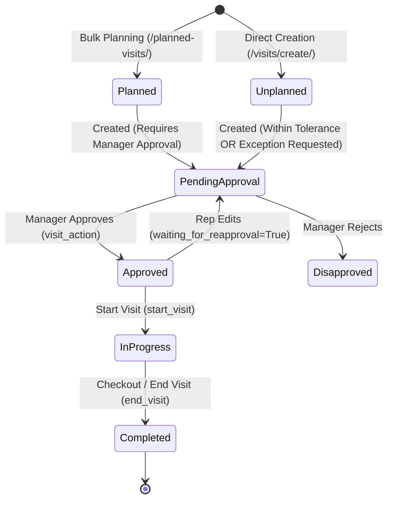
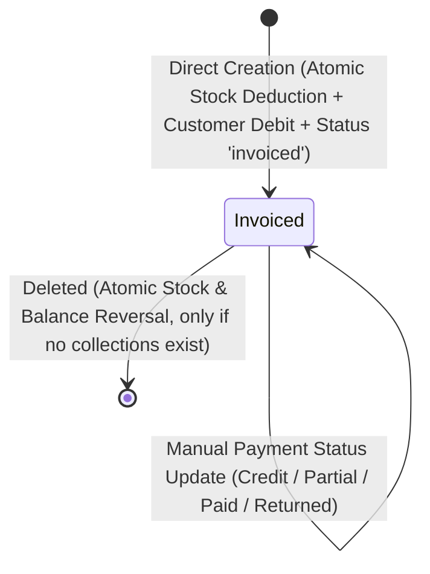
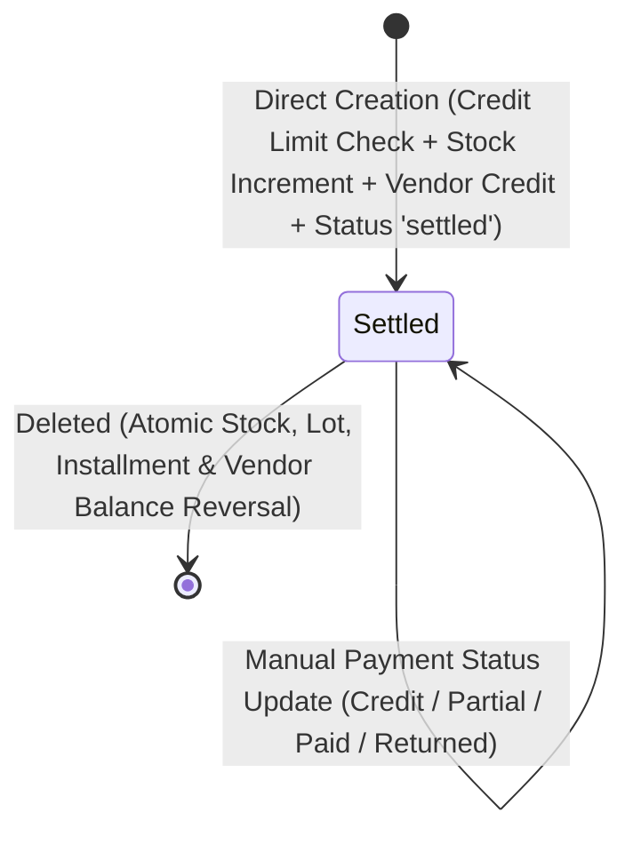
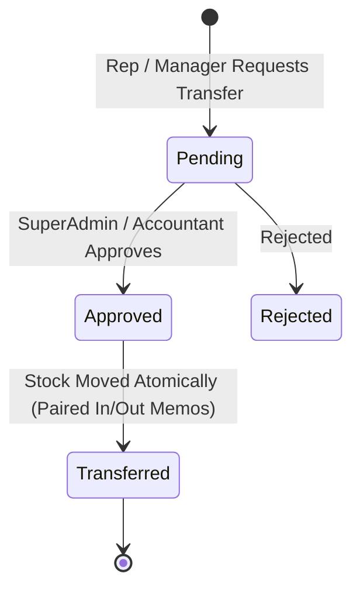

# Core Business Logic & Workflows

This document describes the business rules, transaction invariants, lifecycle status machines, and financial/inventory logic implemented in WEA Pharma ERP.

---

## 1. Field Visit Lifecycle (`activities`)

### 1.1 Automatic Planned vs. Unplanned Determination & Plan-Based Approval Lifecycle
- **Zero Ambiguity**: Manual selection of planned vs. unplanned visit type has been eliminated.
- **Bulk Planned Visits & Visit Plans (`activities.VisitPlan`)**:
  - Generated via bulk daily planning (`/planned-visits/bulk-add/`).
  - Each submission creates a distinct `VisitPlan` with a unique ID (`plan_id`, e.g. `PLAN-YYYYMMDD-0001`) and links all planned visits to it.
  - Form notes/comments are stored strictly as the plan comment (`plan.comment`), displayed directly above each plan in `planned-visits/` and `agenda/`.
  - **Approval Workflow**: If the plan creator lacks `activities:visits/approve`, the plan and its visits are created with `approval_status='pending'`. Authorized managers within the data scope can approve/reject the entire plan via `/planned-visits/plan/<pk>/action/<action>/` or approve individual visits.
- **Unplanned Visits**: Initiated via `/visits/create/`. The backend sets `is_planned=False`. Unplanned visits are **auto-approved upon creation** (`approval_status='approved'`) and can be started immediately without manager approval.
- **Date Restriction**: Visits can only be started when the visit date matches the actual current local date (`visit.date == timezone.localdate()`). Visit time fields have been completely removed.
- **Re-approval Trigger on Edits**: Any permitted edit to a visit's date or template (pre-start/pre-end) or questionnaire answers (post-end) immediately invalidates existing approval: sets `approval_status='pending'`, `waiting_for_reapproval=True`, clears prior approver info, and writes structured changes with `approval_required=True` to the Complete Visit Timeline.

### 1.2 GPS Distance Validation, Geofencing, & Forced Bypass Tracking
- **Configurable Allowed Distance**:
  - Global default: `LocationSettings.tolerance` (default 300 meters).
  - Template override: If `LocationSettings.allow_template_distance_override` is enabled and `VisitTemplate.has_special_location_settings=True`, the template's `special_tolerance` takes precedence.
- **Coordinate Handling & Decimal Separator Resilience**:
  - The distance calculation engine (`calculate_haversine_distance`) and verification services sanitize input coordinates by converting comma decimal separators to standard dots prior to float and Decimal conversion, preventing localization crashes.
- **Stage-Specific Validation (`verify_visit_location`)**:
  - **Start (`stage='start'`)**: Mandatory when starting a visit (`start_visit`) if `LocationSettings.verify_visits=True`. Missing or out-of-range coordinates are strictly rejected unless bypassed by an authorized user with `activities:visits/bypass_gps`.
  - **Completion (`stage='end'`)**: Mandatory when ending a visit (`end_visit`) if `LocationSettings.verify_end_visit_distance=True`.
- **Forced GPS Start & End Separation**:
  - Forced GPS bypass at start is recorded distinctly in `gps_forced_start`, `gps_forced_start_by`, and `gps_forced_start_at`.
  - Forced GPS bypass at end is recorded distinctly in `gps_forced_end`, `gps_forced_end_by`, and `gps_forced_end_at`.
  - Both actions generate separate `ApprovalAuditLog` records and display dedicated badges in visit list and detail views.
- **Server-Side GPS Integrity / Suspicious Location Detection (`activities/gps_integrity.py`)**:
  - Runs non-blockingly inside `verify_visit_location()` at start/end without altering `distance`/`allowed_distance` rules, warning the rep, or auto-rejecting visits.
  - Evaluates technically supported web/server signals (`invalid_or_zero_accuracy`, `impossible_travel_speed`, `exact_coordinate_clone`, `stale_or_drifted_timestamp`). Browser-based detection cannot inspect OS-level mock location apps/APIs; VPN/IP signals are never treated as standalone proof of GPS spoofing.
  - Classifies `Visit.gps_integrity_status` as `normal`, `suspicious`, `confirmed_manipulation` (only when multiple high-confidence signals concur), or `undetermined` (missing coords or evaluation failure).
  - Visibility in `visit_detail`, `visits_list`, `visits_list` filtering (`?gps_integrity=`), and `visits_export` is strictly gated on `activities:visits/view_gps_suspicion` + `ScopeResolutionService`.
- **Evidence Photos Removed**:
  - Photo evidence capture, storage, and permission (`activities:visits/evidence`) have been completely removed across the entire application.

### 1.3 Visit Outcome & Questionnaire Architecture
- **Visit Outcome via Questionnaire**:
  - Visit-level `visit_outcome` and `feedback` model fields have been removed completely.
  - The visit outcome is collected as Question #1 (`نتيجة الزيارة`) in every `VisitTemplate`.
  - Answers are stored in `visit.questionnaire_answers` and rendered dynamically via `visit.outcome_display` and `visit.get_qa_display_list()`.
- **Pre-Start / Pre-End Visit Editing (`visit_edit` / `POST /visits/<pk>/edit/`)**:
  - Editing is restricted strictly to date and template.
  - All permitted edits trigger re-approval (`approval_status='pending'`, `waiting_for_reapproval=True`).
- **Post-End Questionnaire Answer Editing (`visit_update_answers` / `POST /activities/visits/<pk>/update-answers/`)**:
  - Allowed **only after the visit has finished** (`status == 'finished'`) by the visit owner/creator with `activities:visits/edit_answers`.
  - Updating questionnaire answers triggers re-approval (`approval_status='pending'`, `waiting_for_reapproval=True`), records before/after answer diffs in `ApprovalAuditLog`, and appears in the Complete Visit Timeline.
- **Agenda Start-Visit Execution**:
  - Clicking «بدء الزيارة» from `agenda/` executes the exact same start workflow as the visit details page (capturing GPS, verifying geofence, displaying bypass/exception options, and answering check-in questions), rather than merely redirecting.
- **Removal of Cancellation Actions & Strict Deletion Rules**:
  - Visit cancellation buttons and actions have been completely removed from the UI.
  - Finished visits cannot be deleted under any circumstances (`status == 'finished'` or `ended_at is not None`).
  - Unended visits may only be deleted by authorized users holding `activities:visits/delete` when `LocationSettings.allow_visit_deletion_before_end=True`. Deletion unbinds any linked `PlannedVisitItem` to preserve the planned slot.
- **Visit Detail Actions**:
  - Direct manual status overrides (`change_status` / `manage_status`) are prohibited; visits progress exclusively through `approve`, `disapprove` (only while `approval_status != 'approved'`), `start`, and `complete`.

### 1.4 Visit Start Workflow & Questionnaire Stages
- **Separation of Stages**:
  - `start_only`: Check-in questions answered when starting the visit (e.g. site open status, arrival observations).
  - `end_only` / `all`: Completion questions answered when documenting and concluding the visit (e.g. detailing outcome, objections, sample delivery).
- **Check-In Validation**:
  - Required `start_only` questions are validated server-side during the `start_visit` mutation.
  - Successful start transitions the visit to `status = 'started'`, sets `started_at`, and populates `visit.questionnaire_answers`.
- **Elimination of Duplicate Start**:
  - Once started, the active visit dossier immediately renders the completion form and the "End Visit" (`complete`) action.
  - The "Start Visit" button is hidden once active, and duplicate start POST requests redirect safely without state degradation.

### 1.5 Scheduled Time & Quick Actions
- Visits maintain a dedicated `time` (`TimeField`) and localized Arabic 12-hour property `formatted_time`.
- An inline AJAX modal endpoint (`POST /activities/visits/<pk>/set-time/`) allows adjusting scheduled visit times without a page refresh, audited via `SecurityAuditLog`.

### 1.6 Visit Templates & Mandatory Questions
- **Role Restrictions**: Templates can be restricted to specific roles (`restricted_roles`). Unrestricted templates are available to all authorized roles.
- **Client-First Filtering**: Available templates dynamically filter based on the selected contact's account type (`is_contact_eligible(contact)`).
- **Mandatory Completion Validation**: When ending a visit (`can_end_visit`), every required question in the template (including active conditional questions) must have non-empty answers.

---

## 2. Data Integrity, Foreign Key Protection & Unified Deletions
- **Protected Relations (`ProtectedError`)**: Physical deletion of core entities (Products, Contacts, Areas, Roles) is protected by foreign key constraints. If related records exist (e.g. stock movements, invoices, visits, subareas, users), deletion is prevented and a clear, descriptive Arabic error message is displayed.
- **Audit Trails & Reversals**: Financial transactions (e.g. `VaultTransaction`) and inventory documents are never hard-deleted; instead, business logic requires financial reversal (`vault_transaction_reverse`) creating an explicit reversing entry and balancing the ledger.
- **Global Confirmation Standard**: All deletion and reversal actions trigger the unified modal (`showConfirmDeleteModal`) rather than native browser alerts.

---

## 2. Sales Order Lifecycle (`sales`)

### 2.1 Direct Execution Architecture & Safe Reversal Engine
- **Direct Automation on Creation (`create_order`)**: To eliminate multi-step status machine overhead and support rapid ERP commercial operations:
  1. Validates available warehouse stock for all line items atomically with row-level locks (`select_for_update()`). If stock is insufficient, creation is rejected immediately with a descriptive validation error.
  2. Posts an inward/outward balanced `InventoryMemo` (`memo_type='out'`, `status='posted'`), directly reducing `qty_on_hand` and updating batch lots.
  3. Records the financial debit entry in the customer ledger (`CustomerAccount`) via `CustomerTransaction` (`reason='sales_invoice'`), increasing customer receivables.
  4. Directly sets the order status to `invoiced` (`status='invoiced'`) and payment status to `credit` (`payment_status='credit'`).
- **Safe Delta Reconciliation on Edit (`update_order`)**:
  - Modifications to quantities or items compute stock and financial deltas atomically.
  - Decreasing quantity restores stock to warehouse; increasing quantity validates availability and deducts stock.
  - Customer account balance is adjusted by the exact difference in order grand total.
  - **Protection Invariant**: Orders with associated payments/collections (`order.collections.exists()`) cannot be edited.
- **Safe Reversal on Deletion (`delete_order`)**:
  - Requires permission `sales:orders/delete` and manage scope.
  - **Collection Block**: Deletion is strictly blocked if any payment collections are linked to the order (`order.collections.exists()`).
  - Restores deducted stock to the warehouse, reverts customer account balance, deletes related `CustomerTransaction` and `InventoryMemo`, and logs `SALES_ORDER_DELETED` in `SecurityAuditLog`.
- **Backward Compatibility**: Downstream service methods (`prepare_order`, `deliver_order`, `invoice_order`) remain idempotent and safe if called by legacy scripts.

### 2.2 Operational Payment Status (`payment_status`)
- Independent from order fulfillment, `SalesOrder` maintains an operational `payment_status` tracking settlement progress:
  - `credit` (آجل) — default on creation.
  - `partial` (جزئي) — partial collection received.
  - `paid` (مدفوع بالكامل) — fully collected.
  - `returned` (مرتجع) — refunded or returned.
- **Authority**: Managed via dedicated modal action on `sales_order_detail.html` restricted to users with permission `sales:orders/manage_payment_status`.
- **Audit Logging**: Every transition generates entries in both `ApprovalAuditLog` and `SecurityAuditLog`.
- **Advanced List Filtering**: Replaced obsolete fulfillment status tabs with active payment status filters, total amount range (`total_min` / `total_max`), and remaining balance range (`remaining_min` / `remaining_max`) with active filter chips.

### 2.3 Live Available Stock Display & Strict Atomic Validation
- On order creation and editing, available warehouse stock is displayed in real-time next to product selections via `/inventory/api/warehouse-stock/`.
- Clear red visual alerts warn the user if requested quantities exceed available stock.
- On order drafting/submission, orders are saved with pending status. Authoritative stock validation and atomic deduction execute strictly during order approval under `select_for_update()`.
- Sales by representatives are strictly constrained to warehouses accessible within their configured data scope.

### 2.4 Pricing, Discounts, and Taxes
- **Line-Item Discounts**: Verified to be between 0% and 100%.
- **Order-Level Discounts**: Verified not to exceed subtotal.
- **Shipping Fees**: Strictly non-negative.
- **Taxation Modes**: Inclusive or Exclusive based on `CompanyProfile.tax_mode`.

---

## 3. Purchase Order Lifecycle (`purchases`)

### 3.1 Direct Execution Architecture & Supplier Credit Limit Validation
- **Supplier Credit Limit Check**: During PO creation (`PurchaseOrderService.create_order`), if the supplier has a configured `credit_limit > 0`, the system verifies that `current_balance + order_total <= credit_limit`. If violated, order creation is rejected with a descriptive error.
- **Immediate Stock Inward & Recalculation**:
  - Automatically posts an inward `InventoryMemo` (`memo_type='in'`, `status='posted'`).
  - Increments warehouse stock (`InventoryStock.qty_on_hand`) and updates batch lots.
  - Recalculates product weighted average unit cost:
    $$\text{New Cost} = \frac{(\text{Current Qty} \times \text{Current Cost}) + (\text{Received Qty} \times \text{Purchase Price})}{\text{Current Qty} + \text{Received Qty}}$$
- **Immediate Financial Recording**:
  - Creates a credit transaction on `VendorAccount` (`VendorTransaction` with `reason='purchase_invoice'`), increasing accounts payable.
  - Automatically creates a open `VendorInstallment` for the net total.
  - Sets order status directly to `settled` (`status='settled'`).
- **Operational Payment Status (`payment_status`)**:
  - Independent operational field (`credit`, `partial`, `paid`, `returned`).
  - Managed via modal on `purchase_order_detail.html` restricted to users with permission `purchases:orders/manage_payment_status`.
- **Safe Reversal on Deletion (`delete_order`)**:
  - Requires permission `purchases:orders/delete` and manage scope.
  - **Reversal Blocks**: Strictly blocks deletion if payments exist (`order.payments.exists()`), if any installments have been settled (`settled_amount > 0`), or if any purchase return orders reference this order (`order.returns.exists()`).
  - **Stock Availability Verification**: Verifies warehouse has sufficient stock to deduct before reversing.
  - Atomically reverses stock, decrements lots, reverses vendor account balance, deletes installments, transactions, memos, and the order itself, logging `PURCHASE_ORDER_DELETED` in `SecurityAuditLog`.

---

## 4. Multi-Warehouse Inventory Transfers (`inventory`)

### Transfer Invariants
1. **Different Warehouses**: Source and destination warehouses must be distinct.
2. **Flexible & Scoped Transfer Requests**: Central warehouse transfers (`is_main=True`) and inter-manager warehouse transfers are permitted. In the UI, source warehouse is selected before destination warehouse.
3. **Available Stock Reservation & Live Display**: Source warehouse available stock (`qty_on_hand - qty_reserved`) is displayed dynamically and must strictly cover the transferred quantity.
4. **Accountant / SuperAdmin Authority**: Transfer execution is reserved for users with transfer approval permission (`inventory:transfers/approve`) or SuperAdmin.
5. **Atomic Execution**: Creates matched Stock Out (source) and Stock In (destination) inventory memos inside `@transaction.atomic`.

### 4.1 Warehouse Lifecycle, CRUD, Scoping & Safe Deletion Integrity (`inventory.Warehouse`)
1. **Permissions & Scoping**: Managed via `inventory:warehouses/manage` and `inventory:warehouses/delete`. SuperAdmin accesses all warehouses; Managers manage warehouses in their assigned Main Area and its child subareas; Representatives access only their assigned custody warehouse.
2. **Safe Deletion Validation (`WarehouseService.delete_warehouse`)**: Deletion is strictly prevented if:
   - Any stock on hand exists (`qty_on_hand > 0`).
   - Any inventory memos (`InventoryMemo`) are linked to the warehouse.
   - Any pending or completed transfer requests (`ProductTransferRequest`) reference the warehouse.
   - Any sales orders (`SalesOrder`) or purchase orders (`PurchaseOrder`) reference the warehouse.
3. **Advanced Filters & Scoped Statistics**: The list view (`warehouses_list`) includes an off-canvas drawer filtering by type (`main`, `rep`, `standard`), status (`active`, `inactive`), governorate/area, assigned custodian, and search terms, with dynamically calculated stats cards.

---

## 5. Treasury Operations (`treasury`)

- **Cash Vaults (`Vault`)**: Each representative has a dedicated cash vault for collections. Central vaults hold corporate funds.
- **Deposit / Withdraw Operations**: Viewing a vault does not grant funds mutation rights. Deposits and withdrawals require `treasury:vaults/transfer` or `treasury:transactions/create` permissions.
- **Concurrency Safety**: Vault balances are locked using `select_for_update()` during deposits, withdrawals, and collections.
- **Negative Balance Prevention**: Withdrawals and outgoing transfers cannot exceed current vault balance.

### 5.1 Vault Lifecycle, CRUD, Scoping & Financial Integrity (`treasury.Vault`)
1. **Permissions & Scoping**: Controlled via `treasury:vaults/manage` and `treasury:vaults/delete`. Scoped by `ScopeResolutionService` across `OWN`, `AREA`, and `ALL`.
2. **Opening Balance Setup**: Non-zero initial balance is posted atomically inside `@transaction.atomic` as a `VaultTransaction` with `reference_type='opening_balance'` and audited via `SecurityAuditLog`.
3. **Safe Deletion Validation (`VaultService.delete_vault`)**: Deletion is strictly blocked if:
   - Current balance is non-zero (`current_balance != 0.00`).
   - Any financial movements exist (`VaultTransaction`).
   - Any vendor payments (`VendorPayment`) or customer collections (`Collection`) are linked to the vault.
4. **Advanced Filters**: The list view (`vaults_list`) includes an off-canvas filter drawer covering vault type (`cash`, `bank`), custody type (`rep`, `central`), active status, area, assigned custodian, and numerical balance range (`balance_min`, `balance_max`).

### 5.2 Bi-directional User Account Linked Assets Assignment (`accounts`)
1. **Direct Profile Assignment**: From the user profile edit interface (`/settings/users/<pk>/edit/`), managers and administrators can view and assign the user's default custody warehouse and vault.
2. **Data Scope Enforcement**: Selectable warehouses and vaults are strictly scoped to the editing user's `manage_scope`.
3. **Audit Trail**: Modifications are audited in `SecurityAuditLog` with explicit before/after values under `USER_UPDATED`.

---

## 7. Agreements Lifecycle (`activities.Agreement`)

- **2-Status Lifecycle**: `new` (جديدة) and `done` (منجزة).
- **Client Scoping**: Agreement client dropdown is dynamically scoped using `get_visit_eligible_contacts_queryset(request.user)` (SuperAdmin = all, Manager = Main Area + child bricks, Rep = assigned Bricks).
- **Status Transitions & Anti-Self-Approval**:
  - Marking an agreement as completed (`done`) or reopening it (`new`) requires `activities:agreements/approve` and manage scope.
  - Anti-self-approval rule strictly prohibits creators from changing the status of their own agreements (`can_user_access_object(user, agreement, 'approve')` / `can_user_access_object(user, agreement, 'done')`).
- **Scoped Edit and Deletion**:
  - Agreements can be edited (`/activities/agreements/<pk>/edit/`) or deleted (`/activities/agreements/<pk>/delete/`) by authorized users respecting data scope (`can_user_access_object(user, agreement, 'edit')` / `'delete'`).
  - All operations write structured audit logs (`AGREEMENT_UPDATED`, `AGREEMENT_DELETED`).
- **Clean Isolated Timeline**: `build_agreement_timeline` strictly isolates agreement events (`action_type__startswith='AGREEMENT_'`), eliminating any foreign visit or plan events.
- **Advanced List Filtering**: Slide-out filter drawer matching visits UX with dynamic active filter chips, customer selector, status, governorate, brick, amount range (`amount_min` / `amount_max`), and date range.

---

## 8. Sales Returns & Purchase Returns

### 8.1 Sales Return Orders (`sales.SalesReturnOrder`)
- **Direct Automation on Creation**: Returns reference an eligible invoiced sales order.
- **Immediate Stock Restocking**:
  - Resalable items (`condition='resalable'`) generate an inward memo and increment `InventoryStock.qty_on_hand` and batch lots.
  - Damaged items (`condition='damaged'`) are logged in the inward memo for documentation but are excluded from sellable inventory.
- **Immediate Financial Settlement**:
  - Generates a credit transaction on `CustomerAccount` (`reason='sales_return'`), reducing customer receivables.
  - Status is set directly to `settled` (`status='settled'`).
- **Safe Reversal on Deletion (`delete_return_order`)**:
  - Requires permission `sales:returns/delete` and manage scope.
  - Atomically deducts restocked inventory (for resalable items), restores customer receivables balance, deletes the credit transaction and memo, and logs `SALES_RETURN_DELETED`.

### 8.2 Purchase Return Orders (`purchases.PurchaseReturnOrder`)
- **Direct Automation on Creation**: Linked to an existing settled purchase order.
- **Returnable Quantity Invariant**: Cannot return more than originally received quantity minus previous returns.
- **Immediate Warehouse Dispatch**:
  - Verifies sufficient stock availability in the warehouse under `select_for_update()`.
  - Generates an outward memo and decrements `InventoryStock.qty_on_hand` and lot quantities.
- **Immediate Financial Settlement**:
  - Generates a debit note on `VendorAccount` (`reason='purchase_return'`), reducing accounts payable.
  - Status is set directly to `settled` (`status='settled'`).
- **Safe Reversal on Deletion (`delete_return_order`)**:
  - Requires permission `purchases:returns/delete` and manage scope.
  - Atomically restores deducted stock to the warehouse, restores lot balances, restores accounts payable balance, deletes debit transaction and memo, and logs `PURCHASE_RETURN_DELETED`.

---

## 9. Vendor Payment Requests (`treasury.VendorPaymentRequest`) & Unified Payment Creation

- **Unified Payment Flow**: Direct creation of isolated vendor payment requests (`/purchases/orders/payment-requests/create/`) automatically redirects with query parameters (`?supplier=...&purchase_order=...`) to the authoritative Treasury payment view (`/treasury/payments/create/`), ensuring all disbursement transactions originate from valid cash vaults with proper audit tracking.
- **Requisition Workflow**: Existing payment requests follow `pending` → `approved` / `rejected` → `executed` / `cancelled`.
- **Validation**:
  - Amount cannot exceed the purchase order's outstanding balance (`purchase_order.outstanding_balance`).
- **Anti-Self-Approval**: Creators cannot approve or reject their own payment requests.
- **Execution & Duplicate Prevention**:
  - Executing a request atomically generates `VendorPayment`, posts a debit entry in `VendorTransaction`, decrements vault funds, and settles installments.
  - Row is locked with `select_for_update()`.
  - `VendorPaymentRequest.vendor_payment` is a `OneToOneField`, preventing duplicate execution or multiple payments for a single request.
- **Timeline**: Comprehensive event tracking rendered in Arabic via `build_payment_request_timeline`.

---

## 10. Arabic Search Normalization Service (`master_data.search_utils`)

All search operations across contacts, catalog, purchases, sales, treasury, and activities utilize unified normalization:
- **Alef Normalization**: `أ`, `إ`, `آ`, `ٱ` → `ا`.
- **Ta Marbuta**: `ة` → `ه`.
- **Ya / Alef Maqsura**: `ى` → `ي`.
- **Diacritics & Tatweel**: Tashkeel (harakat) and Kashida (`ـ`) stripped.
- **SQL Portability**: Sequential SQL `Replace` functions evaluated natively in SQLite and PostgreSQL.
- **Signature Tolerance**: Accepts both `(queryset, fields, query)` and `(queryset, query, fields)` dynamically.

---

## 11. Form Error Recovery & Data Preservation

To protect data entry against accidental loss during server-side validation failures:
- **Zero Redirect on Error**: Form submissions that fail validation re-render the template directly with HTTP 400 Bad Request instead of redirecting.
- **Input & Dynamic Row Re-population**: All scalar inputs, selected relationships, and dynamic item rows (products, quantities, unit prices, discounts, conditions, notes) are packaged as `submitted_items` / `submitted_data` and injected directly into template contexts and JavaScript initialization scripts.
- **Consistent Across Modules**: Enforced across Sales Orders (`sales_order_create`, `sales_order_edit`), Sales Returns (`sales_return_order_create`), Purchase Returns (`purchase_return_order_create`), and Inventory Memos/Transfers (`memo_create`, `product_transfer_create`).

---

## 12. Integer-Only Quantities, Visit Questionnaire & Safe User Deletion

- **Integer-Only Quantities (`master_data.validation_utils.parse_positive_integer_quantity`)**: All Sales, Purchases, Inventory Memos, and Product Transfer quantities must be positive whole integers (`>= 1`, or `>= 0` where zero-qty return rows are skipped). Both HTML inputs (`step="1" min="1"`) and backend services enforce integer-only values.
- **Visit Template Questions (`end_only`)**: New and edited `VisitTemplateQuestion` records enforce `stage='end_only'` so questionnaire answers are collected during visit completion; historical `start_only` answers remain accepted if already recorded on in-progress visits. `Visit.get_qa_display_list()` maps stored option keys (`yes`/`no`, `successful`/`unsuccessful`, and choice `value`s) to Arabic labels.
- **Safe User Deletion (`accounts.services.delete_user_safely`)**: Protected by `users:users/delete`. Blocks self-deletion, SuperAdmin deletion, and deletion of users holding active warehouse stock or non-zero vault balances. Revokes active sessions, reassigns `PROTECT`-ed historical records (`Visit`, `VisitPlan`, `PlannedVisitDay`, `SalesTarget`, `CustomerCall`, `CoachingEvaluation`) to the inactive `historical_archive@wea.com` archive account, and records `USER_DELETED` in `SecurityAuditLog`.

