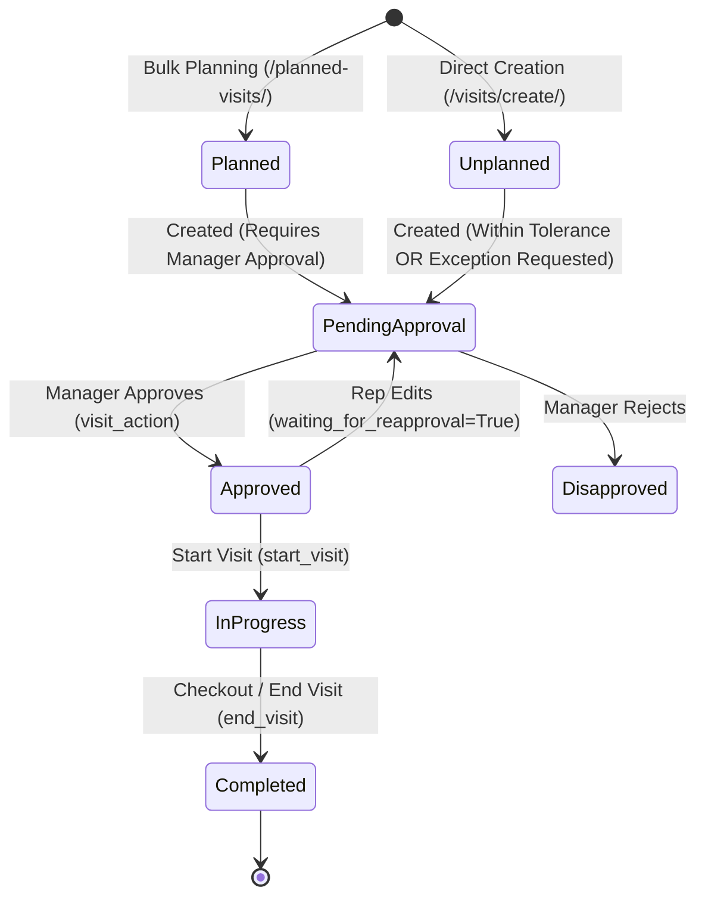
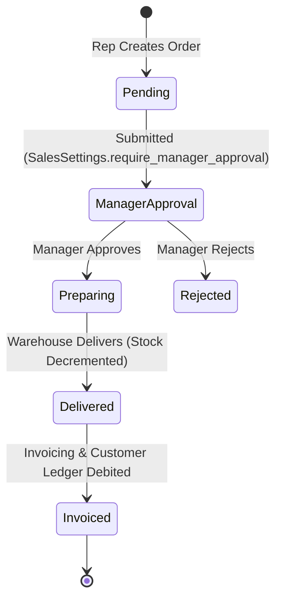
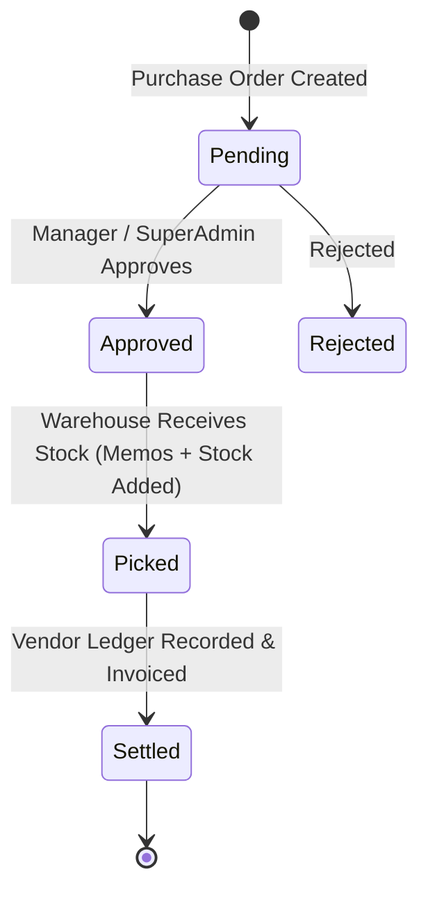
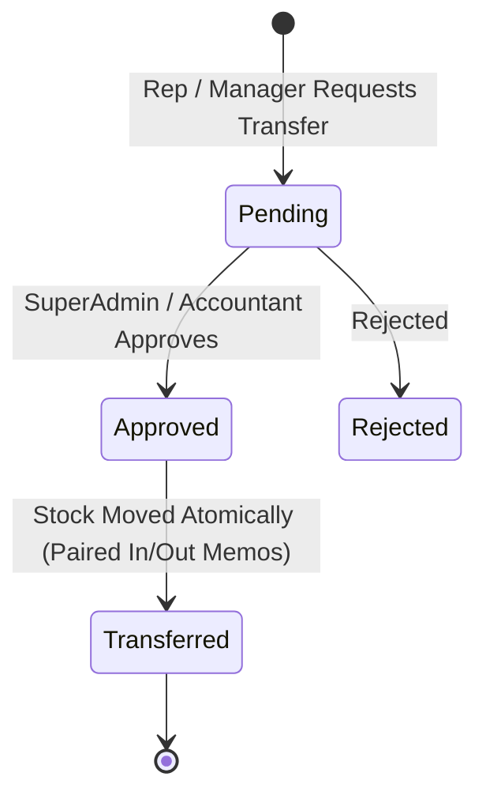

# Core Business Logic & Workflows

This document describes the business rules, transaction invariants, lifecycle status machines, and financial/inventory logic implemented in WEA Pharma ERP.

---

## 1. Field Visit Lifecycle (`activities`)

### 1.1 Automatic Planned vs. Unplanned Determination & Approval Lifecycle
- **Zero Ambiguity**: Manual selection of planned vs. unplanned visit type has been eliminated.
- **Planned Visits**: Generated directly via bulk daily planning (`/planned-visits/bulk-add/`) or individual planned add. Planned visits are **automatically approved upon creation** (`approval_status='approved'`, `approved_by=None`, `approved_at=now()`) and do not require manager approval to start.
- **Unplanned Visits**: Initiated via `/visits/create/`. The backend sets `is_planned=False`. Unplanned visits require manager approval upon creation (`approval_status='pending'`).
- **Re-approval Trigger on Edits**: Any permitted edit to a visit's date, template, time (pre-start/pre-end) or questionnaire answers (post-end) immediately invalidates existing approval: sets `approval_status='pending'`, `waiting_for_reapproval=True`, clears prior approver info, and writes structured changes with `approval_required=True` to the Complete Visit Timeline.

### 1.2 GPS Distance Validation & Geofencing
- **Configurable Allowed Distance**:
  - Global default: `LocationSettings.tolerance` (default 300 meters).
  - Template override: If `LocationSettings.allow_template_distance_override` is enabled and `VisitTemplate.has_special_location_settings=True`, the template's `special_tolerance` takes precedence.
- **Coordinate Handling & Decimal Separator Resilience**:
  - The distance calculation engine (`calculate_haversine_distance`) and verification services sanitize input coordinates by converting comma decimal separators (common in Arabic locales, e.g. `'30,0444'`) to standard dots prior to float and Decimal conversion, preventing localization crashes.
- **Stage-Specific Validation (`verify_visit_location`)**:
  - **Creation (`stage='create'`)**: Mandatory for **unplanned** visits when `LocationSettings.verify_unplanned_visit_distance=True`. **Not enforced** at creation time for **planned** visits (planned visits start with `location_verified=False` until field execution).
  - **Start (`stage='start'`)**: Mandatory when starting a visit (`start_visit`) if `LocationSettings.verify_visits=True`. Missing or out-of-range coordinates are strictly rejected unless bypassed by an authorized user.
  - **Completion (`stage='end'`)**: Mandatory when ending a visit (`end_visit`) if `LocationSettings.verify_end_visit_distance=True`.
- **Bypass & Exception Security**:
  - **Direct Bypass**: Controlled server-side via `LocationSettings.can_user_bypass_without_approval(user, stage)`. Unauthorized users submitting `force_bypass_location=1` are rejected on both form and service layers.
  - **Exception Requests**: Controlled by the explicit permission `activities:visits/gps_request_exception` and `LocationSettings.can_user_request_distance_exception(user)`. When outside tolerance, only users with this permission can request an exception with mandatory `bypass_reason`, marking the visit with `requires_approval_due_to_distance=True` and `approval_status='pending'`.

### 1.3 Separation of Visit Metadata vs. Questionnaire Answers & Lifecycle Restrictions
- **Pre-Start / Pre-End Visit Editing (`visit_edit` / `POST /visits/<pk>/edit/`)**:
  - Before the visit has started and ended, editing is restricted strictly to the visit date, template, and scheduled time. Questionnaire answers and execution fields cannot be edited.
  - All permitted edits trigger re-approval (`approval_status='pending'`, `waiting_for_reapproval=True`), and write structured diffs to `ApprovalAuditLog` and `SecurityAuditLog`.
- **Post-End Questionnaire Answer Editing (`visit_update_answers` / `POST /activities/visits/<pk>/update-answers/`)**:
  - Allowed **only after the visit has finished** (`status == 'finished'` and `ended_at` is set) by the visit owner/creator (or superuser) with `activities:visits/edit_answers`.
  - Updating questionnaire answers triggers re-approval (`approval_status='pending'`, `waiting_for_reapproval=True`), records before/after answer diffs in `ApprovalAuditLog` (`action='answers_updated'`), and is displayed in the Complete Visit Timeline.
  - The UI button «تعديل إجابات استبيان» is hidden until the visit has ended.
- **Agenda Start-Visit Execution**:
  - Clicking «بدء الزيارة» from `agenda/` executes the exact same start workflow as the visit details page (capturing GPS, verifying geofence, displaying bypass/exception options, and answering check-in questions), rather than merely redirecting.
- **Removal of Cancellation Actions & Strict Deletion Rules**:
  - Visit cancellation buttons and actions have been completely removed from the UI.
  - Finished visits cannot be deleted under any circumstances (`status == 'finished'` or `ended_at is not None`).
  - Unended visits may only be deleted by authorized users holding `activities:visits/delete` when `LocationSettings.allow_visit_deletion_before_end=True`. Deletion unbinds any linked `PlannedVisitItem` to preserve the planned slot.
- **Visit Detail Actions**:
  - Direct manual status overrides (`change_status` / `manage_status`) are prohibited; visits progress exclusively through `approve`, `disapprove` (only while `approval_status != 'approved'`), `start`, and `complete`.

### 1.4 Visit Start Workflow & Questionnaire Stages
- **Separation of Stages**:
  - `start_only`: Check-in questions answered when starting the visit (e.g. site open status, arrival observations).
  - `end_only` / `all`: Completion questions answered when documenting and concluding the visit (e.g. detailing outcome, objections, sample delivery).
- **Check-In Validation**:
  - Required `start_only` questions are validated server-side during the `start_visit` mutation.
  - Successful start transitions the visit to `status = 'started'`, sets `started_at`, and populates `visit.questionnaire_answers`.
- **Elimination of Duplicate Start**:
  - Once started, the active visit dossier immediately renders the completion form and the "End Visit" (`complete`) action.
  - The "Start Visit" button is hidden once active, and duplicate start POST requests redirect safely without state degradation.

### 1.5 Scheduled Time & Quick Actions
- Visits maintain a dedicated `time` (`TimeField`) and localized Arabic 12-hour property `formatted_time`.
- An inline AJAX modal endpoint (`POST /activities/visits/<pk>/set-time/`) allows adjusting scheduled visit times without a page refresh, audited via `SecurityAuditLog`.

### 1.6 Visit Templates & Mandatory Questions
- **Role Restrictions**: Templates can be restricted to specific roles (`restricted_roles`). Unrestricted templates are available to all authorized roles.
- **Client-First Filtering**: Available templates dynamically filter based on the selected contact's account type (`is_contact_eligible(contact)`).
- **Mandatory Completion Validation**: When ending a visit (`can_end_visit`), every required question in the template (including active conditional questions) must have non-empty answers.

---

## 2. Data Integrity, Foreign Key Protection & Unified Deletions
- **Protected Relations (`ProtectedError`)**: Physical deletion of core entities (Products, Contacts, Areas, Roles) is protected by foreign key constraints. If related records exist (e.g. stock movements, invoices, visits, subareas, users), deletion is prevented and a clear, descriptive Arabic error message is displayed.
- **Audit Trails & Reversals**: Financial transactions (e.g. `VaultTransaction`) and inventory documents are never hard-deleted; instead, business logic requires financial reversal (`vault_transaction_reverse`) creating an explicit reversing entry and balancing the ledger.
- **Global Confirmation Standard**: All deletion and reversal actions trigger the unified modal (`showConfirmDeleteModal`) rather than native browser alerts.

---

## 2. Sales Order Lifecycle (`sales`)

### 2.1 Available Stock Validation
- On order creation and delivery, the system strictly validates that available warehouse stock (`qty_on_hand - qty_reserved`) is greater than or equal to the ordered quantity.
- Sales by representatives are strictly constrained to their designated representative warehouse (`rep.get_default_warehouse()`).

### 2.2 Pricing, Discounts, and Taxes
- **Line-Item Discounts**: Verified to be between 0% and 100%.
- **Order-Level Discounts**: Verified not to exceed subtotal.
- **Shipping Fees**: Strictly non-negative.
- **Taxation Modes**: Inclusive or Exclusive based on `CompanyProfile.tax_mode`.

### 2.3 Atomic Delivery & Financial Ledger
- Order delivery executes inside `@transaction.atomic` using `select_for_update()` row locks on `InventoryStock`.
- Delivery generates a balanced outward inventory memo.
- Invoicing records the balance on `CustomerAccount` via `CustomerTransaction`.
- Customer payments (`Collection`) credit the customer ledger and debit the representative's cash vault (`rep.get_default_treasury()`).

---

## 3. Purchase Order Lifecycle (`purchases`)

### 3.1 Supplier Validation and Costing
- Suppliers must be active vendor contacts.
- Unit prices must be non-negative; quantities must be strictly positive.
- When an order is marked as `picked` / received:
  - Inventory stock is increased inside `@transaction.atomic`.
  - The product's weighted average unit cost is recalculated:
    $$\text{New Cost} = \frac{(\text{Current Qty} \times \text{Current Cost}) + (\text{Received Qty} \times \text{Purchase Price})}{\text{Current Qty} + \text{Received Qty}}$$
  - A permanent Stock In memo is recorded.

### 3.2 Vendor Settlement & Treasury Payments
- Settling a purchase order creates a liability entry on the vendor ledger (`VendorAccount`).
- Payments to vendors (`VendorPayment`) are disbursed from authorized cash vaults, validating sufficient vault balance and generating `SecurityAuditLog` entries.

---

## 4. Multi-Warehouse Inventory Transfers (`inventory`)

### Transfer Invariants
1. **Different Warehouses**: Source and destination warehouses must be distinct.
2. **Same Main Area Boundary**: Unless requested by SuperAdmin, both warehouses must belong to the same canonical root Main Area (`Area.parent is None`). Cross-governorate unauthorized transfers are blocked.
3. **Available Stock Reservation**: Source warehouse available stock (`qty_on_hand - qty_reserved`) must strictly cover the transferred quantity.
4. **Accountant / SuperAdmin Authority**: Area managers cannot approve transfers; execution is reserved for SuperAdmin and Accountant roles.
5. **Atomic Execution**: Creates matched Stock Out (source) and Stock In (destination) inventory memos inside `@transaction.atomic`.

---

## 5. Treasury Operations (`treasury`)

- **Cash Vaults (`Vault`)**: Each representative has a dedicated cash vault for collections. Central vaults hold corporate funds.
- **Deposit / Withdraw Operations**: Viewing a vault does not grant funds mutation rights. Deposits and withdrawals require `treasury:vaults/transfer` or `treasury:transactions/create` permissions.
- **Concurrency Safety**: Vault balances are locked using `select_for_update()` during deposits, withdrawals, and collections.
- **Negative Balance Prevention**: Withdrawals and outgoing transfers cannot exceed current vault balance.

---

## 6. Contacts, Communication Methods & Geographic Scoping (`contacts`, `master_data`)

- **Universal Customer Classification**: All organizational and individual contacts are classified as customers (`status='customer'`, `is_customer=True`). Legacy 'lead' classification is retired from contact workflows, and customer financial accounts (`CustomerAccount`) are guaranteed for all customer contacts.
- **Communication Methods CRUD (`ContactCommunicationMethod`)**: Complete CRUD support in contact overview and edit screens for communication types (`mobile`, `phone`, `email`, `whatsapp`, `website`, `other`). Marking a communication method as primary automatically synchronizes with primary contact fields (`mobile`, `phone`, `email`, `website`).
- **Unified Geographic Hierarchy**: Strict 2-level hierarchy where Governorate (`parent is None`) contains Bricks/Sub-areas (`parent is not None`). Duplicate governorates (Cairo/Giza) are unified and deduplicated.
- **Multi-Area & Multi-Brick Selection**: Planned visits bulk planning drawer supports multiple governorate and multiple brick selection with cascading dependency filtering.
- **Resilient Egyptian Geocoding (GBS)**: Address and location lookups are constrained to Egypt (`countrycodes=eg`, Egypt bounding box, `addressdetails=1`), with multi-tier fallback (Google Maps -> Nominatim Egypt -> Photon Komoot -> Local database Area matching). Result selection emits `erp:location-selected` event to auto-populate administrative address fields.
- **Filtered Statistics**: Metric cards and list counters dynamically reflect active filters (search, status, relation, area, brick) evaluated over the filtered queryset prior to pagination.

