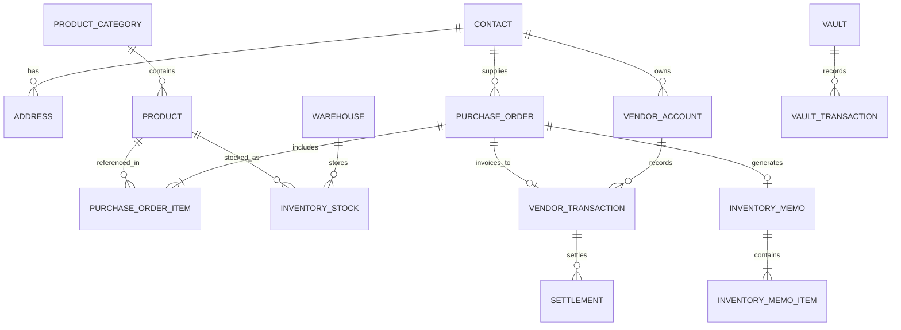

# Database Design Specification (Django ORM & MySQL)

> **System**: Enterprise ERP  
> **Database Engine**: MySQL 8.0+ (utf8mb4 / InnoDB)  
> **ORM**: Django ORM (Python 3.13)  
> **Design Strategy**: Clean 3NF Normalized relational schema modeling the actual business logic discovered from the reference ERP.

---

## 1. Schema Architecture Overview

The database is structured into cohesive Django application apps:
1. `accounts`: User authentication, roles, attributes, and permissions.
2. `master_data`: Geographic areas/governorates, company branding/settings.
3. `contacts`: Suppliers, customers, addresses, and credit parameters.
4. `catalog`: Product categories, products, SKUs, and packaging.
5. `purchases`: Purchase orders, items, pricing calculations, and vendor returns.
6. `inventory`: Warehouses, inventory stocks, lots/batches, and warehouse memos.
7. `treasury`: Cash vaults, payment vouchers, settlements, and double-entry ledger.
8. `sales`: Sales orders, customer invoice settlements, and collections.

---

## 2. Core Entity Relationship Diagram (Purchases & Inventory Core)

---

## 3. Detailed Model Definitions

### 3.1 App: `accounts` (User Management & Roles)

#### `Role`
- `id`: `BigAutoField`, Primary Key
- `name`: `CharField(max_length=100, unique=True)`
- `display_name`: `CharField(max_length=150)`
- `description`: `TextField(blank=True)`
- `is_system`: `BooleanField(default=False)`
- `is_sales_team`: `BooleanField(default=False)`
- `is_area_manager`: `BooleanField(default=False)`
- `is_rep`: `BooleanField(default=False)`
- `can_hold_vault`: `BooleanField(default=False)` (Tag: `accounting:vaults/assignable`)
- `permissions`: `ManyToManyField('auth.Permission', blank=True)`
- `created_at`: `DateTimeField(auto_now_add=True)`
- `updated_at`: `DateTimeField(auto_now=True)`

#### `User` (Custom AbstractUser)
- `id`: `BigAutoField`, Primary Key
- `username`: `CharField(max_length=150, unique=True)`
- `email`: `EmailField(unique=True)`
- `name`: `CharField(max_length=200)`
- `mobile`: `CharField(max_length=30, blank=True)`
- `role`: `ForeignKey(Role, on_delete=models.PROTECT, related_name='users', null=True)`
- `avatar`: `ImageField(upload_to='avatars/', null=True, blank=True)`
- `is_active`: `BooleanField(default=True)`
- `locale`: `CharField(max_length=10, default='ar')`
- `created_at`: `DateTimeField(auto_now_add=True)`
- `updated_at`: `DateTimeField(auto_now=True)`

---

### 3.2 App: `master_data` (Territory & Company Setup)

#### `Area` (Governorates & Districts)
- `id`: `BigAutoField`, Primary Key
- `code`: `CharField(max_length=20, unique=True)`
- `name`: `CharField(max_length=150)`
- `area_type`: `CharField(max_length=20, choices=[('governorate', 'Governorate'), ('subarea', 'Subarea')])`
- `parent`: `ForeignKey('self', on_delete=models.CASCADE, null=True, blank=True, related_name='subareas')`
- `created_at`: `DateTimeField(auto_now_add=True)`

#### `CompanyProfile` (Branding & Global Settings)
- `id`: `BigAutoField`, Primary Key
- `company_name`: `CharField(max_length=200, default='WEA Pharma')`
- `logo`: `ImageField(upload_to='branding/', null=True, blank=True)`
- `commercial_registry`: `CharField(max_length=100, blank=True)`
- `tax_id`: `CharField(max_length=100, blank=True)`
- `phone`: `CharField(max_length=100, blank=True)`
- `address`: `TextField(blank=True)`
- `currency`: `CharField(max_length=10, default='EGP')`
- `use_batch_number`: `BooleanField(default=True)`
- `use_expiry_date`: `BooleanField(default=True)`
- `is_batch_mandatory`: `BooleanField(default=False)`
- `is_expiry_mandatory`: `BooleanField(default=False)`

---

### 3.3 App: `contacts` (Suppliers & Customers)

#### `Contact`
- `id`: `BigAutoField`, Primary Key
- `serial_num`: `PositiveIntegerField(unique=True, db_index=True)`
- `name`: `CharField(max_length=255, db_index=True)`
- `contact_type`: `CharField(max_length=20, choices=[('individual', 'Individual'), ('company', 'Company')], default='company')`
- `is_supplier`: `BooleanField(default=False, db_index=True)`
- `is_customer`: `BooleanField(default=False, db_index=True)`
- `mobile`: `CharField(max_length=30, blank=True)`
- `phone`: `CharField(max_length=30, blank=True)`
- `email`: `EmailField(blank=True)`
- `area`: `ForeignKey(Area, on_delete=models.SET_NULL, null=True, blank=True, related_name='contacts')`
- `tax_card`: `CharField(max_length=100, blank=True)`
- `commercial_registry`: `CharField(max_length=100, blank=True)`
- `credit_limit`: `DecimalField(max_digits=14, decimal_places=2, default=0.00)`
- `credit_period_days`: `PositiveIntegerField(default=30)`
- `status`: `CharField(max_length=20, choices=[('lead', 'Lead'), ('active', 'Active'), ('inactive', 'Inactive')], default='active')`
- `created_by`: `ForeignKey(User, on_delete=models.SET_NULL, null=True, related_name='created_contacts')`
- `created_at`: `DateTimeField(auto_now_add=True)`
- `updated_at`: `DateTimeField(auto_now=True)`

#### `ContactAddress`
- `id`: `BigAutoField`, Primary Key
- `contact`: `ForeignKey(Contact, on_delete=models.CASCADE, related_name='addresses')`
- `title`: `CharField(max_length=100, default='العنوان الرئيسي')`
- `is_main`: `BooleanField(default=True)`
- `street_address`: `TextField()`
- `area`: `ForeignKey(Area, on_delete=models.SET_NULL, null=True, blank=True)`
- `latitude`: `DecimalField(max_digits=10, decimal_places=7, null=True, blank=True)`
- `longitude`: `DecimalField(max_digits=10, decimal_places=7, null=True, blank=True)`

---

### 3.4 App: `catalog` (Products & Catalog)

#### `ProductCategory`
- `id`: `BigAutoField`, Primary Key
- `name`: `CharField(max_length=150, unique=True)`
- `code`: `CharField(max_length=50, unique=True)`
- `description`: `TextField(blank=True)`
- `created_at`: `DateTimeField(auto_now_add=True)`

#### `Product`
- `id`: `BigAutoField`, Primary Key
- `category`: `ForeignKey(ProductCategory, on_delete=models.PROTECT, related_name='products')`
- `sku_code`: `CharField(max_length=60, unique=True, db_index=True)`
- `name`: `CharField(max_length=255, db_index=True)`
- `description`: `TextField(blank=True)`
- `retail_price`: `DecimalField(max_digits=12, decimal_places=2, default=0.00)`
- `default_purchase_cost`: `DecimalField(max_digits=12, decimal_places=2, default=0.00)`
- `tax_percentage`: `DecimalField(max_digits=5, decimal_places=2, default=0.00)`
- `unit`: `CharField(max_length=30, default='pack')`
- `thumbnail`: `ImageField(upload_to='products/', null=True, blank=True)`
- `sellable`: `BooleanField(default=True)`
- `is_active`: `BooleanField(default=True)`
- `created_by`: `ForeignKey(User, on_delete=models.SET_NULL, null=True)`
- `created_at`: `DateTimeField(auto_now_add=True)`
- `updated_at`: `DateTimeField(auto_now=True)`

---

### 3.5 App: `inventory` (Warehouses & Physical Stocks)

#### `Warehouse`
- `id`: `BigAutoField`, Primary Key
- `name`: `CharField(max_length=150, unique=True)`
- `code`: `CharField(max_length=50, unique=True)`
- `is_main`: `BooleanField(default=False)`
- `is_active`: `BooleanField(default=True)`
- `address`: `TextField(blank=True)`
- `manager`: `ForeignKey(User, on_delete=models.SET_NULL, null=True, blank=True)`
- `created_at`: `DateTimeField(auto_now_add=True)`

#### `InventoryStock`
- `id`: `BigAutoField`, Primary Key
- `warehouse`: `ForeignKey(Warehouse, on_delete=models.CASCADE, related_name='stocks')`
- `product`: `ForeignKey(Product, on_delete=models.CASCADE, related_name='inventory_stocks')`
- `qty_on_hand`: `DecimalField(max_digits=12, decimal_places=2, default=0.00)`
- `qty_reserved`: `DecimalField(max_digits=12, decimal_places=2, default=0.00)`
- `product_cost`: `DecimalField(max_digits=12, decimal_places=2, default=0.00)` (Weighted average cost)
- `updated_at`: `DateTimeField(auto_now=True)`

- **Unique Constraint**: `unique_together = ('warehouse', 'product')`

#### `InventoryLot` (Batch & Expiration Tracking)
- `id`: `BigAutoField`, Primary Key
- `stock`: `ForeignKey(InventoryStock, on_delete=models.CASCADE, related_name='lots')`
- `batch_number`: `CharField(max_length=100, db_index=True)`
- `expiry_date`: `DateField(null=True, blank=True, db_index=True)`
- `quantity`: `DecimalField(max_digits=12, decimal_places=2, default=0.00)`

#### `InventoryMemo` (Warehouse Movement Voucher)
- `id`: `BigAutoField`, Primary Key
- `memo_number`: `CharField(max_length=60, unique=True)`
- `memo_type`: `CharField(max_length=20, choices=[('inward', 'إذن إضافة'), ('outward', 'إذن صرف/خصم')])`
- `warehouse`: `ForeignKey(Warehouse, on_delete=models.PROTECT, related_name='memos')`
- `statement`: `CharField(max_length=255)` (e.g. `أمر مشتريات #16`)
- `status`: `CharField(max_length=20, choices=[('draft', 'Draft'), ('applied', 'Applied'), ('cancelled', 'Cancelled')], default='applied')`
- `applied_at`: `DateTimeField(null=True, blank=True)`
- `created_by`: `ForeignKey(User, on_delete=models.SET_NULL, null=True)`
- `created_at`: `DateTimeField(auto_now_add=True)`

#### `InventoryMemoItem`
- `id`: `BigAutoField`, Primary Key
- `memo`: `ForeignKey(InventoryMemo, on_delete=models.CASCADE, related_name='items')`
- `product`: `ForeignKey(Product, on_delete=models.PROTECT)`
- `quantity`: `DecimalField(max_digits=12, decimal_places=2)`
- `unit_cost`: `DecimalField(max_digits=12, decimal_places=2, default=0.00)`
- `batch_number`: `CharField(max_length=100, blank=True)`
- `expiry_date`: `DateField(null=True, blank=True)`

---

### 3.6 App: `purchases` (Purchase Orders & Lifecycles)

#### `PurchaseOrder`
- `id`: `BigAutoField`, Primary Key
- `serial_num`: `PositiveIntegerField(unique=True, db_index=True)`
- `order_number`: `CharField(max_length=50, unique=True)` (e.g. `#16`)
- `supplier`: `ForeignKey(Contact, on_delete=models.PROTECT, related_name='purchase_orders')`
- `delivery_address`: `ForeignKey(ContactAddress, on_delete=models.SET_NULL, null=True, blank=True)`
- `target_warehouse`: `ForeignKey(Warehouse, on_delete=models.PROTECT, related_name='purchase_orders')`
- `order_date`: `DateField(default=timezone.now)`
- `expected_delivery_date`: `DateField(null=True, blank=True)`
- `status`: `CharField(max_length=30, choices=[
    ('pending', 'Pending / قيد الانتظار'),
    ('approved', 'Approved / معتمد'),
    ('picked', 'Picked / تم الاستلام في المخزن'),
    ('settled', 'Settled / تمت الفوترة في الحسابات'),
    ('rejected', 'Rejected / مرفوض'),
    ('split', 'Split / مقسم'),
    ('cancelled', 'Cancelled / ملغي')
], default='pending', db_index=True)`
- `is_hold`: `BooleanField(default=False)`
- `memo`: `OneToOneField(InventoryMemo, on_delete=models.SET_NULL, null=True, blank=True, related_name='purchase_order')`
- `stocked_at`: `DateTimeField(null=True, blank=True)`
- `invoiced_at`: `DateTimeField(null=True, blank=True)`
- `notes`: `TextField(blank=True)`
  
  **Financial Calculations**:
- `items_count`: `PositiveIntegerField(default=0)`
- `items_quantity`: `DecimalField(max_digits=12, decimal_places=2, default=0.00)`
- `subtotal`: `DecimalField(max_digits=14, decimal_places=2, default=0.00)`
- `items_discount_total`: `DecimalField(max_digits=14, decimal_places=2, default=0.00)`
- `custom_discount_percentage`: `DecimalField(max_digits=5, decimal_places=2, default=0.00)`
- `custom_discount_amount`: `DecimalField(max_digits=14, decimal_places=2, default=0.00)`
- `tax_amount`: `DecimalField(max_digits=14, decimal_places=2, default=0.00)`
- `shipping_fees`: `DecimalField(max_digits=14, decimal_places=2, default=0.00)`
- `grand_total`: `DecimalField(max_digits=14, decimal_places=2, default=0.00)`
  
  **Audit & Timestamps**:
- `created_by`: `ForeignKey(User, on_delete=models.SET_NULL, null=True, related_name='created_purchase_orders')`
- `updated_by`: `ForeignKey(User, on_delete=models.SET_NULL, null=True, related_name='updated_purchase_orders')`
- `created_at`: `DateTimeField(auto_now_add=True)`
- `updated_at`: `DateTimeField(auto_now=True)`

#### `PurchaseOrderItem`
- `id`: `BigAutoField`, Primary Key
- `order`: `ForeignKey(PurchaseOrder, on_delete=models.CASCADE, related_name='items')`
- `item_order`: `PositiveSmallIntegerField(default=1)`
- `product`: `ForeignKey(Product, on_delete=models.PROTECT, related_name='purchase_order_items')`
- `quantity`: `DecimalField(max_digits=12, decimal_places=2)`
- `unit_price`: `DecimalField(max_digits=12, decimal_places=2)`
- `batch_number`: `CharField(max_length=100, blank=True)`
- `expiry_date`: `DateField(null=True, blank=True)`
- `subtotal`: `DecimalField(max_digits=14, decimal_places=2, default=0.00)`
- `discount_percentage`: `DecimalField(max_digits=5, decimal_places=2, default=0.00)`
- `discount_amount`: `DecimalField(max_digits=14, decimal_places=2, default=0.00)`
- `tax_percentage`: `DecimalField(max_digits=5, decimal_places=2, default=0.00)`
- `tax_amount`: `DecimalField(max_digits=14, decimal_places=2, default=0.00)`
- `total_price`: `DecimalField(max_digits=14, decimal_places=2, default=0.00)`

#### `PurchaseOrderAttachment`
- `id`: `BigAutoField`, Primary Key
- `order`: `ForeignKey(PurchaseOrder, on_delete=models.CASCADE, related_name='attachments')`
- `title`: `CharField(max_length=200)`
- `file`: `FileField(upload_to='purchase_orders/attachments/%Y/%m/')`
- `file_type`: `CharField(max_length=50, blank=True)`
- `created_by`: `ForeignKey(User, on_delete=models.SET_NULL, null=True)`
- `created_at`: `DateTimeField(auto_now_add=True)`

---

### 3.7 App: `treasury` (Vaults, Ledgers & Settlements)

#### `Vault` (Cash Safes & Banks)
- `id`: `BigAutoField`, Primary Key
- `serial_num`: `PositiveIntegerField(unique=True)`
- `name`: `CharField(max_length=150, unique=True)`
- `vault_type`: `CharField(max_length=20, choices=[('cash', 'Cash Safe / خزينة'), ('bank', 'Bank Account / بنك')], default='cash')`
- `assigned_user`: `ForeignKey(User, on_delete=models.SET_NULL, null=True, blank=True, related_name='assigned_vaults')`
- `is_active`: `BooleanField(default=True)`
- `current_balance`: `DecimalField(max_digits=14, decimal_places=2, default=0.00)`
- `created_at`: `DateTimeField(auto_now_add=True)`

#### `VendorAccount` (Supplier Ledger Account)
- `id`: `BigAutoField`, Primary Key
- `supplier`: `OneToOneField(Contact, on_delete=models.CASCADE, related_name='vendor_account')`
- `credit_limit`: `DecimalField(max_digits=14, decimal_places=2, default=0.00)`
- `credit_period_days`: `PositiveIntegerField(default=30)`
- `current_balance`: `DecimalField(max_digits=14, decimal_places=2, default=0.00)` (Credit balance: positive means company owes supplier)
- `last_transaction_date`: `DateField(null=True, blank=True)`
- `overdue_balance`: `DecimalField(max_digits=14, decimal_places=2, default=0.00)`
- `updated_at`: `DateTimeField(auto_now=True)`

#### `VendorTransaction` (Supplier Double-Entry Ledger)
- `id`: `BigAutoField`, Primary Key
- `serial`: `PositiveIntegerField(unique=True, db_index=True)`
- `account`: `ForeignKey(VendorAccount, on_delete=models.CASCADE, related_name='transactions')`
- `purchase_order`: `ForeignKey(PurchaseOrder, on_delete=models.SET_NULL, null=True, blank=True, related_name='vendor_transactions')`
- `transaction_type`: `CharField(max_length=10, choices=[('credit', 'Credit / دائن (فاتورة)'), ('debit', 'Debit / مدين (سداد)')])`
- `reason`: `CharField(max_length=30, choices=[('purchase', 'Purchase Order Invoice'), ('purchase_payments', 'Vendor Payment'), ('adjustment', 'Adjustment')])`
- `transaction_date`: `DateField(default=timezone.now, db_index=True)`
- `due_date`: `DateField(null=True, blank=True, db_index=True)`
- `credit`: `DecimalField(max_digits=14, decimal_places=2, default=0.00)`
- `debit`: `DecimalField(max_digits=14, decimal_places=2, default=0.00)`
- `running_balance`: `DecimalField(max_digits=14, decimal_places=2, default=0.00)`
- `description`: `CharField(max_length=255)`
- `notes`: `TextField(blank=True)`
- `created_by`: `ForeignKey(User, on_delete=models.SET_NULL, null=True)`
- `created_at`: `DateTimeField(auto_now_add=True)`

#### `VendorInstallment` (Invoice Open Balance Tracker)
- `id`: `BigAutoField`, Primary Key
- `transaction`: `ForeignKey(VendorTransaction, on_delete=models.CASCADE, related_name='installments')`
- `total_amount`: `DecimalField(max_digits=14, decimal_places=2)`
- `closed_amount`: `DecimalField(max_digits=14, decimal_places=2, default=0.00)`
- `open_amount`: `DecimalField(max_digits=14, decimal_places=2)`
- `due_date`: `DateField()`
- `is_settled`: `BooleanField(default=False, db_index=True)`

#### `VendorPayment` (Disbursement Voucher)
- `id`: `BigAutoField`, Primary Key
- `serial_num`: `PositiveIntegerField(unique=True, db_index=True)`
- `supplier`: `ForeignKey(Contact, on_delete=models.PROTECT, related_name='vendor_payments')`
- `vault`: `ForeignKey(Vault, on_delete=models.PROTECT, related_name='vendor_payments')`
- `payment_date`: `DateField(default=timezone.now)`
- `amount`: `DecimalField(max_digits=14, decimal_places=2)`
- `payment_method`: `CharField(max_length=20, choices=[('cash', 'Cash'), ('cheque', 'Cheque'), ('bank_transfer', 'Bank Transfer')], default='cash')`
- `reference_number`: `CharField(max_length=100, blank=True)`
- `notes`: `TextField(blank=True)`
- `status`: `CharField(max_length=20, choices=[('pending', 'Pending'), ('cleared', 'Cleared')], default='cleared')`
- `debit_transaction`: `OneToOneField(VendorTransaction, on_delete=models.SET_NULL, null=True, blank=True, related_name='vendor_payment')`
- `created_by`: `ForeignKey(User, on_delete=models.SET_NULL, null=True)`
- `created_at`: `DateTimeField(auto_now_add=True)`

#### `Settlement` (Matching Payment to Invoice)
- `id`: `BigAutoField`, Primary Key
- `payment_transaction`: `ForeignKey(VendorTransaction, on_delete=models.CASCADE, related_name='outward_settlements')`
- `target_installment`: `ForeignKey(VendorInstallment, on_delete=models.CASCADE, related_name='settlements')`
- `amount`: `DecimalField(max_digits=14, decimal_places=2)`
- `settled_at`: `DateTimeField(auto_now_add=True)`
- `created_by`: `ForeignKey(User, on_delete=models.SET_NULL, null=True)`

#### `VaultTransaction` (Cash Ledger)
- `id`: `BigAutoField`, Primary Key
- `vault`: `ForeignKey(Vault, on_delete=models.CASCADE, related_name='transactions')`
- `transaction_type`: `CharField(max_length=15, choices=[('inflow', 'Inflow / إيداع'), ('outflow', 'Outflow / صرف')])`
- `amount`: `DecimalField(max_digits=14, decimal_places=2)`
- `running_balance`: `DecimalField(max_digits=14, decimal_places=2)`
- `reference_type`: `CharField(max_length=50)` (e.g. `vendor_payment`, `vault_transfer`, `collection`)
- `reference_id`: `PositiveIntegerField(null=True, blank=True)`
- `description`: `CharField(max_length=255)`
- `created_by`: `ForeignKey(User, on_delete=models.SET_NULL, null=True)`
- `created_at`: `DateTimeField(auto_now_add=True)`
