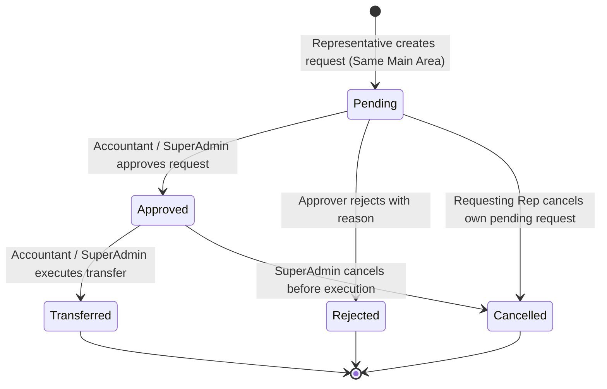

# Inter-Warehouse Product Requests Architecture

## 1. Overview and Core Rules

In multi-region distribution operations, representatives frequently require stock rebalancing to fulfill local orders. The Inter-Warehouse Product Request system enables representative warehouses to request and transfer inventory under strict regional and administrative controls.

### Fundamental Business Rules:
1. **Same Main Area Requirement**: Product requests are strictly permitted only between representative warehouses belonging to the **same main area** (e.g., Cairo Governorate).
2. **Sub-Area Flexibility**: Representatives may belong to different secondary/sub-areas (e.g., Nasr City and Maadi) as long as both sub-areas resolve to the identical root main area.
3. **Cross-Main-Area Prohibition**: Ordinary representatives and managers cannot request or transfer stock across different main areas (e.g., Cairo to Alexandria). Cross-regional transfers require superadmin intervention.
4. **Approval Authority**: Only authorized **SuperAdmins** and **Accountants** have the authority to approve, reject, or execute inter-warehouse stock transfers. Field representatives and area managers cannot approve inter-warehouse stock transfers.
5. **No Stock Movement upon Creation**: Creating a transfer request reserves or notes intention only; zero physical stock moves until formal execution.

---

## 2. Request Lifecycle and State Machine

### State Definitions
- **`pending`**: Request submitted and awaiting administrative review. Validated against current source warehouse availability.
- **`approved`**: Approved by an accountant or superadmin with optional adjustment to approved quantities. Stock availability re-verified.
- **`rejected`**: Disapproved by accountant or superadmin with a documented rejection reason.
- **`cancelled`**: Revoked by the requesting representative or superadmin before execution.
- **`completed`**: Transfer executed. Source stock deducted, destination stock incremented, auditable `InventoryMemo` documents generated.

---

## 3. Data Model Architecture

The transfer workflow is modeled in `inventory.models`:

### `ProductTransferRequest`
- `reference_no` (CharField, unique): Auto-generated sequential reference (e.g., `TR-REQ-20261027-0001`).
- `source_warehouse` (ForeignKey -> Warehouse): Warehouse providing the products.
- `destination_warehouse` (ForeignKey -> Warehouse): Warehouse receiving the products.
- `status` (`pending`, `approved`, `rejected`, `cancelled`, `completed`).
- `requested_by` (ForeignKey -> User): User initiating the request.
- `approved_by` (ForeignKey -> User, nullable): Approver (Accountant or SuperAdmin).
- `transferred_by` (ForeignKey -> User, nullable): User who executed the physical transfer.
- `approval_notes` / `rejection_reason` (TextField): Contextual justification.
- `outward_memo` / `inward_memo` (ForeignKey -> InventoryMemo, nullable): Audit trail linkages.

### `ProductTransferRequestItem`
- `transfer_request` (ForeignKey -> ProductTransferRequest).
- `product` (ForeignKey -> Product).
- `unit` (ForeignKey -> Unit).
- `requested_quantity` (DecimalField): Quantity requested by the representative.
- `approved_quantity` (DecimalField): Actual quantity authorized for transfer.
- `transferred_quantity` (DecimalField): Final quantity moved between warehouses.

---

## 4. Transfer Execution & Concurrency Safety

Transfer execution is orchestrated by `inventory.services.ProductTransferService.execute_transfer`:

### Atomic Database Transaction
The entire transfer executes inside `transaction.atomic()`:
1. **State Verification**: Asserts that `status == 'approved'`. Repeated or concurrent executions are strictly blocked.
2. **Pessimistic Row Locking (`select_for_update`)**:
   - Queries and locks source stock records: `InventoryStock.objects.select_for_update().filter(...)`.
   - Prevents concurrent transactions from overdrawing available quantities.
3. **Availability Validation**:
   - Compares approved quantities against `stock.quantity - stock.reserved_quantity`.
   - If stock is insufficient, rolls back atomically and raises `ValidationError`.
4. **Source Stock Deduction**:
   - Decrements `source_stock.quantity` by `approved_quantity`.
5. **Destination Stock Addition**:
   - Retrieves or creates `destination_stock = InventoryStock.objects.get_or_create(...)`.
   - Increments `destination_stock.quantity` by `approved_quantity`.
6. **Audit Trail Generation**:
   - Generates an outward `InventoryMemo` (`MEMO-OUT-...`) for the source warehouse.
   - Generates an inward `InventoryMemo` (`MEMO-IN-...`) for the destination warehouse.
   - Links memo IDs to the transfer record.
7. **Transition to Completed**:
   - Sets `status = 'completed'`, timestamps completion, and records `transferred_by`.

---

## 5. UI Integration (No New Tabs)

Consistent with system ergonomics and navigation rules, inter-warehouse transfers are embedded into existing inventory workflows:

- **Entry Point**: A prominent quick action button "طلبات التحويل بين المخازن" is embedded in `/inventory/warehouses/` and `/inventory/stock/`.
- **List View**: Accessible at `/inventory/transfers/`, supporting filtering by status (`pending`, `approved`, `completed`, `rejected`), source warehouse, and search queries.
- **Approvals Hub Integration**: Pending transfers appear in the central Approvals Hub (`/activities/approvals/?tab=transfers`), routing approvers to pending transfer items.
- **Mobile Ergonomics**: All transfer views (list, request creation form, detail page) feature responsive layouts, touch-friendly action cards, and mobile data tables tested across 375px, 390px, and 430px viewports.
