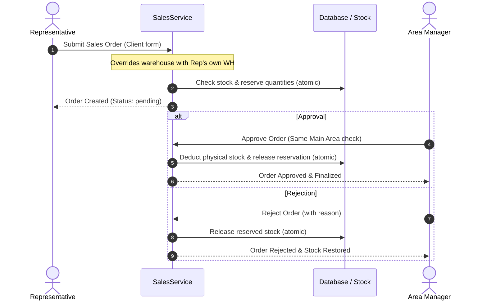

# Inventory and Sales Approvals Architecture

## 1. Representative Sales & Warehouse Enforcement

### Server-Side Warehouse Resolution
In multi-branch and field sales operations, client-submitted inputs cannot be trusted to dictate stock deduction origins. In `sales.services.SalesService.create_order` and `sales.views.sales_order_create`:

1. **Representative Role Detection**: Checks whether `request.user` is a field representative via `is_representative(user)`.
2. **Server-Side Warehouse Assignment**:
   - If the user is a representative, their designated default warehouse is resolved directly from the database using `get_representative_warehouse(user)` or `user.get_default_warehouse()`.
   - Any client-submitted `warehouse_id` in the POST body is strictly ignored and overridden.
   - If a representative attempts to create a sales order without having an assigned warehouse, the transaction is rejected with an actionable `ValidationError` requiring warehouse allocation.
3. **UI Hardening**:
   - In `templates/sales/sales_order_create.html`, the warehouse dropdown is visually locked and badged with `مخزن المندوب المعين` for representatives, preventing accidental UI confusion.

---

## 2. Stock Reservation and Deduction Lifecycle

### Safety Guarantees:
- **Reservation Integrity**: Creating a sales order increments `stock.reserved_quantity`. Stock cannot be double-sold.
- **Atomic Rejection**: If an order is rejected or cancelled, `SalesService.reject_order` atomically decrements `stock.reserved_quantity`, restoring immediately available quantities.
- **Atomic Approval & Deduction**: Approving the order converts reserved quantities into confirmed deductions, recording linked `InventoryMemo` documents.

---

## 3. Same-Main-Area Sales Approval Rules

1. **Manager Eligibility**: A sales order submitted by a representative can only be approved by:
   - A **SuperAdmin**, OR
   - An **Area Manager** whose root main area matches the representative's root main area.
2. **Sub-Area Independence**: Even if the manager oversees "Cairo Central" and the representative operates in "New Cairo", the approval is valid because both belong to the Cairo main area.
3. **Cross-Region Rejection**: A manager from Alexandria attempting to approve a Cairo sales order receives a `ValidationError` / HTTP 403 Forbidden.
4. **Anti-Self-Approval**: A manager who creates a sales order cannot approve their own order.
5. **Duplicate Approval Protection**: Repeated approval calls on an already-approved order are idempotently rejected to prevent double deduction of stock or duplicate accounting postings.

---

## 4. Inter-Warehouse Transfer Approval vs Sales Approval Matrix

| Workflow | Initiator | Eligible Approver | Pre-requisites | Execution Effect |
|---|---|---|---|---|
| **Representative Sales Order** | Representative | Area Manager (Same Main Area) or SuperAdmin | Sufficient stock in Rep's Warehouse | Deducts stock from Rep's Warehouse; generates customer invoice |
| **Inter-Warehouse Transfer Request** | Representative | SuperAdmin or Accountant ONLY | Same Main Area between Source and Destination Reps | Deducts source warehouse, increments destination warehouse; generates dual transfer memos |
| **Field Visit** | Representative | Area Manager (Same Main Area) or SuperAdmin | Rep assigned to main area | Authorizes check-in and execution of scheduled visit |
