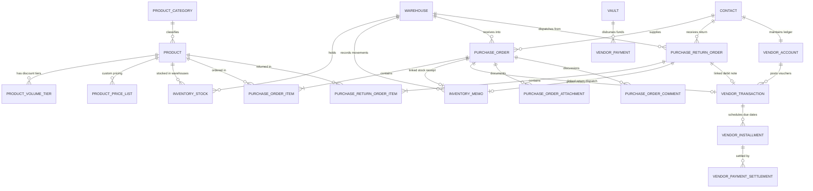

# Products & Purchases Database Architecture & Schema Design

> **System**: WEA Pharma / Bricks Rep ERP  
> **Source Base**: Django ORM / SQLite / MySQL  
> **Status**: Full Relational Schema Specification  

---

## 1. Entity Relationship Overview

---

## 2. Table Specifications

### 2.1 Catalog Models (`catalog` app)

#### `catalog_productcategory`
| Field | Type | Attributes | Description |
|---|---|---|---|
| `id` | BigAutoField | Primary Key | Internal ID |
| `name` | CharField(150) | Unique, db_index | Category title (e.g. `WEA`, `Packing materials`) |
| `code` | CharField(50) | Unique, db_index | Short alphanumeric code |
| `description` | TextField | Blank | Long descriptive summary |
| `created_at` | DateTimeField | auto_now_add | Timestamp of registration |

#### `catalog_product`
| Field | Type | Attributes | Description |
|---|---|---|---|
| `id` | BigAutoField | Primary Key | Internal ID |
| `category_id` | ForeignKey | `on_delete=PROTECT` | Reference to `ProductCategory` |
| `sku_code` | CharField(60) | Unique, db_index | SKU / unique catalog code (e.g. `GE1`) |
| `name` | CharField(255) | db_index | Arabic/English product title |
| `description` | TextField | Blank | Clinical/commercial description |
| `retail_price` | DecimalField(12, 2) | Default: 0.00 | Retail selling price (EGP) |
| `default_purchase_cost` | DecimalField(12, 2) | Default: 0.00 | Standard expected purchasing cost (EGP) |
| `tax_percentage` | DecimalField(5, 2) | Default: 0.00 | Sales / purchase tax rate (0% or 14%) |
| `barcode` | CharField(100) | Blank, db_index | EAN-13 or internal barcode |
| `unit` | CharField(30) | Default: "عبوة (Pack)" | Unit of measure |
| `thumbnail` | ImageField | Null, Blank | Product photo / catalog thumbnail |
| `sellable` | BooleanField | Default: True | Can be included in commercial sales |
| `is_active` | BooleanField | Default: True | Active master record flag |
| `has_volume_discounts`| BooleanField | Default: False | Activates tiered pricing |
| `packing_boxes` | CharField(100) | Blank | Box capacity (e.g. `10 عبوة / علبة`) |
| `packing_cartons` | CharField(100) | Blank | Carton capacity (e.g. `50 علبة / كرتونة`) |
| `created_by_id` | ForeignKey | `on_delete=SET_NULL`, Null | Creator user |
| `created_at` | DateTimeField | auto_now_add | Registration timestamp |
| `updated_at` | DateTimeField | auto_now | Modification timestamp |

#### `catalog_productvolumediscounttier`
| Field | Type | Attributes | Description |
|---|---|---|---|
| `id` | BigAutoField | Primary Key | Internal ID |
| `product_id` | ForeignKey | `on_delete=CASCADE` | Reference to `Product` |
| `min_quantity` | DecimalField(10, 2) | Positive | Minimum threshold units |
| `discount_percentage` | DecimalField(5, 2) | 0.00 to 100.00 | Applied discount % |

---

### 2.2 Procurement Models (`purchases` app)

#### `purchases_purchaseorder`
| Field | Type | Attributes | Description |
|---|---|---|---|
| `id` | BigAutoField | Primary Key | Internal ID |
| `serial_num` | PositiveIntegerField | Unique, db_index | Serial number (e.g. `16`) |
| `order_number` | CharField(50) | Unique | Formatted number (e.g. `#16`) |
| `supplier_id` | ForeignKey | `on_delete=PROTECT` | Contact with `is_supplier=True` |
| `delivery_address_id` | ForeignKey | `on_delete=SET_NULL`, Null | Contact address |
| `target_warehouse_id` | ForeignKey | `on_delete=PROTECT` | Destination Warehouse |
| `order_date` | DateField | default=now | Official order date |
| `expected_delivery_date` | DateField | Null, Blank | Scheduled delivery date |
| `delivery_agent` | CharField(150) | Blank | Logistics rep / driver name |
| `delivery_time` | CharField(100) | Blank | Delivery window / hour |
| `status` | CharField(30) | db_index | `pending`, `approved`, `picked`, `settled`, `rejected`, `split`, `cancelled` |
| `is_hold` | BooleanField | Default: False | Temporary administrative hold |
| `is_canceled` | BooleanField | Default: False | Explicit cancellation flag |
| `is_split` | BooleanField | Default: False | Order was split flag |
| `parent_order_id` | ForeignKey | Null, Blank | Pointer to parent PO if split |
| `memo_id` | OneToOneField | Null, Blank | Inward `InventoryMemo` upon stocking |
| `stocked_at` | DateTimeField | Null, Blank | Goods receipt timestamp |
| `invoiced_at` | DateTimeField | Null, Blank | Invoicing & ledger posting timestamp |
| `items_count` | PositiveIntegerField | Default: 0 | Number of distinct item lines |
| `items_quantity` | DecimalField(12, 2) | Default: 0.00 | Sum of item quantities |
| `subtotal` | DecimalField(14, 2) | Default: 0.00 | Raw lines subtotal |
| `items_discount_total` | DecimalField(14, 2) | Default: 0.00 | Total discount from line items |
| `custom_discount_percentage`| DecimalField(5, 2) | Default: 0.00 | Order-level discount % |
| `custom_discount_amount` | DecimalField(14, 2) | Default: 0.00 | Order-level discount in EGP |
| `tax_amount` | DecimalField(14, 2) | Default: 0.00 | Total tax in EGP |
| `shipping_fees` | DecimalField(14, 2) | Default: 0.00 | Freight / shipping expenses (EGP) |
| `grand_total` | DecimalField(14, 2) | Default: 0.00 | Final payable balance (EGP) |
| `notes` | TextField | Blank | Procurement notes / terms |
| `created_by_id` | ForeignKey | `on_delete=SET_NULL`, Null | Creator user |
| `updated_by_id` | ForeignKey | `on_delete=SET_NULL`, Null | Last updater user |
| `created_at` | DateTimeField | auto_now_add | Creation timestamp |
| `updated_at` | DateTimeField | auto_now | Update timestamp |

#### `purchases_purchaseorderitem`
| Field | Type | Attributes | Description |
|---|---|---|---|
| `id` | BigAutoField | Primary Key | Internal ID |
| `order_id` | ForeignKey | `on_delete=CASCADE` | Reference to `PurchaseOrder` |
| `item_order` | PositiveSmallIntegerField| Default: 1 | Line sort index |
| `product_id` | ForeignKey | `on_delete=PROTECT` | Reference to `Product` |
| `quantity` | DecimalField(12, 2) | Non-negative | Ordered units |
| `unit_price` | DecimalField(12, 2) | Non-negative | Purchase unit cost (EGP) |
| `product_batch_number` | CharField(100) | Blank | Lot / Batch number |
| `product_expiry_date` | DateField | Null, Blank | Expiration date |
| `discount_percentage` | DecimalField(5, 2) | Default: 0.00 | Line discount % |
| `discount_amount` | DecimalField(14, 2) | Default: 0.00 | Line discount in EGP |
| `tax_percentage` | DecimalField(5, 2) | Default: 0.00 | Line tax % |
| `tax_amount` | DecimalField(14, 2) | Default: 0.00 | Line tax in EGP |
| `subtotal` | DecimalField(14, 2) | Default: 0.00 | Qty * Unit Price |
| `total_price` | DecimalField(14, 2) | Default: 0.00 | Net line subtotal after discount + tax |

#### `purchases_purchasereturnorder`
| Field | Type | Attributes | Description |
|---|---|---|---|
| `id` | BigAutoField | Primary Key | Internal ID |
| `serial_num` | PositiveIntegerField | Unique, db_index | Serial number (e.g. `1`) |
| `order_number` | CharField(50) | Unique | Formatted number (e.g. `#RO-1`) |
| `purchase_order_id` | ForeignKey | Null, Blank | Optional reference to original PO |
| `supplier_id` | ForeignKey | `on_delete=PROTECT` | Supplier contact |
| `warehouse_id` | ForeignKey | `on_delete=PROTECT` | Originating Warehouse (dispatched from) |
| `order_date` | DateField | default=now | Return order date |
| `delivery_agent` | CharField(150) | Blank | Receiving courier / agent |
| `delivery_time` | CharField(100) | Blank | Handover timestamp |
| `status` | CharField(30) | db_index | `pending`, `approved`, `delivered`, `settled`, `cancelled` |
| `memo_id` | OneToOneField | Null, Blank | Outward `InventoryMemo` upon dispatch |
| `dispatched_at` | DateTimeField | Null, Blank | Stock decrement timestamp |
| `settled_at` | DateTimeField | Null, Blank | Vendor ledger debit timestamp |
| `items_count` | PositiveIntegerField | Default: 0 | Number of returned lines |
| `subtotal` | DecimalField(14, 2) | Default: 0.00 | Sum of returned line prices |
| `tax_amount` | DecimalField(14, 2) | Default: 0.00 | Return tax adjustment |
| `grand_total` | DecimalField(14, 2) | Default: 0.00 | Total credit/debit value |
| `notes` | TextField | Blank | Return justification / defects notes |
| `created_by_id` | ForeignKey | `on_delete=SET_NULL`, Null | Creator user |
| `created_at` | DateTimeField | auto_now_add | Creation timestamp |

#### `purchases_purchasereturnorderitem`
| Field | Type | Attributes | Description |
|---|---|---|---|
| `id` | BigAutoField | Primary Key | Internal ID |
| `return_order_id` | ForeignKey | `on_delete=CASCADE` | Reference to `PurchaseReturnOrder` |
| `product_id` | ForeignKey | `on_delete=PROTECT` | Returned `Product` |
| `quantity` | DecimalField(12, 2) | Positive | Returned units |
| `unit_price` | DecimalField(12, 2) | Non-negative | Return unit credit price |
| `batch_number` | CharField(100) | Blank | Lot / Batch number |
| `expiry_date` | DateField | Null, Blank | Expiration date |
| `subtotal` | DecimalField(14, 2) | Default: 0.00 | Qty * Unit Price |
| `total_price` | DecimalField(14, 2) | Default: 0.00 | Net return line value |
