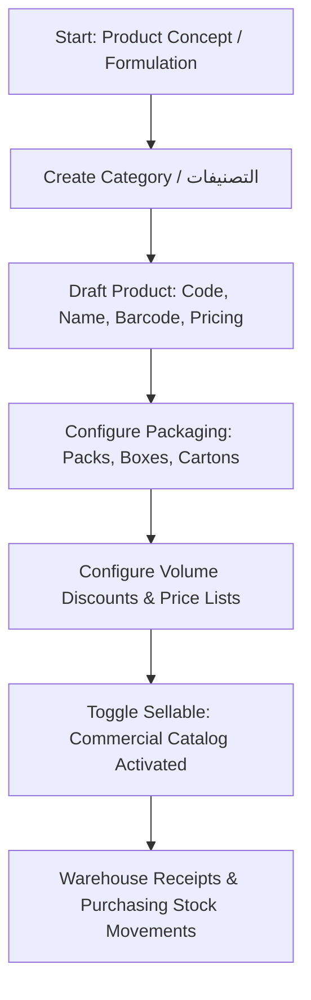
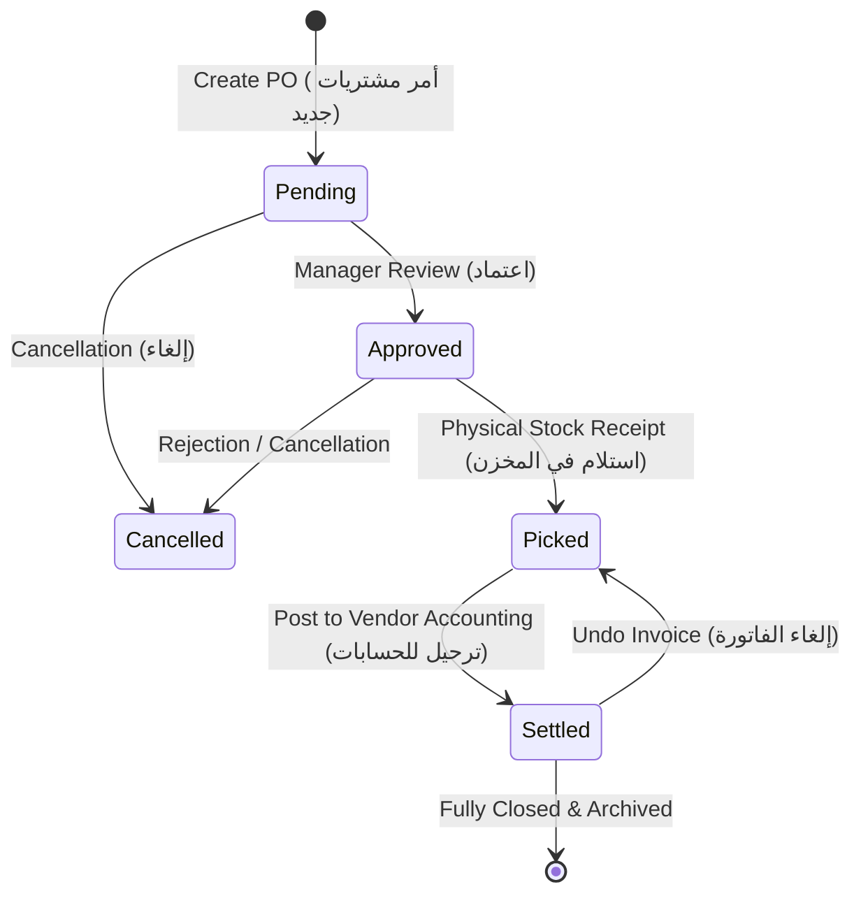
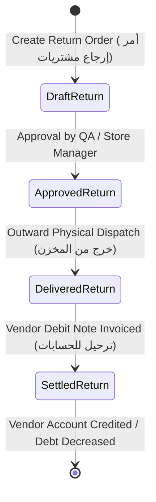
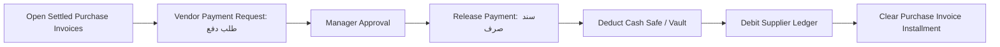

# Products & Purchases Business Workflows Specification

> **System**: WEA Pharma / Bricks Rep ERP  
> **Source Base**: `https://weapharma.bricks-rep.com/`  
> **Status**: Comprehensive Workflow Parity Architecture  

---

## 1. Product Catalog Lifecycle Workflow

### 1.1 Validation Rules & Business Constraints
1. **Uniqueness**: Product `sku_code` must be globally unique and alphanumeric.
2. **Pricing Integrity**: Retail price must be non-negative; `tax_percentage` defaults to 0% (or standard VAT 14% if configured).
3. **Packaging Ratios**: Box and carton capacities represent packaging hierarchies (e.g. 1 Carton = 50 Boxes = 500 Packs).
4. **Volume Discounts**: Minimum quantity thresholds must be ascending; discounts apply at sales/purchases based on order volumes.
5. **Safe Deletion / Deactivation**: Products linked to historical transactions (Purchase Orders, Stock Memos, Sales) cannot be hard-deleted from the database; instead, they are deactivated (`is_active=False` or `sellable=False`).

---

## 2. Purchase Order Lifecycle Workflow (P0 Core)

The core procurement pipeline transitions through 4 deterministic stages:

### 2.1 Stage Transitions & Atomic Boundaries

#### Stage 1: Order Draft Creation (`Pending`)
- **Actor**: Purchasing Specialist / Warehouse Manager.
- **Inputs**: Supplier Contact, Target Warehouse, Line items (Product, Qty, Unit Cost, Discount %, Batch #, Expiry Date), Custom discount, Shipping fees.
- **Calculations**:
  $$\text{Subtotal} = \sum (\text{Qty} \times \text{Unit Cost})$$
  $$\text{Items Discount} = \sum \text{Line Discount}$$
  $$\text{Net Items} = \text{Subtotal} - \text{Items Discount}$$
  $$\text{Custom Discount} = \text{Net Items} \times \frac{\text{Custom Disc \%}}{100}$$
  $$\text{Grand Total} = (\text{Net Items} - \text{Custom Discount}) + \text{Tax} + \text{Shipping Fees}$$
- **State Effect**: Order saved with serial `#X`, `status='pending'`. No stock or financial balance changes.

#### Stage 2: Manager Approval (`Approved`)
- **Actor**: Commercial Manager / SuperAdmin.
- **Validation**: Verifies pricing and supplier credit status.
- **State Effect**: `status='approved'`.

#### Stage 3: Goods Receipt & Inward Warehouse Stocking (`Picked`)
- **Actor**: Warehouse Keeper / Inventory Auditor.
- **Atomic Operations** (wrapped in `@transaction.atomic`):
  1. Generates official Inward Warehouse Memo (`InventoryMemo` type `inward`, serial `MEMO-IN-{serial}`).
  2. For each line item:
     - Increments `InventoryStock.qty_on_hand` for `(warehouse, product)`.
     - Recalculates weighted average unit cost:
       $$\text{Cost}_{\text{new}} = \frac{(\text{Stock}_{\text{old}} \times \text{Cost}_{\text{old}}) + (\text{Qty}_{\text{received}} \times \text{Cost}_{\text{item}})}{\text{Stock}_{\text{old}} + \text{Qty}_{\text{received}}}$$
     - Records or increments batch number and expiration date in `InventoryLot`.
  3. Transitions order status to `status='picked'`, records `stocked_at=now()`.

#### Stage 4: Accounting Invoicing & Vendor Ledger (`Settled`)
- **Actor**: Senior Accountant / Financial Controller.
- **Prerequisite**: Order must be in `picked` status.
- **Atomic Operations**:
  1. Retrieves or initializes `VendorAccount` for the supplier.
  2. Creates double-entry Credit transaction in `VendorTransaction`:
     - `transaction_type = 'credit'`
     - `reason = 'purchase'`
     - `credit = order.grand_total`
     - `debit = 0.00`
     - `running_balance = previous_balance + order.grand_total`
     - `due_date = order_date + supplier.credit_period_days`
  3. Creates `VendorInstallment` record linked to transaction for partial/full payment tracking.
  4. Updates `VendorAccount.current_balance` and `last_transaction_date`.
  5. Transitions order to `status='settled'`, records `invoiced_at=now()`.

#### Stage 5: Undo Invoice (`الغاء الفاتورة`)
- **Actor**: SuperAdmin / Chief Accountant.
- **Business Rule**: If an invoice was posted prematurely and no payments have cleared against its installment:
  1. Posts an offsetting Debit adjustment in `VendorTransaction` for `order.grand_total`.
  2. Decrements `VendorAccount.current_balance`.
  3. Reverts order status back to `picked`, setting `invoiced_at=None`.

#### Stage 6: Split Order (`فصل الطلب`)
- **Actor**: Purchasing Manager.
- **Business Rule**: When a supplier delivers an order in multiple batches:
  1. Selected items or remaining quantities are extracted into a new child Purchase Order.
  2. Child order is flagged `is_split=True` referencing the parent order.

---

## 3. Purchase Return Order Workflow (P0 Core)

When defective, damaged, or expired stock must be returned to a pharmaceutical manufacturer or supplier:

### 3.1 Step-by-Step Return Logic

1. **Creation (`pending`)**:
   - Operator selects the Supplier and the Warehouse holding the goods.
   - Selects products, quantities, returned batch numbers, and unit purchase credit values.
   - Subtotal, taxes, and grand return total are computed.
2. **Approval (`approved`)**:
   - Management verifies the return reason and supplier return policy.
3. **Goods Dispatch / Unstocking (`delivered` / `picked`)**:
   - Generates Outward Warehouse Memo (`InventoryMemo` type `outward`, serial `MEMO-OUT-RO-{serial}`).
   - Decrements `InventoryStock.qty_on_hand` at the originating warehouse.
   - Decrements `InventoryLot.quantity` for the specific batch/expiry.
   - Validates that available stock is sufficient before unstocking (prevents negative physical stock).
4. **Accounting Settlement (`settled`)**:
   - Generates a Debit Note transaction in `VendorTransaction`:
     - `transaction_type = 'debit'`
     - `reason = 'purchase_return'`
     - `debit = return_order.grand_total`
     - `credit = 0.00`
     - `running_balance = previous_balance - return_order.grand_total`
   - Decreases the supplier's outstanding payable debt (`VendorAccount.current_balance`).

---

## 4. Supplier Payments & Treasury Workflow (P1)

1. **Payment Initiation**:
   - Purchasing staff files a payment request specifying the supplier, amount, and payment method (Cash / Bank Transfer / Cheque).
2. **Execution & Clearance**:
   - Cashier or accountant executes the payment from an authorized `Vault` (خزنة).
   - Generates `VendorPayment` voucher (`#10027`).
   - Deducts vault balance (`Vault.current_balance`).
   - Posts a Debit entry in `VendorTransaction`.
   - Allocates the payment to the oldest open `VendorInstallment`, reducing its `open_amount`.
