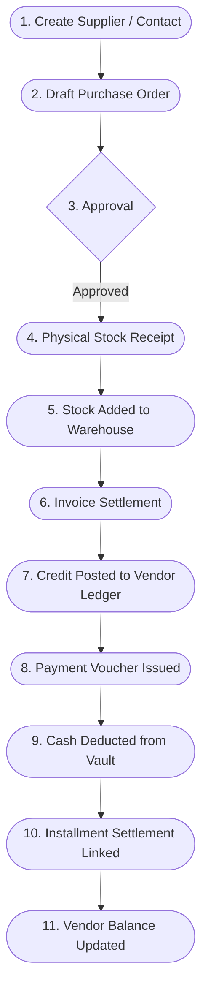
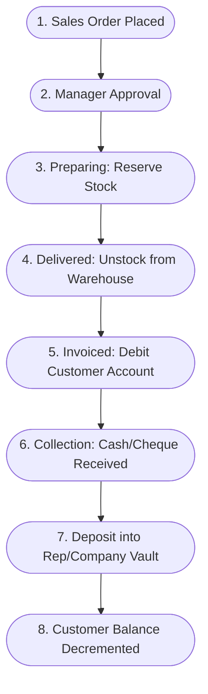
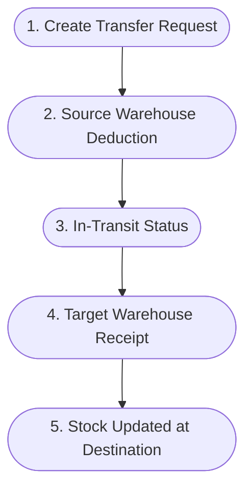

# Reference ERP Business Workflows

> **System**: Bricks Rep / WEA Pharma ERP  
> **Source Base URL**: `https://weapharma.bricks-rep.com/`  
> **Analysis Date**: October 2026  
> **Methodology**: Systematic inspection of live transactional entities, API payload lifecycles, and permission state machines.

---

## 1. The Core Purchasing Workflow (P0 Master Workflow)

This is the primary procurement backbone of the ERP. It coordinates relationships across **Suppliers (Contacts)**, **Purchase Orders**, **Inventory Stocks (Warehouse Memos)**, **Vendor Accounts (Double-Entry Ledger)**, and **Treasury (Vaults/Payments)**.

### Detailed Workflow Stages

#### Stage 1: Supplier Registration & Master Setup
- **Starting Point**: `/contacts` -> Click `إضافة جهة اتصال`
- **Required Data**:
  - Name (e.g. `مصنع اورجانيك للمكملات الغذائية بنها`)
  - Contact Type (`company` | `individual`)
  - Business Relation (`vendor`)
  - Primary Area / Governorate
  - Commercial Reg & Tax Card numbers
  - Credit Limit & Payment Due Period (e.g. 30 days)
- **User Role**: `SuperAdmin`, `Accountant`, `Purchasing Manager`
- **Validation**: Unique supplier name, valid tax ID format, required area.
- **Related Records Created**:
  - `Contact` record
  - `VendorAccount` in Supplier Accounting with zero starting balance.
- **Status Transitions**: Initial state `Active`.

#### Stage 2: Purchase Order Creation
- **Starting Point**: `/purchase-orders` -> Click `أمر مشتريات جديد`
- **Required Data**:
  - Supplier select (`contact_id`)
  - Target Warehouse (`warehouse_id`)
  - Order Date & Delivery Date
  - Order line items:
    - Product select (`product_id`)
    - Quantity (`quantity` > 0)
    - Unit Purchase Cost (`item_price` > 0)
    - Batch Number (`product_batch_number`)
    - Expiration Date (`product_expiry_date`)
    - Item discount (optional)
  - Order-level custom discount (optional)
  - Shipping fees (e.g. `400.00 EGP`)
- **Calculations**:
  $$\text{Item Subtotal} = \text{Quantity} \times \text{Unit Cost}$$
  $$\text{Order Subtotal} = \sum \text{Item Subtotals}$$
  $$\text{Discounted Total} = \text{Order Subtotal} - \text{Item Discounts} - \text{Order Custom Discount}$$
  $$\text{Tax Amount} = \text{Discounted Total} \times \text{Tax Rate}$$
  $$\text{Grand Total} = \text{Discounted Total} + \text{Tax Amount} + \text{Shipping Fees}$$
- **Status Transition**: Created as `PurchaseOrders:status:pending`.
- **Audit**: Logged with creator `created_by_id` and timestamp.

#### Stage 3: Management Approval
- **Starting Point**: Order Detail view `/purchase-orders/{id}`
- **Action**: Change status from `Pending` to `Approved`.
- **Validation**: User must have permission `workflowActions:execute/PurchaseOrders/*/change_status/to_approved`.
- **Status Transition**: `PurchaseOrders:status:pending` $\rightarrow$ `PurchaseOrders:status:approved`.

#### Stage 4: Warehouse Stock Receipt ("Stocking")
- **Starting Point**: Order Detail view -> Action `stock` / استلام البضاعة
- **Action Execution**:
  - Generates Warehouse Inward Memo (`InventoryMemo` type `إضافة`, status `applied`).
  - For each line item:
    - Checks or creates `InventoryStock` record for `(warehouse_id, product_id)`.
    - Increments `qty_on_hand` by item quantity.
    - Updates `on_hand_cost` and recalculates weighted average product cost.
    - Records batch number and expiration date in inventory lot ledger.
  - Links memo to order via `memo_id`.
  - Sets `stocked_at` timestamp.
- **Status Transition**: `PurchaseOrders:status:approved` $\rightarrow$ `PurchaseOrders:status:picked`.

#### Stage 5: Invoicing & Financial Settlement ("Invoicing")
- **Starting Point**: Order Detail view -> Action `invoice` / فوترة أمر الشراء
- **Action Execution**:
  - Automatically posts a formal Credit Transaction to the Supplier's Ledger:
    - `transaction_type`: `credit`
    - `reason`: `purchase`
    - `credit`: Order Grand Total (e.g. `58,849.20 EGP`)
    - `debit`: `0.00 EGP`
    - `date`: `acc_tx_date`
    - `due_date`: `acc_tx_due_date`
  - Creates an accounting `Installment` linked to the transaction:
    - `total_amount`: Grand Total
    - `closed_amount`: `0.00`
    - `open_amount`: Grand Total
  - Increments Supplier's outstanding balance:
    $$\text{New Vendor Balance} = \text{Previous Balance} + \text{Grand Total}$$
  - Links accounting transaction to purchase order via `acc_tx_id` and sets `invoiced_at`.
- **Status Transition**: `PurchaseOrders:status:picked` $\rightarrow$ `PurchaseOrders:status:settled`.

#### Stage 6: Supplier Payment & Debt Settlement
- **Starting Point**: `/vendor-payments` -> Click `مدفوعة جديدة` (or Payment button on Order/Supplier view)
- **Required Data**:
  - Supplier select (`contact_id`)
  - Payment Date
  - Amount to Pay (e.g. `25,000.00 EGP`)
  - Payment Method: `cash` | `cheque` | `bank`
  - Paying Safe / Vault (`account_id` / `vault_id`)
  - Reference / Receipt Number
- **Validation**: Vault must have sufficient cash balance if petty cash.
- **Action Execution**:
  1. **Treasury Outflow**:
     - Deducts `25,000.00 EGP` from the chosen `Vault` balance.
     - Creates a `VaultTransaction` (Withdrawal / Outflow).
  2. **Vendor Ledger Debit**:
     - Posts a Debit Transaction to the Supplier's Ledger:
       - `transaction_type`: `debit`
       - `reason`: `purchase_payments`
       - `debit`: `25,000.00 EGP`
       - `credit`: `0.00 EGP`
  3. **Installment Settlement Matching**:
     - Automatically matches payment against open purchase invoice installments (FIFO or selected invoice).
     - Generates a `Settlement` record linking Payment Transaction to Invoice Installment:
       - `amount`: `25,000.00 EGP`
       - Updates Invoice Installment: `closed_amount` $\rightarrow$ `25,000.00`, `open_amount` $\rightarrow$ `33,849.20`.
  4. **Balance Adjustment**:
     - Decrements supplier balance:
       $$\text{Vendor Balance} = 59,144.12 - 25,000.00 = 34,144.12 \text{ EGP}$$
- **Status Transitions**: Payment marked as `Cleared`.

#### Stage 7: Undo Invoice / Order Reversal (Exception Workflow)
- **Starting Point**: Order Detail view -> Action `attach_money الغاء الفاتورة` (`undoInvoice`)
- **Validation**: Requires `purchase:purchaseOrders:accounting/undoInvoice` permission.
- **Execution**:
  - Reverts the vendor credit ledger transaction.
  - If installments were partially settled, prompts for settlement unlink.
  - Reverts order status from `settled` back to `picked`.
- **Status Transition**: `PurchaseOrders:status:settled` $\rightarrow$ `PurchaseOrders:status:picked`.

---

## 2. The Sales & Distribution Workflow (P1 Workflow)

### Detailed Workflow Stages

1. **Order Initiation (`/sales-orders`)**:
   - Medical/Sales Rep or Backoffice enters customer order with products and requested delivery date.
   - Status: `SalesOrders:status:pending`.
2. **Approval & Stock Reservation (`preparing`)**:
   - Order validated against customer credit limits.
   - Stock is reserved in target warehouse: `qty_reserved` increments, `qty_available` decrements.
   - Status: `SalesOrders:status:preparing`.
3. **Dispatch & Stock Deduction (`delivered`)**:
   - Warehouse dispatch generates Outward Inventory Memo (`Memo` type `خصم`).
   - `qty_on_hand` and `qty_reserved` both decrement.
   - Status: `SalesOrders:status:delivered`.
4. **Customer Invoicing (`invoiced`)**:
   - Customer account debited for invoice grand total.
   - Accounts Receivable balance increments.
   - Due date calculated based on customer credit terms.
   - Status: `SalesOrders:status:invoiced`.
5. **Collection & Receipting (`/collections`)**:
   - Rep or Cashier receives cash or cheque.
   - Collection voucher created (`cash` deposited to Rep's Mobile Vault or Company Vault).
   - Customer account credited, lowering debt balance.

---

## 3. Warehouse Inventory Transfer Workflow (P1/P2 Workflow)

1. **Transfer Memo Draft (`/inventory/transfer-memo`)**:
   - Source Warehouse: e.g. `المخزن الرئيسي`
   - Destination Warehouse: e.g. `خزنة/مخزن مندوب بني سويف`
   - Products, batch numbers, and quantities specified.
2. **Dispatch Confirmation**:
   - Source warehouse creates Stock Out memo (`خصم`).
   - Quantities deducted from source stock.
3. **Receipt Confirmation**:
   - Destination warehouse inspects items and confirms receipt.
   - Stock In memo (`إضافة`) generated at destination warehouse.
   - Quantities added to destination stock with identical batch/expiry details.

---

## 4. Cash Vault & Rep Handover Workflow (P1 Workflow)

1. **Rep Daily Collections**:
   - Field Rep collects `15,000 EGP` cash from multiple pharmacies.
   - Funds accumulate in Rep's Personal Cash Vault (`خزنة المندوب`).
2. **Handover to Company Safe (`/accounting/vaults/transfers`)**:
   - Rep creates transfer request: Source = `خزنة المندوب`, Destination = `الخزنة الرئيسية`.
   - Amount: `15,000 EGP`.
3. **Cashier Acceptance**:
   - Chief Accountant / Cashier physically receives funds and confirms transfer.
   - Source vault balance decrements; Main vault balance increments.
   - Double-entry transfer log recorded in vault transaction ledger.

---

## 5. End-to-End Financial Integrity Rules Observed

1. **No Phantom Inventory**: Stock can only enter inventory via approved Purchase Orders or manual Inward Memos, and can only exit via Delivery Memos or Outward Memos.
2. **Immutable Ledger Transactions**: Invoiced purchase and sales transactions cannot be silently deleted; they require formal cancellation (`undoInvoice` / `credit note` / `reversal transaction`).
3. **Traceable Cash Movements**: Every payment must cite an origin or destination Vault/Safe, ensuring the trial balance is always reconciled.
