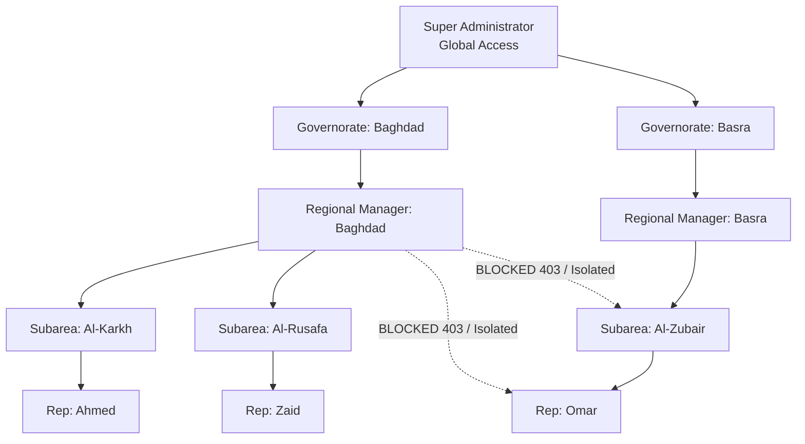

# Regional Access Control & Territorial Hierarchy

**Module:** Accounts & Master Data  
**Status:** IMPLEMENTED & PRODUCTION-READY  
**Date:** 2026-10-24  

---

## 1. Architectural Overview & Security Principle

The ERP enforces a strict multi-tiered territorial authorization model based on geographical regions (`المحافظات`) and subregions (`المناطق الفرعية`). 

**The Golden Security Axiom:**  
> A Regional Manager assigned to a Governorate is strictly responsible for that Governorate and all its constituent Subareas. They have full managerial authority over representatives operating within that territorial tree, but are completely isolated from records, sales, and visits of any foreign region. A Super Administrator retains universal oversight across all territories.



---

## 2. Territorial Data Model & Hierarchy

The territorial entities are defined in `master_data.models.Area`:

- `area_type`: `'governorate'` (المحافظة) or `'subarea'` (المنطقة الفرعية).
- `parent`: Self-referential ForeignKey linking a `subarea` to its parent `governorate`.
- `code`: Unique identifier code (e.g. `IRQ-BGW-01`).
- `User.assigned_areas`: `ManyToManyField(Area)` establishing operational territory assignments for representatives and managers.

### 2.1 Representative Assignment
Representatives are assigned either directly to specific subareas (e.g., Al-Karkh) or to the overarching governorate.

### 2.2 Manager Assignment
Regional Managers are assigned to their governorate. By rule of hierarchy, assigning a manager to a governorate automatically grants jurisdiction over:
1. The governorate itself (`Area.id`).
2. All direct children (`Area.objects.filter(parent=governorate)`).
3. All representatives assigned to any area in that set.

---

## 3. Centralized Permission & Scoping Services

All territorial authorization logic is centralized in `accounts/permissions.py`:

### 3.1 `get_user_managed_areas(user)`
Returns the complete set of `Area` objects under a user's managerial jurisdiction:
```python
def get_user_managed_areas(user):
    if not user or not user.is_authenticated:
        return Area.objects.none()
    if is_super_admin(user):
        return Area.objects.filter(is_active=True)

    assigned = user.assigned_areas.filter(is_active=True)
    governorates = assigned.filter(area_type='governorate')
    child_subareas = Area.objects.filter(parent__in=governorates, is_active=True)
    
    return (assigned | child_subareas).distinct()
```

### 3.2 `get_user_managed_representatives(user)`
Returns the queryset of `User` instances operating within the user's managed areas:
```python
def get_user_managed_representatives(user):
    managed_areas = get_user_managed_areas(user)
    return User.objects.filter(assigned_areas__in=managed_areas, is_active=True).distinct()
```

### 3.3 `get_scoped_queryset(user, base_queryset, area_field, user_field)`
Applies territorial filtering at the database layer, eliminating N+1 memory loading:
- **SuperAdmin:** Unfiltered access.
- **Regional Manager:** Filtered where `area_id IN managed_areas` OR `owner/rep IN managed_representatives`.
- **Field Representative:** Filtered strictly to their own created records (`owner=user`).

### 3.4 `can_user_access_object(user, obj, action='view')`
Provides fine-grained object-level authorization (ABAC):
- Prevents horizontal privilege escalation across regional boundaries.
- **Self-Approval Prevention Rule:** If `action in ['approve', 'reject']` and `obj.owner_id == user.id` (or `obj.created_by_id == user.id`), permission is strictly **denied** (`False`), unless the user is a sovereign SuperAdmin. Managers cannot approve their own submissions.

---

## 4. Regional Manager Dashboard (`/regional/`)

The centralized Regional Command Center provides managers with immediate operational intelligence:

1. **Territory Selector & Scope Summary:** Shows the manager's assigned governorate and all child subareas.
2. **Key Metric Indicators (KPIs):**
   - Total Active Supervised Representatives.
   - Visits Executed (Total, Planned, Unplanned).
   - Approval Queue Status (Pending, Approved, Rejected).
   - Commercial Turnover (Total Confirmed Sales Orders & Total Collections).
3. **Representative Performance Roster:**
   - Rep Name, Email, Assigned Subarea.
   - Visit Count & Ratio.
   - Orders Generated & Grand Total.
   - Direct link to inspect representative activity in the Approvals Hub.

---

## 5. Security & Edge Case Handling

| Scenario | System Enforcement Behavior |
|:---|:---|
| **Cross-Region Access Attempt** | Manager of Region A attempts to view or approve a visit from Region B. Blocked via `get_scoped_queryset` or `can_user_access_object` (HTTP 403 / 404). |
| **Self-Approval Attack** | Manager submits a visit or sales order and attempts to approve it. Blocked via `can_user_access_object` self-approval check. |
| **Representative Transfer** | Rep moved from Region A to Region B. Historical visits and orders retain their original `area` stamp, preserving historical reporting integrity. |
| **Unassigned Territory** | A rep with no assigned area can only view their own records; managers without assigned areas cannot view other users' records. |
| **Subarea without Parent** | Handled gracefully: subarea is managed only by managers directly assigned to that subarea. |

---

## 6. Automated Test Suite

Codified in `activities/tests_approval_and_regional.py`:
- `test_regional_hierarchy_scoping`: Asserts governorate manager manages subareas and assigned reps.
- `test_cross_regional_isolation_prevents_unauthorized_access`: Verifies Manager B is rejected from approving or viewing Manager A's visits (HTTP 403).
- `test_superadmin_global_access`: Verifies superadmin can access and approve records across all territories.
- `test_self_approval_prevention`: Asserts managers cannot approve their own submissions.
