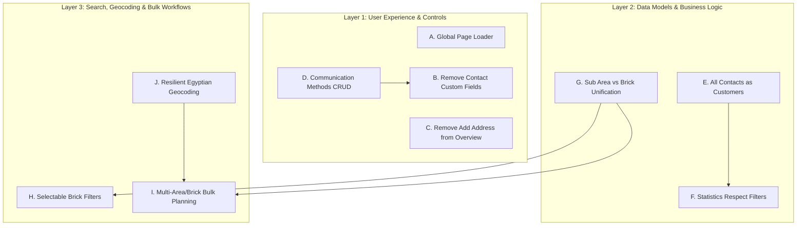
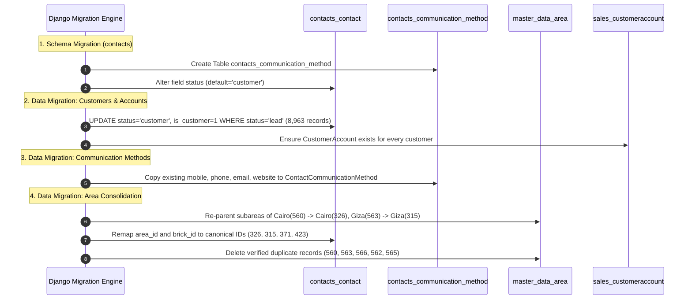

# WEA Pharma ERP — Comprehensive Requirements Implementation Plan & Technical Architecture Analysis

> **Document Status**: Authoritative Engineering Analysis & Implementation Plan  
> **Author**: Senior Django Architect, Business Analyst, Database Engineer, UI/UX Engineer, QA Engineer  
> **Target Date**: 2026-11-11  
> **Phase**: Analysis Only (Pre-Implementation Baseline)  
> **Reference System**: WEA Pharma ERP (`https://weapharma.bricks-rep.com`)

---

## 1. Executive Summary

This document presents a comprehensive, multi-disciplinary analysis of the 10 core business and technical requirements requested for the **WEA Pharma ERP** platform. Every requirement has been investigated against the live codebase, existing SQLite schema (`db.sqlite3`), server-rendered templates, JavaScript client components, permissions resolution engine (`accounts.scope_service.ScopeResolutionService`), and the 371-test automated suite.

### Key Insights Summary

1. **Global Page Loading (Req A)**: The application currently lacks a unified loading experience. As a multi-page Django app styled with Tailwind CDN and custom fonts, full-page transitions and AJAX operations suffer from occasional unstyled flashes or blank rendering states. A lightweight, brand-aligned (`#27bebe`) top-progress bar and non-blocking spinner system embedded into `templates/layouts/base.html` will resolve this globally without third-party bloat.
2. **Contact Custom Fields (Req B)**: "الحقول المخصصة" (Contact UDF) is isolated exclusively to the `contacts` app and `master_data.ContactFieldSetting`. It does not affect catalog, sales, inventory, or treasury. Removing it from contact overview, creation, and editing requires only template and view cleanup, while preserving database columns safely.
3. **Address Management Scoping (Req C)**: The "إضافة عنوان جديد" modal in Contact Overview (`contact_detail.html`) bypasses the canonical contact edit workflow. Removing address creation from the overview page, partner cards, and branch lists while keeping it in the dedicated Contact Edit (`contact_edit.html`) and Create (`contact_create.html`) workflows establishes clear separation of concerns.
4. **Communication Methods CRUD (Req D)**: Contact communication methods currently exist only as static CharFields (`mobile`, `phone`, `email`, `website`) on `Contact`, while the sidebar accordion (`sec-comms`) displays a hardcoded empty placeholder (`لا يوجد طرق اتصال`). A dedicated, relational model `ContactCommunicationMethod` with bi-directional synchronization to `Contact`'s primary fields is required to enable full CRUD across overview and edit pages.
5. **Customer vs. Lead Migration (Req E)**: In the existing database of 8,967 contacts, **8,963 contacts are currently flagged as `status='lead'`** (and only 4 as `status='customer'`). Migrating all contacts to customers requires a data migration script that updates `status='customer'`, provisions missing `CustomerAccount` records for sales/collections, adjusts the model default, and refactors lead-specific dashboard metrics and filters.
6. **Statistics Filter Alignment (Req F)**: In `contacts_list` (and several other list views), statistics boxes are calculated against an unfiltered `scoped_all` queryset rather than the active filtered `qs`. Modifying the aggregation pipeline to evaluate the filtered queryset before pagination ensures real-time accuracy across both full-page reloads and AJAX drawer interactions.
7. **Sub Area vs. Brick Unification & Territorial Deduplication (Req G)**: A Brick is conceptually identical to a Sub Area (level 2 child under a Governorate in `master_data.Area`). However, the database currently suffers from severe duplicates created during data imports: **Duplicate Cairo (ID 326 with 54 districts vs ID 560 with 2,666 contacts)** and **Duplicate Giza (ID 315 with 68 districts vs ID 563 with 2,829 contacts)**. A zero-data-loss consolidation migration must remap contacts and child areas before merging duplicate governorates.
8. **Brick Selectable Filter (Req H)**: In `contacts_list.html`, the subarea filter is currently a plain text `<input type="text" name="sub_area">` with an incomplete `loadDrawerSubareas` onchange hook. Replacing it with a scoped, cascading `<select>` backed by database records and AJAX `/contacts/api/subareas/` restores expected usability.
9. **Multi-Area/Multi-Brick Bulk Planning (Req I)**: The planned visit drawer currently restricts area and brick filters to single integer values. Transitioning to multi-select controls with cascading option dependencies, client-side session persistence, and strict backend permission validation enables representatives and managers to schedule across complex territories efficiently.
10. **Egyptian Geocoding Resilience (Req J)**: Geocoding fails for Egyptian locations because `/api/geocoding/search/` lacks `countrycodes=eg`, causing Egyptian searches like "Dokki" to match Norway and "Smouha" to match New York. Adding strict Egyptian bounding boxes, country filters, `addressdetails=1`, Arabic text normalization, Photon secondary fallback, and local database area matching creates an enterprise-grade solution without recurring API costs.

---

## 2. Existing Architecture Findings

### 2.1 Technology Stack & Architectural Patterns

- **Framework**: Django 5.x, Python 3.13.
- **Frontend Architecture**: Server-Side Rendered (SSR) HTML templates extending a single base layout `templates/layouts/base.html`.
- **CSS / UI Engine**: Tailwind CSS CDN, Cairo Arabic typeface, Google Material Symbols Outlined, Leaflet.js maps. UI is native Arabic RTL (`dir="rtl"`).
- **Primary Brand Theme**: Teal `#27bebe` (`brand-500`), hover `#1fa8a8` (`brand-600`), accent `#f0fdfd` (`brand-50`).
- **Database**: SQLite (`db.sqlite3`) in local/test environments; relational schema with Django ORM migrations.
- **Service Layer Pattern**: Business mutations are encapsulated in `*/services.py` with `@transaction.atomic` and row-level locking (`select_for_update()`).
- **Authorization Engine**: Hierarchical permission registry in `accounts.permission_registry` enforced via `@require_permission`, `get_scoped_queryset`, `can_user_access_object`, and `ScopeResolutionService` supporting 4 organizational scopes (`OWN`, `BRICK`, `AREA`, `ALL`).
- **Test Infrastructure**: Single-test-file architecture (`<app>/tests.py`) across 9 apps with 371 existing unit/integration tests running at 100% pass rate.

### 2.2 App-by-App Inventory Matrix

| App | Primary Models | Scoping & Roles | Key Templates |
|---|---|---|---|
| `accounts` | `User`, `Role`, `RoleModuleScope`, `UserModuleScope`, `SecurityAuditLog` | SuperAdmin, Manager, Accountant, Rep, Medical Rep | `user_form.html`, `role_form.html`, `effective_permissions.html` |
| `master_data` | `Area`, `CompanyProfile`, `LocationSettings`, `ContactFieldSetting` | Two-level territorial tree (Governorate $\to$ Brick) | `geographic_area_selector.html`, `location_picker.html` |
| `contacts` | `Contact`, `ContactAddress`, `ContactComment`, `ContactAttachment`, `ContactTodo`, `ContactActivity` | Scoped via `area` and `brick` | `contacts_list.html`, `contact_create.html`, `contact_detail.html`, `contact_edit.html` |
| `activities` | `Visit`, `PlannedVisitDay`, `PlannedVisitItem`, `VisitTemplate`, `ApprovalAuditLog` | Scoped via `assigned_areas` and customer brick | `planned_visits_list.html`, `visits_list.html`, `agenda.html` |
| `sales` | `SalesOrder`, `SalesOrderItem`, `CustomerAccount`, `Collection` | Representative warehouse and vault boundaries | `sales_orders_list.html`, `sales_order_create.html` |
| `purchases` | `PurchaseOrder`, `PurchaseOrderItem`, `VendorInvoice` | Centralized purchasing | `purchase_orders_list.html` |
| `inventory` | `Warehouse`, `InventoryStock`, `ProductTransferRequest`, `StockMemo` | Inter-warehouse movements restricted to same main area | `warehouses_list.html`, `transfers_list.html` |
| `treasury` | `Vault`, `VaultTransaction`, `VendorAccount`, `VendorPayment` | Cash ledgers, collections, reversals | `vaults_list.html`, `transactions_list.html` |

---

## 3. Requirement-by-Requirement Deep Dive & Root Causes



---

### Requirement A: Global Page Loading Experience

#### Current State & Symptoms
- All application views inherit `templates/layouts/base.html`.
- Currently, there is no global visual loading indicator when navigating between views or during initial DOM rendering.
- Because Tailwind CSS CDN (`https://cdn.tailwindcss.com`) and Google Fonts are parsed asynchronously in the browser `<head>`, large pages (e.g. `contacts_list.html` with data tables or `planned_visits_list.html` with month agendas) occasionally produce brief unstyled content flashes or perceived frozen UI on slower connections.
- Form submissions (except where individual buttons have isolated spinners) do not give global feedback, causing users to double-click submit buttons.

#### Desired Behavior
1. **Lightweight Navigation Indicator**: A sleek, non-intrusive top-progress bar (YouTube/NProgress style, 3px height, primary teal `#27bebe`) that activates immediately upon link click or form submission and completes when the new document renders.
2. **First-Paint Micro-Overlay**: An inline CSS-based splash/spinner centered on screen during page load that smoothly fades out as soon as `DOMContentLoaded` or `window.load` fires.
3. **Flicker-Free Threshold**: Fast responses (<120ms) should avoid showing full-screen blocking modals to prevent visual jarring.
4. **Error & Timeout Resilience**: If an asset fails or an error occurs, the loader must automatically auto-hide after a hard ceiling (max 4.0 seconds) so the UI is never stuck.
5. **AJAX API Compatibility**: Provide simple window hooks (`window.showGlobalLoader()`, `window.hideGlobalLoader()`) so that drawer filtering or async tasks can trigger non-blocking loading states seamlessly.

#### Root Cause
- Complete absence of centralized loading lifecycle hooks in `templates/layouts/base.html`.

#### Affected Files
- `templates/layouts/base.html`: Embedding critical inline CSS in `<head>` (guaranteeing zero flash before external CDN loads) and minimal JS at the footer.

---

### Requirement B: Remove Custom Fields from Contact Overview and CRUD

#### Current State & Symptoms
- In `templates/contacts/contact_create.html` (lines 578–650): "SECTION 4: الحقول المخصصة (Custom Fields)" renders dynamic form inputs based on `custom_field_settings`.
- In `templates/contacts/contact_edit.html` (lines 456–525): "SECTION 4: الحقول المخصصة (Custom Fields)" renders custom values.
- In `templates/contacts/contact_detail.html` (lines 397–445): "الحقول المخصصة (Custom Fields)" renders custom values table.
- In `contacts/views.py`:
  - `extract_custom_values_from_post()` parses POST fields prefixed with `custom_`.
  - Views query `ContactFieldSetting.objects.filter(is_active=True)` in `contact_create`, `contact_edit`, and `contact_detail`.
- In `contacts/models.py`: `Contact.custom_values` (`JSONField(default=dict, blank=True)`).
- In `master_data/models.py`: `ContactFieldSetting` defines custom field metadata (field key, type, choices).

#### Investigation & Isolation Check
- **Is UDF used by any other module?** We executed a codebase-wide audit across catalog, inventory, purchases, sales, activities, and treasury. **Zero other modules use `ContactFieldSetting` or contact custom fields**.
- In `accounts/models.py`, there is an audit log event code `CONTACT_UDF_UPDATED` which is non-breaking.

#### Desired Behavior
1. Remove the "الحقول المخصصة" UI sections from `contact_create.html`, `contact_edit.html`, and `contact_detail.html`.
2. Clean up `contacts/views.py` so views do not query `ContactFieldSetting` or inject `custom_field_settings` into templates.
3. Maintain backward compatibility for the database: retain `Contact.custom_values` JSONField on the model so existing JSON data is not abruptly dropped from database tables.
4. Update tests in `contacts/tests.py` that specifically test custom field extraction.

---

### Requirement C: Remove Adding New Addresses from Specific Pages

#### Current State & Symptoms
- In `templates/contacts/contact_detail.html` (lines 502–507):
  ```html
  <button type="button" onclick="openAddAddressModal()" class="inline-flex items-center gap-1 text-xs text-brand-600 font-bold hover:underline">
      <span class="material-symbols-outlined text-sm">add</span>
      <span>اضف عنوان جديد</span>
  </button>
  ```
- Lines 985–1025 define modal `#modal-add-address` submitting to ``.
- Below addresses in `contact_detail.html` are the accordions for:
  - "الشركاء" (Partners, lines 553–562)
  - "الفروع" (Branches, lines 564–579)
- Users mistakenly use the detail page modal to add addresses or attempt to add addresses from branch/partner lists, leading to incomplete records (missing geocoding, coordinates, and proper line scoping).

#### Desired Behavior
1. In `templates/contacts/contact_detail.html`:
   - Remove the "اضف عنوان جديد" button (`openAddAddressModal`) from the "العناوين" accordion.
   - Remove the `#modal-add-address` modal HTML completely from the template.
   - Retain the address display list and the delete address button (`contact_delete_address`) so existing addresses remain viewable and manageable.
   - Verify that no "إضافة عنوان" triggers exist in the "الشركاء" and "الفروع" accordions.
2. Canonical address creation and editing remains preserved exclusively where it belongs:
   - In **Contact Create** (`templates/contacts/contact_create.html`): Multi-address cards with location picker.
   - In **Contact Edit** (`templates/contacts/contact_edit.html`): Multi-address cards (`address-card`) with full district and map coordinates.

---

### Requirement D: Contact Communication Methods CRUD

#### Current State & Symptoms
- In `templates/contacts/contact_detail.html` (lines 543–551):
  ```html
  <!-- 6. طرق الاتصال -->
  <div class="bg-white rounded-xl border border-slate-200 shadow-sm overflow-hidden">
      <div class="erp-accordion-header" onclick="toggleAccordion('sec-comms')">
          <span>طرق الاتصال</span>
          <span id="icon-sec-comms" class="material-symbols-outlined text-slate-400">expand_less</span>
      </div>
      <div id="sec-comms" class="p-4 text-center text-xs text-slate-400">
          لا يوجد طرق اتصال
      </div>
  </div>
  ```
  The section is completely static with hardcoded text `لا يوجد طرق اتصال`.
- In `contacts/models.py`, `Contact` has only 4 scalar fields: `mobile`, `phone`, `email`, `website`.
- In `templates/contacts/contact_edit.html`, there are only 2 fixed phone inputs (`mobile_number` and `phone_number`) with country code dropdowns.
- There is no model or UI allowing a contact to have multiple phone numbers, multiple mobiles, WhatsApp lines, or dedicated secondary emails with labels (e.g. "عيادة صباحية", "مدير المشتريات", "سكرتارية").

#### Desired Architecture & Behavior
1. **Model Specification**: Create `ContactCommunicationMethod` in `contacts/models.py`:
   - `contact`: `ForeignKey(Contact, on_delete=CASCADE, related_name='communication_methods')`
   - `method_type`: `CharField(max_length=20, choices=[('mobile', 'موبايل'), ('phone', 'هاتف أرضي'), ('whatsapp', 'واتساب'), ('email', 'بريد إلكتروني'), ('fax', 'فاكس'), ('website', 'موقع إلكتروني'), ('other', 'أخرى')])`
   - `value`: `CharField(max_length=150, verbose_name="القيمة / الرقم")`
   - `is_primary`: `BooleanField(default=False, verbose_name="رئيسي")`
   - `label`: `CharField(max_length=100, blank=True, verbose_name="الوصف / المسمى")` (e.g. "العيادة", "المكتب")
   - `created_at`: `DateTimeField(auto_now_add=True)`
2. **Data Migration**: Automatically populate `ContactCommunicationMethod` rows for all existing 8,967 contacts from their current `mobile`, `phone`, `email`, and `website` columns (setting `is_primary=True`).
3. **Bi-Directional Field Synchronization**: When a communication method marked `is_primary` is saved or updated, keep `Contact.mobile`, `Contact.phone`, `Contact.email` synchronized so all existing search queries, exports, and visit cards continue working without alteration.
4. **Overview Page CRUD (`contact_detail.html`)**:
   - Render all communication methods in accordion `sec-comms` with method badges, value, copy-to-clipboard, WhatsApp quick links, and action buttons.
   - Inline modal to add a new communication method via AJAX (`POST /contacts/<pk>/communications/add/`).
   - Inline modal to edit method (`POST /contacts/<pk>/communications/<id>/edit/`).
   - Unified delete confirmation modal (`showConfirmDeleteModal`) calling `POST /contacts/<pk>/communications/<id>/delete/`.
5. **Edit Page CRUD (`contact_edit.html`)**:
   - Provide a dynamic formset / card repeater allowing users to add, edit, toggle primary, and remove communication methods seamlessly during contact update.

---

### Requirement E: All Contacts Must Be Customers

#### Current State & Symptoms
- Database Query Result from live `db.sqlite3`:
  - Contacts with `status='customer'`: **4**
  - Contacts with `status='lead'`: **8,963**
- In `contacts/models.py`:
  - `status`: choices `[('lead', 'Lead'), ('customer', 'Customer'), ('active', 'Active'), ('inactive', 'Inactive')]`, `default='lead'`.
  - `is_customer`: `BooleanField(default=False)`.
- In `contacts/views.py`:
  - `contact_create` defaults `status_val = 'lead'`.
  - `contacts_list` computes `total_leads = scoped_all.filter(is_customer=True, status='lead').count()`.
  - Kanban pipeline has separate column for `lead` and `customer`.
- In `master_data/views.py`:
  - Dashboard statistics compute `leads_count = all_contacts_scoped.filter(status='lead').count()`.
  - KPI card `visits_created_lead_stats` ('زيارات العملاء المحتملين').

#### Business Rule Impact
- The business requirement is unequivocal: **All contacts in WEA Pharma ERP must be classified as Customers, not Leads**.
- Pharmaceutical field visits, sales orders, and customer accounts operate strictly against customer accounts. Having 99.9% of the contacts marked as "Leads" causes confusion in reporting, filters, and agenda scheduling.

#### Safe Migration & Architecture Strategy
1. **Schema & Model Adjustments**:
   - Change `Contact.status` default to `'customer'` (or `'active'`).
   - Ensure `Contact.is_customer` defaults to `True` for newly created contacts.
2. **Data Migration**:
   - Update all existing 8,963 records with `status='lead'` to `status='customer'` and `is_customer=True`.
   - Iterate through updated contacts and ensure `sales.CustomerAccount.get_or_create_for_customer(contact)` is executed for each, establishing clean financial ledger balances.
3. **Application & Workflow Refactoring**:
   - Update `contacts_list` stage filtering: retire the separate "Lead" stage filter or alias it to Customer.
   - Update `contact_create` and `contact_edit` forms so the customer classification is default and primary.
   - Update `contacts_import` to assign `status='customer'` and `is_customer=True`.
   - Refactor `master_data/views.py` dashboard cards: retire `visits_created_lead_stats` and `leads_count_stats` or adapt them to total active customers.
   - Update tests in `contacts/tests.py` (specifically `test_default_contact_classification_is_lead`) to assert `status == 'customer'` and `is_customer == True`.

---

### Requirement F: Statistics Must Respect Filters

#### Current State & Symptoms
- In `contacts/views.py` (`contacts_list`, lines 242–248):
  ```python
  # Dedicated real scoped statistics cards
  scoped_all = get_scoped_queryset(Contact.objects.all(), request.user, 'contact')
  stats = {
      'total_contacts': scoped_all.count(),
      'total_customers': scoped_all.filter(is_customer=True, status='active').count(),
      'total_leads': scoped_all.filter(is_customer=True, status='lead').count(),
      'total_suppliers': scoped_all.filter(is_supplier=True).count(),
  }
  ```
- **The Defect**: When a user filters the contacts list by Area (e.g. Cairo), Brick (e.g. Maadi), Specialty, Account Type, or text search:
  - The table and cards update to show the matching contacts (`qs`).
  - **The top KPI statistics cards continue to show counts for the entire organization (`scoped_all`)!**
- The same pattern exists in other list views:
  - `sales/views.py` (`sales_orders_list` computes stats on `scoped_all` rather than filtered `qs`).
  - `activities/views.py` (`agreements_list` computes stats on `base_scoped_agreements`).
  - `purchases/views.py` (`purchase_orders_list` computes stats on `scoped_active`).

#### Desired Behavior
1. In `contacts_list`, statistics must evaluate against the filtered queryset (`qs`), calculated **after** all search, area, brick, category, relation, and status filters are applied, but **before** pagination slicing (`paginate_queryset`).
2. Statistics must represent the entire filtered set across all pages, never just the 25 items on the current page.
3. When filters change via AJAX drawer submission, the statistics boxes in the DOM must update dynamically or refresh with the response payload.
4. With Requirement E applied, the statistics card definitions should be:
   - `total_contacts`: `qs.count()`
   - `total_customers`: `qs.filter(is_customer=True, status__in=['active', 'customer']).count()`
   - `total_suppliers`: `qs.filter(is_supplier=True).count()`
   - `active_rate`: formatted percentage of active customers within the filtered subset.

---

### Requirement G: Sub Area vs Brick Organizational Hierarchy & Area Deduplication

#### Current State & Model Findings
- In `master_data/models.py`:
  - `Area` model has `area_type` choices: `[('governorate', 'محافظة'), ('subarea', 'منطقة / مركز')]`.
  - Self-referential `parent` foreign key:
    - Root Main Area (Governorate): `parent is None`.
    - Child Area (Sub Area / Brick): `parent is not None`.
- **The Concept**: In WEA Pharma ERP, **Sub Area represents Brick**. There are not three separate geographical tiers. Level 1 is Governorate/Main Area; Level 2 is Sub Area/Brick.
- In `contacts/models.py`:
  - `Contact.area` points to Level 1 (`parent is None`).
  - `Contact.brick` points to Level 2 (`parent is not None`).
  - `ContactAddress` redundantly stores both `brick` (`ForeignKey`) and `sub_area` (`CharField(max_length=150)`).

#### Database Audit Findings: The Duplicate Areas Crisis
Our live database inspection of `master_data_area` revealed serious duplicated entities created during legacy Excel imports:

| Name | ID | Code | Type | Parent | Child Areas | Contacts Linked | Users Assigned |
|---|---|---|---|---|---|---|---|
| **محافظة القاهرة** | **326** | `01` | governorate | None | **54 official districts** | 0 | 7 |
| **محافظة القاهرة** | **560** | `CAI` | governorate | None | 2 districts | **2,666 contacts** | 7 |
| **محافظة الجيزة** | **315** | `03` | governorate | None | **68 official districts** | 0 | 6 |
| **محافظة الجيزة** | **563** | `GIZ` | governorate | None | 2 districts | **2,829 contacts** | 6 |
| **محافظة الإسكندرية**| **541** | `02` | governorate | None | 0 | 0 | 0 |
| **محافظة الإسكندرية**| **566** | `ALX` | governorate | None | 1 | 0 | 0 |
| **المهندسين** | **423** | `0364` | subarea | 315 | 0 | 0 | 0 |
| **المهندسين** | **565** | `GIZ-MH` | subarea | 563 | 0 | 19 contacts | 0 |
| **المعادي** | **371** | `0142` | subarea | 326 | 0 | 0 | 0 |
| **المعادي** | **562** | `CAI-MD`| subarea | 560 | 0 | 172 contacts | 0 |

#### Why this breaks the application:
1. When a user selects "محافظة القاهرة" from dropdowns, they often receive ID 326 (which has 54 child bricks, but **0 contacts**).
2. When importing contacts, contacts were attached to ID 560 (which has **2,666 contacts**, but only 2 child bricks).
3. Filtering for Cairo contacts with Maadi brick fails depending on which duplicate was loaded!

#### Safe Consolidation Strategy
> [!IMPORTANT]
> Never delete records by name alone. All remapping must be executed inside an atomic data migration.

1. **Step 1: Remap Child Subareas**:
   - Re-parent child subareas of duplicate governorate ID 560 (ID 561 'وسط القاهرة', ID 562 'المعادي') to canonical governorate ID 326.
   - Re-parent child subareas of duplicate governorate ID 563 (ID 564 'الهرم', ID 565 'المهندسين') to canonical governorate ID 315.
   - Re-parent child subareas of duplicate governorate ID 566 to canonical governorate ID 541.
2. **Step 2: Consolidate Child Bricks**:
   - Merge ID 562 ('المعادي') into canonical ID 371 ('المعادي' under 326): update all contacts and addresses pointing to 562 to point to 371.
   - Merge ID 565 ('المهندسين') into canonical ID 423 ('المهندسين' under 315): update all contacts and addresses pointing to 565 to point to 423.
3. **Step 3: Remap Contacts & Addresses**:
   - Update `contacts_contact.area_id = 326` where `area_id = 560`.
   - Update `contacts_contact.area_id = 315` where `area_id = 563`.
   - Update `contacts_contactaddress.area_id = 326` where `area_id = 560`.
   - Update `contacts_contactaddress.area_id = 315` where `area_id = 563`.
4. **Step 4: Remap User Assigned Areas & Resources**:
   - Update `accounts_user_assigned_areas`: replace references to 560/563 with 326/315.
   - Update `inventory_warehouse.area_id` and `treasury_vault.area_id`.
5. **Step 5: Safely Decommission Duplicate Entities**:
   - Only after zero foreign key references remain, delete the duplicate governorates (IDs 560, 563, 566) and duplicate subareas (IDs 562, 565).
   - Resolve the 5 orphaned test subareas (IDs 569, 571, 573, 575, 577) by deleting or re-parenting them.

---

### Requirement H: Brick Filters Must Use Selectable Values

#### Current State & Symptoms
- In `templates/contacts/contacts_list.html` (lines 638–642):
  ```html
  <div>
      <label class="mat-like-label">المنطقة الفرعية</label>
      <input type="text" name="sub_area" value="{{ current_sub_area }}" placeholder="اسم المنطقة الفرعية..." class="mat-like-control">
  </div>
  ```
- Line 630 has an `onchange="loadDrawerSubareas(this.value)"` attribute on the Area select, but `loadDrawerSubareas` is **completely missing from JavaScript**.
- As a result, users have to manually type the Arabic text of a subarea, which frequently fails due to Arabic spelling variations (e.g. "المعادي" vs "المعادى", "الهرم" vs "شارع الهرم").

#### Desired Behavior
1. In `templates/contacts/contacts_list.html`:
   - Replace `<input type="text" name="sub_area">` with `<select name="brick_id" id="drawer_brick_id" class="mat-like-control">`.
   - Add initial placeholder: `<option value="">جميع المناطق الفرعية (Bricks)</option>`.
2. **Cascading Dynamic Behavior**:
   - Implement `loadDrawerSubareas(areaId)` in JavaScript.
   - When the user selects a Main Area (Governorate), trigger an asynchronous fetch to `/contacts/api/subareas/?area_id=${areaId}`.
   - Populate `#drawer_brick_id` with active bricks belonging to that area.
   - If the user clears the Main Area, display all bricks within their authorized scope or prompt to choose a main area.
3. **Scope Enforcement**:
   - Representatives can only view/select bricks assigned to them.
   - Managers can only view/select bricks belonging to their assigned main areas.
   - SuperAdmin can view all bricks across Egypt.
4. **Backend View Alignment**:
   - Ensure `contacts/views.py` processes `brick_id = request.GET.get('brick_id')` cleanly and queries `Q(brick_id=brick_id) | Q(addresses__brick_id=brick_id)`.

---

### Requirement I: Multiple Areas and Bricks in Planned Visit Bulk Forms

#### Current State & Symptoms
- In `templates/activities/planned_visits_list.html` (lines 218–235):
  - Area selector is a single-select `<select name="main_area" id="filter_main_area">`.
  - Brick selector is a single-select `<select name="area" id="filter_area">`.
- In `activities/views.py` (`planned_visits_list`, lines 535–560):
  - Backend filters:
    ```python
    main_area_filter = (request.GET.get('main_area') or '').strip()
    area_filter = (request.GET.get('brick') or request.GET.get('area') or '').strip()
    if main_area_filter and main_area_filter.isdigit():
        ...
    if area_filter and area_filter.isdigit():
        ...
    ```
- Representatives whose assigned territory spans multiple bricks (e.g. Nasr City 1, Nasr City 2, Heliopolis) or managers supervising multi-governorate sectors cannot filter clients across their entire portfolio at once.

#### Desired Architecture & Implementation
1. **Frontend UI Components (`planned_visits_list.html`)**:
   - Convert `filter_main_area` and `filter_area` into multi-select controls with badge/chip pills or searchable multi-checkbox dropdowns matching the compact UI standards.
   - **Cascading Inter-dependency**:
     - Selecting one or more Main Areas dynamically updates the Brick selector to show **only** Bricks that belong to the selected Main Areas.
     - If an Area is deselected, any selected Bricks belonging to that deselected Area are **automatically cleared**.
2. **AJAX Filtering & State Preservation**:
   - The drawer filter submission (`applyDrawerFilterAjax`) serializes arrays: `main_area[]` and `brick[]`.
   - Active selections are persisted in `sessionStorage ('wea_planned_selected_areas', 'wea_planned_selected_bricks')` so drawer operations and page reloads maintain active filter context.
3. **Backend Queryset Scoping (`activities/views.py`)**:
   - Extract parameters:
     ```python
     main_area_ids = [int(x) for x in request.GET.getlist('main_area') if str(x).isdigit()]
     brick_ids = [int(x) for x in request.GET.getlist('brick') or request.GET.getlist('area') if str(x).isdigit()]
     ```
   - Filter contacts:
     ```python
     if main_area_ids:
         contacts_qs = contacts_qs.filter(
             Q(area_id__in=main_area_ids) |
             Q(brick__parent_id__in=main_area_ids) |
             Q(addresses__area_id__in=main_area_ids) |
             Q(addresses__brick__parent_id__in=main_area_ids)
         ).distinct()
     if brick_ids:
         contacts_qs = contacts_qs.filter(
             Q(brick_id__in=brick_ids) |
             Q(addresses__brick_id__in=brick_ids)
         ).distinct()
     ```
4. **Security & Permission Guardrails**:
   - Every submitted `main_area_id` and `brick_id` must be validated against `ScopeResolutionService` for the current user.
   - Representatives attempting to inject IDs outside their assigned bricks are blocked server-side.

---

### Requirement J: GBS Search for Egyptian Locations

#### Current State & Root Cause Analysis
- Location picker component: `templates/components/location_picker.html`.
- Geocoding endpoints:
  - Search: `/api/geocoding/search/?q=<query>`
  - Reverse: `/api/geocoding/reverse/?lat=<lat>&lng=<lng>`
- Implemented in `master_data/views.py` (`geocoding_search_api` and `geocoding_reverse_api`).

#### Concrete Root Causes Discovered During Live Testing:
1. **Missing Country Restriction**: The query to OpenStreetMap Nominatim was sent without `countrycodes=eg`.
   - *Test Evidence*: Searching "Smouha" returned a synagogue in Brooklyn, New York. Searching "Dokki" returned a district in Norway.
   - When tested with `countrycodes=eg`, "Smouha" immediately returned Alexandria, Egypt, and "Dokki" returned Giza, Egypt.
2. **Missing Structured Address Breakdown**: Nominatim was queried without `addressdetails=1`. The API returned only a raw formatted string, preventing the frontend from extracting `state` (Governorate) and `suburb` (Brick/District).
3. **Nominatim Usage Limits & Block Potential**: Public Nominatim has a strict 1 request per second policy and frequently blocks cloud IPs or throttles requests during rapid typing.
4. **Egyptian Compound Search Queries**: When Egyptian users type doctor/pharmacy search terms like "د. احمد شارع التحرير الدقي", Nominatim fails because it cannot parse prefix titles or unstructured Egyptian street text.

#### Resilient Architectural Solution (Zero Extra Licensing Cost)
1. **Strict Egypt Bounding & Country Restriction**:
   - Add `countrycodes='eg'` to all Nominatim requests.
   - Add Egypt bounding box: `viewbox=24.7,31.7,36.9,22.0&bounded=0`.
   - Add `addressdetails=1` so structured components (`state`, `city`, `suburb`, `road`) are parsed.
2. **Dual-Provider Resilience (Photon Komoot Fallback)**:
   - Primary: OpenStreetMap Nominatim with country code and bounding box.
   - Secondary Fallback: Photon Geocoder API (`https://photon.komoot.io/api/?q=<query>&country=eg`), an open-source Elasticsearch-based geocoder specifically built for real-time search-as-you-type without strict rate-limits.
3. **Local Database Fallback (`master_data.Area`)**:
   - If external APIs fail or return 0 results (e.g. offline, connection loss, or rate-limited), the backend queries local `master_data.Area` (which contains 261 Egyptian governorates and districts).
   - If a user types "مدينة نصر" or "المنصورة", the local database instantly returns the canonical Egyptian area coordinates!
4. **Frontend Autofill Integration (`location_picker.html`)**:
   - Debounce search input to 400ms to eliminate duplicate calls.
   - When a location is selected from search results or clicked on the map, dispatch a custom event `erp:location-selected` with parsed `{lat, lng, governorate, brick, street_address}`.
   - In `contact_create.html` and `contact_edit.html`, listen for this event and automatically select the matching Governorate in the dropdown and populate the Street Address field.

---

## 4. Comprehensive Impact & File Inventory

### 4.1 Affected Files Matrix

| File Path | Related Requirements | Nature of Change |
|---|---|---|
| `templates/layouts/base.html` | Req A | Embed lightweight global page progress bar and non-blocking splash screen |
| `contacts/models.py` | Req D, Req E | Add `ContactCommunicationMethod` model, change `Contact.status` default to `'customer'` |
| `contacts/views.py` | Req B, Req D, Req E, Req F, Req H | Remove custom field hooks, add communication methods CRUD endpoints, update default contact status, compute stats on filtered `qs`, update brick filter |
| `templates/contacts/contact_create.html` | Req B, Req E, Req J | Remove custom fields Section 4, default status to customer, bind geocoding auto-population |
| `templates/contacts/contact_edit.html` | Req B, Req C, Req D, Req J | Remove custom fields Section 4, preserve address cards, add communication methods CRUD, bind geocoding auto-population |
| `templates/contacts/contact_detail.html` | Req B, Req C, Req D | Remove custom fields table, remove "اضف عنوان جديد" button & modal, render communication methods CRUD in `sec-comms` |
| `templates/contacts/contacts_list.html` | Req F, Req H | Replace text input with selectable cascading brick dropdown, implement `loadDrawerSubareas` |
| `contacts/urls.py` | Req D | Add routes for communication methods CRUD (`add`, `edit`, `delete`) |
| `contacts/tests.py` | Req B, Req D, Req E, Req F, Req H | Update tests for customer default, add communication methods CRUD tests, verify filtered stats |
| `master_data/models.py` | Req G | Clarify Brick/Sub Area docstrings, prepare consolidation migration |
| `master_data/views.py` | Req E, Req J | Refactor dashboard lead metrics, enhance `geocoding_search_api` with `countrycodes=eg`, Photon fallback, and local area search |
| `master_data/tests.py` | Req G, Req J | Add tests for Egypt geocoding parameters and area consolidation integrity |
| `activities/views.py` | Req I | Support multi-area and multi-brick filtering in `planned_visits_list` and `load_contacts` |
| `templates/activities/planned_visits_list.html` | Req I | Implement multi-select area and brick controls with cascading clearing logic |
| `activities/tests.py` | Req I | Add tests for multi-area/brick bulk planning and permission scoping validation |

---

## 5. Database & Migration Plan

### 5.1 Data Migrations Sequence



### 5.2 Step-by-Step Migration Safety Protocol
1. **Pre-Migration Snapshot**: Full SQLite binary backup (`backups/db_backup_pre_req_exec.sqlite3`) verified before running migrations.
2. **Zero Table Truncation**: No destructive drops of existing columns (`Contact.custom_values` is retained on the model).
3. **Reversible Data Migrations**: Every data migration must provide an exact `reverse_code` function.
4. **Foreign Key Integrity Verification**: Pre- and post-migration validation checking for orphaned foreign keys in `contacts_contact`, `contacts_contactaddress`, and `accounts_user_assigned_areas`.

---

## 6. UI/UX Changes & Design Parity

All UI enhancements adhere to the project's **UI/UX Guidelines** (`docs/UI_UX_GUIDE.md`):
- **Compact & High Information Density**: No bloated cards or unnecessary vertical white space.
- **Teal Brand Fidelity**: Primary `#27bebe`, secondary `#1fa8a8`, surface `#f8fafc`.
- **First-Class Arabic RTL**: Proper alignment of icons, labels, badges, and modals.
- **Drawer Interaction Without Full-Page Reload**: Preserve drawer open state, selected chips, and scroll positions using `sessionStorage` and AJAX.
- **Unified Deletion Standards**: All delete actions (addresses, communication methods, contacts) use `showConfirmDeleteModal` instead of native browser `confirm()`.

---

## 7. Security, Scoping & Permission Considerations

1. **Configurable Module Scopes (`ScopeResolutionService`)**:
   - `contacts`: Representative scoping (`BRICK`), Manager scoping (`AREA`), Accountant/SuperAdmin (`ALL`).
   - `activities`: Representative scoping (`BRICK`), Manager scoping (`AREA`).
2. **Anti-Tampering in Multi-Select (Req I)**:
   - When a user submits multiple Area or Brick IDs in planned visits, the server does not trust the client payload.
   - `ScopeResolutionService` verifies that every requested Area and Brick is within the user's authorized territory. If an unauthorized ID is detected, it is silently dropped or rejected with HTTP 403.
3. **Communication Methods CRUD Authorization (Req D)**:
   - Creating, editing, or deleting a communication method requires `can_user_access_object(request.user, contact, 'edit')` and permission `contacts:contacts/edit`.
   - Prevents IDOR vulnerabilities where an attacker attempts to delete a communication method belonging to another user's contact.
4. **Audit Trail Compliance**:
   - Any mutation to communication methods or contact status logs an entry in `accounts.models.SecurityAuditLog`.

---

## 8. Implementation Dependencies & Execution Order

```mermaid
graph LR
    subgraph Phase1["Phase 1: Foundation & Data Integrity (P0)"]
        Task1["1. Database Area Consolidation (Req G)"]
        Task2["2. Contact to Customer Migration (Req E)"]
    end

    subgraph Phase2["Phase 2: Core Models & Backend Services (P1)"]
        Task3["3. Communication Methods Model & Migration (Req D)"]
        Task4["4. Statistics Filter Scoping (Req F)"]
        Task5["5. Egyptian Geocoding Proxy (Req J)"]
    end

    subgraph Phase3["Phase 3: UI & Workflow Parity (P1-P2)"]
        Task6["6. Global Page Loader (Req A)"]
        Task7["7. Remove Custom Fields from UI (Req B)"]
        Task8["8. Address Creation Scoping (Req C)"]
        Task9["9. Selectable Brick Filter (Req H)"]
        Task10["10. Multi-Area/Brick Bulk Planning (Req I)"]
    end

    subgraph Phase4["Phase 4: QA, Verification & Documentation (P0)"]
        Task11["11. Comprehensive Regression Testing & Docs"]
    end

    Phase1 --> Phase2
    Phase2 --> Phase3
    Phase3 --> Phase4
```



---

## 9. Testing Strategy & Verification Plan

### 9.1 Unit & Integration Test Targets

1. **`master_data/tests.py`**:
   - Test consolidation of duplicate Cairo (326/560) and Giza (315/563) areas.
   - Test `geocoding_search_api` with `countrycodes=eg` parameter and mock response.
   - Test Photon fallback when Nominatim fails.
   - Test local database fallback when external network is disabled.
2. **`contacts/tests.py`**:
   - Test newly created contact defaults to `status='customer'` and `is_customer=True`.
   - Test `ContactCommunicationMethod` CRUD (create, update, delete, set primary).
   - Test primary communication method syncs to `Contact.mobile` and `Contact.phone`.
   - Test `contacts_list` statistics cards strictly reflect applied filters.
   - Test cascading brick options in `/contacts/api/subareas/`.
3. **`activities/tests.py`**:
   - Test multi-area and multi-brick bulk planning querysets.
   - Test representative territorial boundary enforcement when multiple bricks are selected.
   - Test tamper prevention against unauthorized brick IDs.
4. **Full Suite Regression**:
   - Execute `python manage.py test` to ensure all 371+ tests pass without errors.

---

## 10. Risks & Decision Points for Product Owner

> [!WARNING]
> Please review the following key architectural decision points before implementation commences:

1. **Duplicate Area Consolidation Strategy (Req G)**:
   - **Recommendation**: Canonical Egyptian Governorate codes (ID 326 for Cairo with its 54 districts, and ID 315 for Giza with its 68 districts) will be preserved as authoritative. Contacts currently linked to ID 560 and ID 563 will be cleanly re-parented to IDs 326 and 315 in an atomic migration.
   - *Decision needed*: Confirm approval to merge legacy alpha IDs (560/563) into canonical IDs (326/315).
2. **Customer vs. Lead Field Nomenclature (Req E)**:
   - **Recommendation**: All 8,963 contacts currently marked `status='lead'` will be migrated to `status='customer'`, and `is_customer` set to `True`. The "Leads" KPI card on the dashboard will be replaced with "Total Active Customers".
   - *Decision needed*: Confirm that no external integration or third-party CRM relies on contacts retaining `status='lead'`.
3. **Geocoding Secondary Provider (Req J)**:
   - **Recommendation**: Use OpenStreetMap Nominatim (restricted with `countrycodes=eg`) with automatic secondary fallback to Photon Komoot (`https://photon.komoot.io`), backed by local database fallback. This is 100% free with zero API keys or monthly costs.
   - *Decision needed*: Confirm that this zero-cost solution is preferred over paid Google Maps Geocoding API keys.
4. **Custom Fields Deprecation (Req B)**:
   - **Recommendation**: Remove the UI inputs from contact create/edit/overview templates, but keep the `Contact.custom_values` column in the database so no existing historical JSON data is lost.
   - *Decision needed*: Confirm that preserving the dormant database column is acceptable.

---

## 11. Ordered Implementation Roadmap & Task Checklist

### Phase 1: Foundation & Data Integrity (P0)
- [ ] **Task 1.1 (P0, Med)**: Create atomic data migration to consolidate duplicate areas (merge Cairo 560 $\to$ 326, Giza 563 $\to$ 315, remap child bricks and contacts).
- [ ] **Task 1.2 (P0, Med)**: Create data migration to transition all 8,963 contacts from `status='lead'` to `status='customer'`, ensure `is_customer=True`, and provision `CustomerAccount` records (Req E).
- [ ] **Task 1.3 (P0, Low)**: Update `Contact` model field default (`status='customer'`).

### Phase 2: Core Data Models & Backend Services (P1)
- [ ] **Task 2.1 (P1, Med)**: Create `ContactCommunicationMethod` model in `contacts/models.py` with migration and data population from existing contact phone/email fields (Req D).
- [ ] **Task 2.2 (P1, Med)**: Implement communication methods CRUD view endpoints (`add`, `edit`, `delete`) with `@require_permission` and object-level authorization (Req D).
- [ ] **Task 2.3 (P1, Med)**: Refactor `contacts_list` in `contacts/views.py` so that `stats` dictionary is computed against the filtered `qs` before pagination (Req F).
- [ ] **Task 2.4 (P1, Med)**: Refactor `geocoding_search_api` in `master_data/views.py` with `countrycodes=eg`, bounding box, `addressdetails=1`, Photon fallback, and local area matching (Req J).

### Phase 3: UI, Templates & Client Interaction (P1–P2)
- [ ] **Task 3.1 (P1, Low)**: Add centralized top-loading progress bar and non-blocking spinner to `templates/layouts/base.html` (Req A).
- [ ] **Task 3.2 (P1, Low)**: Remove Section 4 "الحقول المخصصة" from `contact_create.html`, `contact_edit.html`, and `contact_detail.html` (Req B).
- [ ] **Task 3.3 (P1, Low)**: Remove "اضف عنوان جديد" button and modal from `contact_detail.html` while preserving address listing and deletion (Req C).
- [ ] **Task 3.4 (P1, Med)**: Implement communication methods interactive UI in `contact_detail.html` accordion `sec-comms` (list, add, edit, delete modals) and `contact_edit.html` (Req D).
- [ ] **Task 3.5 (P1, Med)**: Replace text input with cascading `<select name="brick_id">` in `contacts_list.html` and implement `loadDrawerSubareas` JavaScript (Req H).
- [ ] **Task 3.6 (P1, Med)**: Upgrade `planned_visits_list.html` and `activities/views.py` to support multi-area and multi-brick selection with cascading auto-clear (Req I).
- [ ] **Task 3.7 (P2, Low)**: Connect geocoding selection in `location_picker.html` to auto-populate Governorate, Brick, and Street Address in `contact_create.html` and `contact_edit.html` (Req J).

### Phase 4: Verification, Quality Assurance & Documentation (P0)
- [ ] **Task 4.1 (P0, Med)**: Write comprehensive unit and integration tests across `contacts/tests.py`, `master_data/tests.py`, and `activities/tests.py`.
- [ ] **Task 4.2 (P0, Low)**: Execute full automated test suite (`python manage.py test`) ensuring 100% pass rate.
- [ ] **Task 4.3 (P0, Low)**: Update documentation in `docs/` (`ARCHITECTURE.md`, `API_REFERENCE.md`, `BUSINESS_LOGIC.md`).
- [ ] **Task 4.4 (P0, Low)**: Perform manual end-to-end verification across desktop and mobile viewports.

