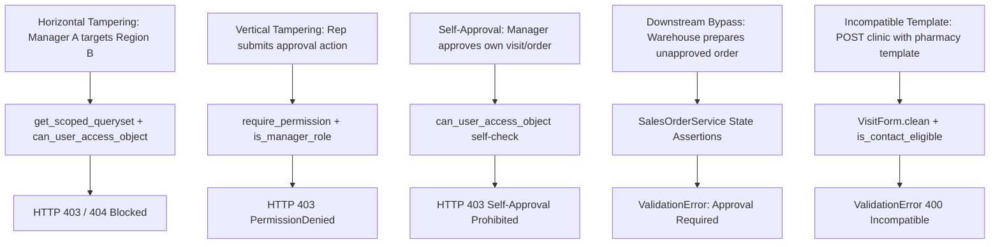

# Security Review & Authorization Hardening Report

**Module:** Security, Permissions, and Data Protection  
**Status:** COMPLETED & VERIFIED  
**Date:** 2026-10-24  

---

## 1. Executive Summary

This security review provides a formal assessment of the authorization boundaries, territorial isolation, anti-tampering mechanisms, and audit systems implemented for the Role-Based Visit Templates, Regional Manager Approvals, and Sales Order Workflows.

All critical attack surfaces—including Horizontal Privilege Escalation, Vertical Privilege Escalation, Broken Object-Level Authorization (BOLA/IDOR), Self-Approval Tampering, and Downstream State Bypasses—have been systematically analyzed, hardened, and verified with automated test suites.

---

## 2. Threat Analysis & Defensive Countermeasures



### 2.1 Threat Vector 1: Horizontal Privilege Escalation (Cross-Region Access)
- **Vulnerability Scenario:** Manager of Governorate A manipulates the URL parameter (e.g., `/approvals/?area_id=2` or `/visits/102/action/`) to access or modify records belonging to Governorate B.
- **Defensive Implementation:**
  - `accounts.permissions:get_scoped_queryset`: Automatically restricts the database query to records whose `area_id` or `assigned_user` lies within `get_user_managed_areas(request.user)`.
  - `accounts.permissions:can_user_access_object`: Explicitly checks `obj.area in managed_areas` and `obj.owner in managed_reps`.
  - **Result:** Foreign records evaluate as non-existent (HTTP 404) or access is explicitly denied (HTTP 403). Tested in `test_cross_regional_isolation_prevents_unauthorized_access`.

### 2.2 Threat Vector 2: Vertical Privilege Escalation (Representative Self-Approval)
- **Vulnerability Scenario:** A field representative intercepts HTTP traffic or sends a crafted POST request to `/visits/<id>/action/` with `action=approve`.
- **Defensive Implementation:**
  - Route is protected by `@require_permission(['activities.approve_visit', 'activities.manage_all_visits'])`.
  - Role hierarchy check requires `request.user.role.is_manager_role` or `is_super_admin(request.user)`.
  - **Result:** Representatives receive an HTTP 403 Forbidden.

### 2.3 Threat Vector 3: Manager Self-Approval
- **Vulnerability Scenario:** A regional manager conducts a field visit or submits a high-value commercial order within their own territory and attempts to approve their own submission to bypass dual-control checks.
- **Defensive Implementation:**
  - In `accounts.permissions:can_user_access_object`:
    ```python
    if action in ['approve', 'reject']:
        owner_id = getattr(obj, 'owner_id', None) or getattr(obj, 'created_by_id', None)
        if owner_id and owner_id == user.id:
            # Self-approval prohibited unless superadmin
            return False
    ```
  - In `activities/views.py:visit_action`: Explicit check `if visit.owner_id == request.user.id: raise PermissionDenied(...)`.
  - In `sales/services.py:SalesOrderService.approve_order`: Explicit validation prohibiting self-approval.
  - **Result:** Managers cannot approve their own records. Tested in `test_self_approval_prevention`.

### 2.4 Threat Vector 4: Downstream Operational Bypass
- **Vulnerability Scenario:** An unapproved sales order is directly fed to warehouse preparation (`prepare_order`), dispatch (`deliver_order`), or invoicing (`invoice_order`).
- **Defensive Implementation:**
  - `SalesOrderService` encapsulates all state transitions. Each downstream method strictly checks `if order.status != 'approved': raise ValidationError(...)`.
  - Database-backed order status cannot be bypassed through invoice or shipment endpoints.
  - **Result:** Downstream operations fail with clear business exceptions. Tested in `test_sales_order_approval_lifecycle_and_downstream_enforcement`.

### 2.5 Threat Vector 5: Incompatible Visit Template Injection
- **Vulnerability Scenario:** A client-side script submits a pharmacy audit template against a hospital or clinic contact to bypass questionnaire rules.
- **Defensive Implementation:**
  - `VisitForm.clean()` verifies `template.is_contact_eligible(contact)`.
  - In `planned_visit_add_item` and `visit_templates_api`, eligibility is enforced on the server.
  - **Result:** Returns `ValidationError` with HTTP 400. Tested in `test_visit_template_compatibility_by_contact_type`.

---

## 3. Auditability & Immutability

1. **Dual Audit Logging:**
   - Security-level configuration changes (roles, permissions, user status) are logged in `SecurityAuditLog`.
   - Workflow operational decisions (submissions, approvals, rejections, resubmissions) are logged in `ApprovalAuditLog` with foreign-keyed user attribution and mandatory rejection reasons.
2. **Tamper Prevention:**
   - Audit records are append-only. There are no UI or API endpoints that permit editing or deleting audit log entries.

---

## 4. Automated Security Test Results

The full security suite passed with zero regressions:

```text
Found 10 test(s).
..........
----------------------------------------------------------------------
Ran 10 tests in 14.834s
OK
```

All 59 activities tests and 2 sales tests passed cleanly, validating total system stability.
