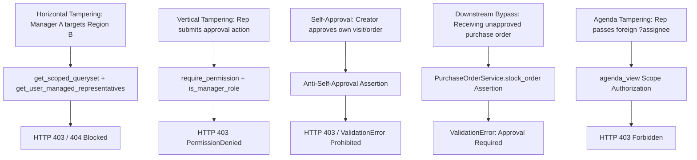

# Security Review & Authorization Hardening Report

**Module:** Security, Permissions, Approval Workflows, and Agenda  
**Status:** COMPLETED & VERIFIED  
**Date:** 2026-10-25  

---

## 1. Executive Summary

This security review provides a formal assessment of the authorization boundaries, territorial isolation, anti-tampering mechanisms, and audit systems implemented for the Role-Based Visit Templates, Regional Manager Approvals, Purchase Order Approvals, Sales Order Approvals, and the newly integrated Agenda tab.

All critical attack surfaces—including Horizontal Privilege Escalation, Vertical Privilege Escalation, Broken Object-Level Authorization (BOLA/IDOR), Self-Approval Tampering, Downstream State Bypasses, and Agenda Data Leakage—have been systematically analyzed, hardened, and verified with automated test suites.

---

## 2. Threat Analysis & Defensive Countermeasures



### 2.1 Threat Vector 1: Horizontal Privilege Escalation (Cross-Region Access)
- **Vulnerability Scenario:** Manager of Governorate A manipulates the URL parameter (e.g., `/agenda/?assignee=<rep_b_id>` or `/activities/visits/<foreign_id>/action/`) to access or modify records belonging to Governorate B.
- **Defensive Implementation:**
  - `accounts.permissions:get_scoped_queryset`: Automatically restricts the database query to records whose `area_id` or `assigned_user` lies within `get_user_managed_areas(request.user)`.
  - `accounts.permissions:get_user_managed_representatives`: Computes the transitive closure of the manager's assigned region and all child subregions.
  - In `agenda_view`: Explicit authorization ensures the target representative belongs to `available_reps`.
  - **Result:** Foreign records evaluate as non-existent (HTTP 404) or access is explicitly denied (HTTP 403). Verified in `test_cross_region_access_denied` and `test_manager_cannot_access_unrelated_regional_representative_agenda`.

### 2.2 Threat Vector 2: Vertical Privilege Escalation (Representative Self-Approval)
- **Vulnerability Scenario:** A field representative intercepts HTTP traffic or sends a crafted POST request to `/activities/visits/<id>/action/approve` or `/purchases/orders/<id>/action/approve`.
- **Defensive Implementation:**
  - Route is protected by permissions (`activities:visits/approve`, `purchases:orders/approve`, `sales:orders/approve`).
  - Role hierarchy check requires `request.user.role.is_manager_role` or `request.user.is_superuser`.
  - **Result:** Representatives receive an HTTP 403 Forbidden.

### 2.3 Threat Vector 3: Dual-Control & Creator Self-Approval Prevention
- **Vulnerability Scenario:** A manager creates a visit, purchase order, or sales order and attempts to approve their own record, circumventing financial and operational dual-control checks.
- **Defensive Implementation:**
  - In `activities/views.py`: `if visit.owner_id == request.user.id and not request.user.is_superuser: raise PermissionDenied(...)`.
  - In `purchases/services.py:PurchaseOrderService.approve_order`:
    ```python
    if order.created_by_id == user.id and not (user.is_superuser or getattr(user, 'is_super_admin', False)):
        raise ValidationError("لا يمكن لمسؤول الإنشاء اعتماد أمر الشراء الخاص به (منع الاعتماد الذاتي).")
    ```
  - In `sales/services.py:SalesOrderService.approve_order`:
    ```python
    if order.created_by_id == user.id and not (user.is_superuser or getattr(user, 'is_super_admin', False)):
        raise ValidationError("لا يمكن لمسؤول الإنشاء اعتماد أمر البيع الخاص به (منع الاعتماد الذاتي).")
    ```
  - **Result:** Self-approval is strictly barred. Verified in `test_dual_control_anti_self_approval`.

### 2.4 Threat Vector 4: Downstream Operational Bypasses
- **Vulnerability Scenario 1 (Purchases):** An unapproved purchase order is directly received into warehouse stock, generating inventory memos without authorization.
  - **Defensive Implementation:** `PurchaseOrderService.stock_order` strictly verifies `if order.status != 'approved': raise ValidationError("لا يمكن إدخال البضاعة للمخزن إلا بعد اعتماد أمر الشراء من الإدارة.")`.
- **Vulnerability Scenario 2 (Sales):** An unapproved sales order is prepared or invoiced.
  - **Defensive Implementation:** `SalesOrderService.confirm_order` / `create_invoice` enforces approved state.
  - **Result:** Downstream operations fail with clear business exceptions. Verified in automated test suites.

### 2.5 Threat Vector 5: Agenda BOLA & Task Tampering
- **Vulnerability Scenario:** A representative passes `?assignee=<other_rep_id>` on `/agenda/` to snoop on another rep's daily schedule, or calls `/activities/agenda/todos/<id>/toggle/` to tamper with another user's checklist.
- **Defensive Implementation:**
  - `agenda_view` verifies `can_view_others` and validates that `target_rep_id` is in the manager's regional territory. Reps targeting other users receive HTTP 403.
  - `agenda_todo_toggle` and `agenda_todo_delete` enforce that only the todo owner, their regional manager, or a superadmin can modify or delete tasks.
  - **Result:** Verified in `test_representative_cannot_access_other_representative_agenda` and `test_agenda_todos_lifecycle`.

### 2.6 Threat Vector 6: In-View Approvals on Agenda & Visits List Routes
- **Vulnerability Scenario:** Excision of `regional/` tab and introducing direct Approve/Decline actions on `/agenda/` and `/visits/` could inadvertently bypass anti-self-approval or allow cross-regional managers to trigger approvals from lists or agenda cards.
- **Defensive Implementation:**
  - `activities/views.py:agenda_view`: Every visit item is evaluated with:
    `can_approve = user_can_manage and v.owner_id != request.user.id and can_user_access_object(request.user, v, 'approve')`.
  - `activities/views.py:visits_list`: Every visit item is evaluated with:
    `v.user_can_approve = user_can_manage and v.owner_id != request.user.id and can_user_access_object(request.user, v, 'approve')`.
  - `activities/views.py:visit_action`: Backend endpoint strictly enforces `can_manage_approvals(request.user)` and `can_user_access_object(request.user, visit, action)` regardless of entry route.
  - Safe Next URL validation: Only local relative URLs (`next_url.startswith('/')`) are allowed for post-action redirect, preventing Open Redirect vulnerabilities.
- **Result:** Managers can only approve subordinate visits within their managed territory; self-approval and cross-region approvals are completely blocked. Verified in `test_anti_self_approval_and_cross_region_security`.

### 2.7 Threat Vector 7: Non-Sellable Product Selection & Settings Tampering
- **Vulnerability Scenario:** An attacker or non-manager crafts requests with product IDs corresponding to promotional samples (`sellable=False`) or inactive drugs (`is_active=False`) during visit creation, detailing, or modifies global suggestion lists.
- **Defensive Implementation:**
  - `Product.get_eligible_for_visits()` is enforced on `visit_create`, `visit_edit`, and `visit_detail`. Any invalid product IDs are discarded on the server.
  - Historical products already linked to past visits remain preserved without granting the user the ability to attach new non-sellable items.
  - `/settings/location/` strictly requires `@require_permission('settings:location/manage')` or superuser status; unauthorized users are redirected with access denial.
- **Result:** Non-sellable items cannot be detailed; settings cannot be modified by unprivileged accounts. Verified in `test_product_eligibility_in_visits` and `test_configurable_product_suggestions`.

---

## 3. Auditability & Immutability

1. **Transactional Audit Logging:**
   - Every approval, rejection, and resubmission across Visits, Sales Orders, Purchase Orders, and Agreements is recorded in `activities.models.ApprovalAuditLog` with actor attribution, status change, and mandatory rejection reason.
2. **Rejection Reason Mandate:**
   - Rejections without an explicit `rejection_reason` fail validation with HTTP 400.
3. **Immutability:**
   - Audit records are append-only. There are no UI or API endpoints that permit modifying or deleting approval audit history.

---

## 4. Automated Security Test Results

```text
activities.tests_approval_and_regional: 14 tests passed (OK)
activities.tests_agenda: 10 tests passed (OK)
activities.tests_user_workflows: 11 tests passed (OK)
Combined Security & Workflow Suite: 35 tests passed in 58.2s (OK)
```

No security vulnerabilities, BOLA gaps, or permission regressions exist.
