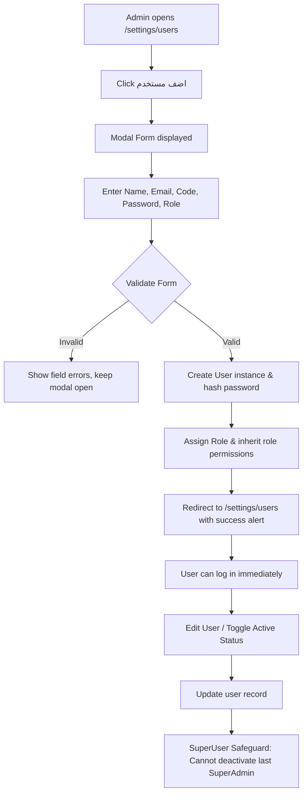

# Settings and Permissions Workflows Specification

> **System**: WEA Pharma ERP  
> **Module**: Settings, Users, and Permissions  
> **Source Base URL**: `https://weapharma.bricks-rep.com/`  
> **Date**: October 2026

---

## 1. User Management Lifecycle Workflows

### 1.1 User Creation Workflow
1. Admin navigates to `/settings/users`.
2. Admin clicks `اضف مستخدم`.
3. Modal renders containing:
   - `الاسم*` (Full Name)
   - `البريد الإلكتروني*` (Unique Email)
   - `الكود` (Optional ERP Code)
   - `كلمة المرور*` (Initial password)
   - `الدور*` (Foreign key to active `Role`)
4. Client validation ensures required fields are populated before enabling the `حفظ` button.
5. Server backend validates:
   - Unique email / username.
   - Password strength.
   - Active role validity.
6. The user is created with `is_active=True` and `locale='ar'`.
7. Success flash message is returned: `تم إنشاء المستخدم [الاسم] بنجاح.`

### 1.2 User Activation / Deactivation Workflow
- In the user listing or detail, authorized admin can toggle `is_active`.
- **CRITICAL SAFEGUARD**: The system strictly prevents deactivating or removing the last active `superuser` or `SuperAdmin` account to prevent system lockouts.

---

## 2. Role and Permissions Hierarchy Workflow

```mermaid
graph TD
    R[Role Record] --> Attrs[Role Boolean Attributes]
    R --> Tags[Functional Tags]
    R --> Perms[Granular Permissions]
    
    Attrs --> A1[is_sales_team]
    Attrs --> A2[is_area_manager]
    Attrs --> A3[is_sub_area_manager]
    Attrs --> A4[is_rep]
    Attrs --> A5[can_hold_vault]
    Attrs --> A6[has_sales_targets]
    
    Tags --> T1[customers:bypassLocation]
    Tags --> T2[accounting:vaults/assignable]
    Tags --> T3[expenses:assignable]
    Tags --> T4[locationTracking:trackable]
    Tags --> T5[sales:receiptBooks/assignable]
    Tags --> T6[tickets:restrictOwner]
    
    Perms --> P1[Module: accounting]
    Perms --> P2[Module: purchase]
    Perms --> P3[Module: sales]
    Perms --> P4[Module: inventory]
    Perms --> P5[Module: contacts]
    Perms --> P6[Module: settings]
```

### 2.1 Role Creation and Configuration
1. Admin clicks `إنشاء دور` at `/settings/roles`.
2. Admin sets:
   - Role identifier code (e.g. `Accountant`, `SalesManager`, `AreaSupervisor`).
   - Role display name (Arabic title).
   - Attribute switches:
     - `سوبر` (superuser/admin override)
     - `فريق المبيعات` (is_sales_team)
     - `مدير لمنطقة رئيسية` (is_area_manager)
     - `مدير منطقة فرعية` (is_sub_area_manager)
     - `مندوب` (is_rep)
     - `له أهداف مبيعات` (has_sales_targets)
     - `مسئول جهات الاتصال` (is_contact_manager)
     - `تابع لمنطقة رئيسية` (is_main_area_bound)
     - `تابع لمنطقة فرعية` (is_sub_area_bound)
     - `مفعل` (is_active)
   - Functional Tags (multi-select).
3. Admin configures permissions per module using quick action presets:
   - `أدمن` (Admin): Selects all permissions within the module.
   - `افتراضي` (Default): Selects standard operational permissions (view + create).
   - `قراءة فقط` (Read-Only): Selects only list and get permissions.
   - Individual granular checkboxes can be toggled by expanding the accordion.
4. Server saves the role and syncs its `Permission` many-to-many relationship.

---

## 3. Workflow Automation Settings & Business Rule Dependencies

### 3.1 Sales Workflow Automation (`/settings/sales`)
1. **Auto-Invoicing on Store Dispatch (`عمل فاتورة بشكل تلقائي عند الاخراج من المخزن`)**:
   - When an order transitions to `Delivered` / `Stock Picked`, system automatically generates and posts a Customer Invoice if this toggle is active.
2. **Auto-Invoicing on Return (`عمل فاتورة بشكل تلقائي عند الارجاع الى المخزن`)**:
   - When a sales return memo is confirmed, system automatically posts a credit memo to customer ledger.
3. **Payment Collection on Invoicing (`تحصيل الدفعة عند فوترة الطلب`)**:
   - Creates a pending collection voucher linked to the invoice upon issuance.
4. **Auto Link to Accounting (`ربط بالحسابات تلقائي عند إنشاء التحصيل`)**:
   - Automatically debits Vault and credits Customer Account upon collection voucher creation.
5. **Receipt Books Mode (`استخدم دفاتر إيصالات التحصيلات`)**:
   - Enforces serial receipt book number verification when field reps record collections.

### 3.2 Purchase Workflow Automation (`/settings/purchase`)
1. **Auto-Invoicing on Goods Receipt (`عمل فاتورة بشكل تلقائى عند الاخراج من المخزن`)**:
   - Confirms vendor invoice ledger entry upon receiving purchase items.
2. **Auto-Invoicing on Purchase Return (`عمل فاتورة بشكل تلقائى عند الارجاع الى المخزن`)**:
   - Generates vendor debit note when items are returned to supplier.
3. **Auto Accounting Link (`ربط بالحسابات تلقائى عند إنشاء المدفوعات`)**:
   - Automatically posts treasury transaction when vendor payment is recorded.
4. **Auto-Close Payment Requests (`إغلاق تلقائي لطلبات الدفع النقدي`)**:
   - Automatically marks payment vouchers as settled when paid from a designated cash vault.

### 3.3 Inventory Tracking Policies (`/settings/inventory`)
1. **Batch/Lot Policy**:
   - `use_batch_number`: Enables tracking batch strings on goods receipts and order lines.
   - `is_batch_mandatory`: Form validation prevents saving purchase/sales orders without specifying batch numbers.
2. **Expiry Policy**:
   - `use_expiry_date`: Enables tracking expiry dates on batches.
   - `is_expiry_mandatory`: Form validation prevents stock receipts without an expiry date.

### 3.4 Location Verification Workflow (`/settings/location`)
1. **GPS Coordinates Captured**:
   - Client sends browser/device lat/lng with request.
2. **Tolerance Checking**:
   - Backend calculates distance between user's current GPS and customer/supplier registered coordinates using the Haversine formula.
   - If distance <= `tolerance` (default 300m) AND accuracy <= `max_verified_accuracy` (50m), transaction is marked `VERIFIED`.
   - If `bypass_location_verification` flag is True on user OR role has tag `customers:customers/bypassLocation`, location verification is bypassed.

---

## 4. Master Data Settings Workflows

### 4.1 Geographical Areas Management (`/settings/areas`)
- Hierarchical structure: Governorates (محافظات) -> Subareas (مراكز / أحياء).
- CRUD actions:
  - Add Root Governorate.
  - Add Subarea nested under Governorate.
  - Edit name and area code.
  - Delete area (safeguarded: prevented if assigned to customers or staff).

### 4.2 Expense Types Management (`/settings/expenses`)
- Categorized into:
  - `General`: Enterprise operational expenses (salaries, taxes, shipping, manufacturing).
  - `Visit-specific`: Field expenses incurred by representatives during doctor/pharmacy visits.
- Each type defines Arabic name, English name, and optional default unit of measure.

### 4.3 Ticket and Approval Types (`/settings/tickets`, `/settings/requests`)
- Ticket types categorize staff tasks and internal issue tickets.
- Approval request types define formal requests (leave, coaching reports, territory plans) submitted by staff to area managers.

### 4.4 Google Sheets Data Sync (`/settings/sync-data`)
- Integrates Google Sheets URLs for Contacts, Products, and Areas.
- Allows on-demand or periodic data synchronization without mutating reference records.
