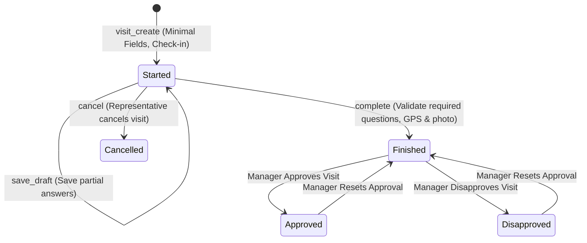

# Visit Lifecycle: Create First, Answer Later

## 1. Executive Summary & Paradigm Shift
In field medical operations, a representative checks into an account prior to engaging with the healthcare professional. Requiring the representative to fill out all questionnaire details and upload evidence inside the initial visit check-in form caused major operational issues:
- If a phone lost battery, crashed, or received an incoming call during the conversation, all answered questions were wiped out.
- Representatives were blocked from starting a visit until all details were known in advance.
- Accidental double-clicks led to duplicate visits.

The **Create First, Answer Later** lifecycle standardizes the visit process into two decoupled, resilient phases:
1. **Creation / Check-In Phase**: Fast, minimal creation of the visit record with `status='started'`. Locks representative, verifies account eligibility, records initial GPS, and establishes the visit record in the database.
2. **Execution / Answering Phase**: The representative enters the active visit dossier, conducts the meeting, records product detailing, answers dynamic questionnaire items, captures photo evidence, and saves draft progress or marks the visit completed.

---

## 2. State Machine & Status Transitions

### 2.1 State Definitions

| Status Code | Arabic Display | Badge Styling | Description |
|---|---|---|---|
| `started` | جارية (مسودة) | `bg-amber-50 text-amber-700 border-amber-200` | Visit record created and in-progress; questions can be answered incrementally and saved as draft. |
| `finished` | منتهية | `bg-emerald-50 text-emerald-700 border-emerald-200` | All required questions answered, location and photo verified, ended timestamp recorded. |
| `cancelled` | ملغاة | `bg-rose-50 text-rose-700 border-rose-200` | Visit aborted by representative or supervisor. |
| `planned` | مجدولة | `bg-blue-50 text-blue-700 border-blue-200` | Planned item awaiting execution. |

---

## 3. Two-Phase Workflow Details

### Phase 1: Visit Creation (`visit_create`)
- **Required Fields**:
  - `contact`: Selected customer (filtered by account-type eligibility).
  - `template`: Selected visit template.
  - `date`: Execution date (defaults to today).
  - `owner`: Locked to authenticated representative (unless superuser).
- **Anti-Duplicate Guard**: Checks if a visit for the same customer, owner, and `status='started'` was created within the last 60 seconds. If found, transparently redirects to the existing visit instead of creating a duplicate.
- **Persistence**:
  - Sets `status='started'`.
  - Sets `started_at = timezone.now()`.
  - Records initial check-in GPS coordinates and calculates initial distance.
  - Links to `PlannedVisitItem` if executed from planner.
- **Redirect**: Automatically forwards to `visit_detail` (`/visits/<pk>/`).

### Phase 2: Answering, Detailing, and Evidence (`visit_detail`)
When `visit.status == 'started'`, the screen renders the interactive questionnaire and completion card:
1. **Interactive Questions**:
   - Categorized by stage (`opening`, `presentation`, `agreement`, `objection`, `closing`, `feedback`).
   - Supports `single_choice`, `multiple_choice`, `boolean`, `rating`, `text`.
   - Client-side and server-side evaluation of conditional questions (`is_conditional`, `conditional_parent`, `conditional_trigger_value`).
2. **Product Detailing**:
   - Displayed **only** for supported templates: (1) Single DR, (2) Single Pharmacy, (3) Healthy Day.
   - Representatives check off products presented during the visit.
3. **Live Evidence Verification**:
   - Camera input with live preview and retake option (`capture="environment"`).
   - GPS re-acquisition and tolerance status indicator (300m).
   - Audited superuser bypass option if user has administrative rights.
4. **Draft Saving vs Completion**:
   - `action='save_draft'`: Saves current answers, product detailing, and feedback. Keeps `status='started'`. Can be resumed anytime.
   - `action='complete'`: Validates that all required questions have answers, validates location and photo evidence, records `ended_at` and duration, and transitions status to `'finished'`.
   - `action='cancel'`: Transitions status to `'cancelled'`.

---

## 4. Preservation of Answers on Validation Errors
If a representative submits `action='complete'` but forgot to answer a required question or attach photo evidence:
- The backend parses and persists all answered questions to `visit.questionnaire_answers`.
- Returns an explicit, localized validation error (e.g. `السؤال 'هل قابلت الطبيب؟' إلزامي لإتمام الزيارة`).
- The representative's work is never lost; they simply satisfy the missing requirement and re-submit.
