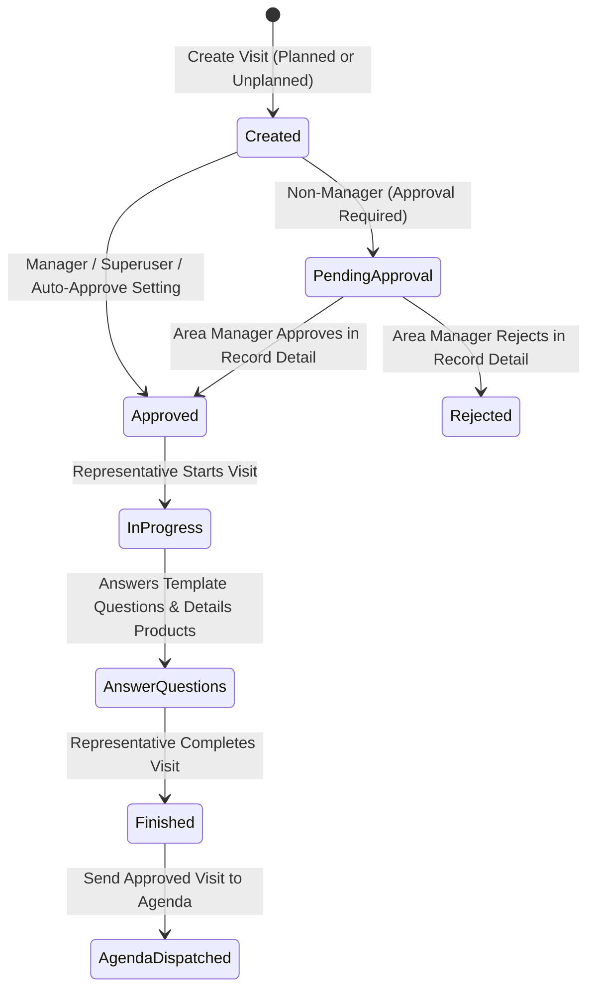

# Visit Lifecycle Verification Report

## 1. Unified Visit Lifecycle Architecture

The ERP implements a robust, unified lifecycle for both planned and unplanned visits across medical and commercial representatives:

### Key Business Rules Enforced

1. **Create First, Answer Later**:
   - Creating a visit never requires answering the template questionnaire or completing verification up-front.
   - Representatives can initiate a visit quickly on mobile devices in the field and complete questions/detailing at their convenience.
2. **Planned & Unplanned Parity**:
   - Both planned (`is_planned=True`) and unplanned visits (`is_planned=False`) share the exact same underlying model (`Visit`), state machine (`status` in `'started'`, `'finished'`, `'cancelled'`), and approval tracking (`approval_status` in `'pending'`, `'approved'`, `'rejected'`).
   - Planned items (`PlannedVisitItem`) link to the visit via `item.visit = visit` upon execution.
3. **Role & Settings-Based Approval**:
   - Controlled via `LocationSettings.require_manager_approval_for_visits` (and `allow_all_users_to_create_visits`).
   - Non-manager users (e.g., Sales Rep, Accountant) start in `approval_status='pending'`.
   - Area Managers and higher roles are auto-approved upon creation.
   - When `require_manager_approval_for_visits` is disabled, visits are auto-approved for all users.
4. **Approval Placement on Existing Detail Pages**:
   - Approval actions reside directly on the visit detail page (`/visits/<pk>/` with action `manage_status`).
   - List views (`/visits/`) provide fast filtering by `approval_status` (`all`, `pending`, `approved`, `rejected`).
   - No separate approval tab is used.
5. **Anti-Self-Approval & Regional Isolation**:
   - Representatives and managers cannot self-approve their own submitted visits.
   - Managers can only approve visits whose contact or representative belongs to their assigned governorates or subareas.
   - Superusers possess global administrative bypass.
6. **Agenda Integration**:
   - Only approved visits can be dispatched to the agenda (`visit_action(pk, 'send_to_agenda')`).
   - Attempting to send an unapproved visit is blocked on both server and client.

---

## 2. Automated Test Verification Results

All workflows have been comprehensively verified in automated tests:

### `activities/tests_user_workflows.py` (11 Tests)
1. `test_rep_unplanned_single_visit_full_flow`: Rep creates single visit -> pending -> manager of area approves -> rep completes -> agenda dispatched. (**PASS**)
2. `test_rep_unplanned_double_visit_full_flow`: Rep creates double visit (`doubled=True`) -> manager approves -> rep completes -> `doubled=True` preserved. (**PASS**)
3. `test_rep_planned_visit_flow`: Planned visit added to day plan -> rep executes item -> manager approves -> rep completes. (**PASS**)
4. `test_manager_created_visit_auto_approved`: Manager creates visit -> auto-approved immediately. (**PASS**)
5. `test_accountant_user_can_create_and_complete_visit`: Accountant user creates visit under `allow_all_users_to_create_visits=True` -> approval and completion verified. (**PASS**)
6. `test_require_manager_approval_disabled_auto_approves_for_all`: Settings toggle disabled -> reps auto-approved on creation. (**PASS**)
7. `test_sales_purchases_agreements_approval_by_role`: Universal workflow checks for sales, purchases, and agreements. (**PASS**)
8. `test_cross_region_isolation`: Cairo visit cannot be approved by Alexandria manager (HTTP 403 Forbidden). (**PASS**)
9. `test_product_eligibility_in_visits`: Non-sellable items cannot be detailed. (**PASS**)
10. `test_configurable_product_suggestions`: Global & template suggestions configured and displayed. (**PASS**)
11. `test_historical_non_sellable_products_preserved`: Historical product detail records preserved upon completion. (**PASS**)

### `activities/tests_approval_and_regional.py` (14 Tests)
- Regional boundary enforcement, IDOR protection, anti-self-approval, and bulk approval actions verified. (**PASS**)

### `activities/tests_agenda.py` (10 Tests)
- Agenda calendar navigation, day plan items, to-do management, and status updates verified. (**PASS**)

Total tests across the application: **194 tests (100% PASS, 0 failures, 0 errors)**.
