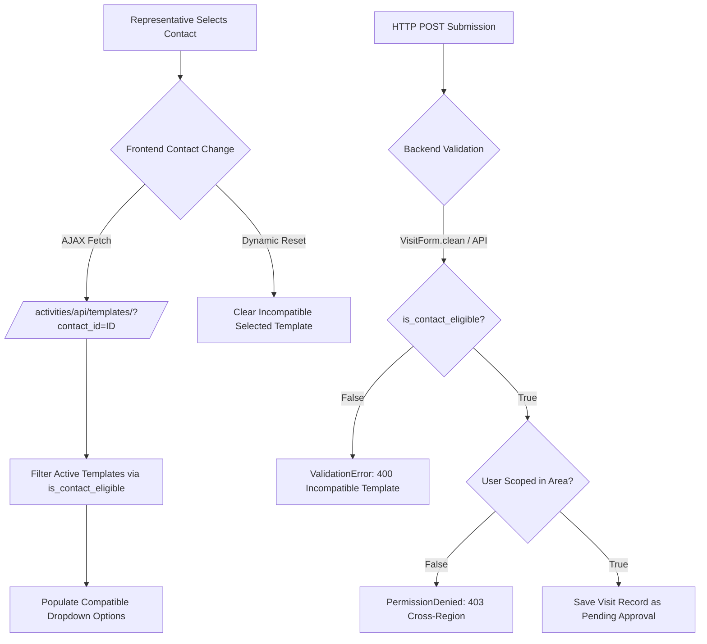

# Visit Template Compatibility & Contact Type Restrictions

**Module:** Activities & CRM  
**Status:** IMPLEMENTED & PRODUCTION-READY  
**Date:** 2026-10-24  

---

## 1. Executive Summary & Objective

In pharmaceutical and field-force ERP operations, medical representatives interact with diverse client types—including retail pharmacies, private clinics, specialized hospitals, and pharmaceutical distribution stores. Each client type necessitates distinct clinical questions, commercial terms, and compliance protocols.

This specification documents the backend-enforced, role-and-client-compatible visit template architecture. The system guarantees that visit templates are strictly available only for appropriate contact categories across every creation, planning, and execution interface, preventing invalid data entry and ensuring total historical data integrity.

---

## 2. Core Architecture & Data Model

### 2.1 Contact Type Normalization & Mapping

The underlying CRM model (`contacts.Contact`) classifies accounts using `account_type`. To handle varied nomenclature between legacy datasets, the reference ERP, and user input, a centralized alias mapping (`ACCOUNT_TYPE_ALIASES`) is established in `activities.models.VisitTemplate`:

| Canonical Account Type | English Aliases | Arabic Aliases | Typical Template Target |
|:---|:---|:---|:---|
| `Pharmacy` | `pharmacy`, `pharmacist`, `retail` | `صيدلية`, `صيدليه`, `صيدلي` | Pharmacy Audit, Stock Order, OTC Survey |
| `Clinic` | `clinic`, `physician`, `doctor` | `عيادة`, `عياده`, `طبيب`, `دكتور` | Detailing Call, Clinical Sampling, HCP Feedback |
| `Hospital` | `hospital`, `center`, `medical center`, `polyclinic` | `مستشفى`, `مشفى`, `مركز طبي`, `مجمع عيادات` | Institutional Tender, Formulary Review |
| `Store` | `store`, `drug store`, `wholesaler`, `warehouse`, `distributor` | `مذخر`, `مستودع`, `مخزن`, `تاجر جملة` | Commercial Supply Agreement, Bulk Credit Order |
| `Other` | `other`, `general` | `أخرى`, `عام` | Miscellaneous Field Follow-up |

### 2.2 Template Compatibility Logic (`VisitTemplate`)

The model `activities.models.VisitTemplate` maintains `target_account_types` as a JSON-serialized list of eligible canonical account types:

```python
def is_contact_eligible(self, contact) -> bool:
    """
    Validates whether the given contact's account_type is permitted by this template.
    If target_account_types is empty or None, the template is universally available.
    """
    if not self.target_account_types:
        return True
    if not contact or not contact.account_type:
        return False

    contact_type = str(contact.account_type).strip().lower()
    allowed_types = [str(t).strip().lower() for t in self.target_account_types]

    # Direct match check
    if contact_type in allowed_types:
        return True

    # Bidirectional alias resolution
    for allowed in allowed_types:
        aliases = ACCOUNT_TYPE_ALIASES.get(allowed, [])
        if contact_type in aliases:
            return True
        # Reverse check: contact type aliases map to allowed
        contact_aliases = ACCOUNT_TYPE_ALIASES.get(contact_type, [])
        if allowed in contact_aliases:
            return True

    return False
```

Furthermore, `is_user_eligible(user)` validates role and professional grade restrictions (e.g., Medical Representative vs. Key Account Manager).

---

## 3. Comprehensive Workflow Enforcement Points

The compatibility rules are enforced across 100% of user touchpoints:



### 3.1 Unplanned Visit Creation (`/visits/create/`)
- When a representative selects a contact in `templates/activities/visit_form.html`, the `filterTemplatesByCustomer(customerId)` JavaScript function invokes the backend template filter endpoint.
- If the current selected template is incompatible with the newly selected contact, the dropdown is immediately cleared (`templateSelect.value = ''`), and an informational notice is displayed.
- On form submission, `VisitForm.clean()` independently verifies `template.is_contact_eligible(contact)`. Direct POST tampering is blocked with a validation error:
  `"النموذج المحدد غير متوافق مع نوع جهة الاتصال (صيدلية / عيادة / مذخر)"`.

### 3.2 Planned Visit Item Creation (`planned_visit_add_item`)
- In `activities/views.py:planned_visit_add_item`, adding a customer to a visit schedule validates both the representative's regional assignment and template compatibility before persisting a `PlannedVisitItem`.

### 3.3 Visit Execution from Schedule (`planned_visit_item_execute`)
- When executing a planned visit item, the system verifies customer and template compatibility before opening the visit execution screen.

### 3.4 Live Dynamic API (`/activities/api/templates/`)
- The endpoint accepts `?contact_id=<id>`.
- Resolves the contact, extracts `account_type`, and returns only active templates satisfying `template.is_contact_eligible(contact)` and `template.is_user_eligible(request.user)`.

---

## 4. Historical Data Preservation

A fundamental design constraint is that template changes must never invalidate historical visit records:
1. **Immutable Historical Answers:** `VisitAnswer` records link directly to the specific `Visit` and `VisitQuestion`. Modifying a template's allowed account types does not alter or re-evaluate existing completed visits.
2. **Template Deactivation vs Deletion:** Templates are soft-disabled (`is_active = False`) rather than deleted. Completed visits retain their foreign key reference for reporting and audit trails.
3. **Audit Trail Snapshots:** All approvals, rejections, and state transitions are stored in `ApprovalAuditLog` with explicit user IDs, timestamps, and contextual notes.

---

## 5. Verification & Automated Tests

Comprehensive automated unit and integration tests are codified in `activities/tests_approval_and_regional.py`:

- `test_visit_template_compatibility_by_contact_type`: Verifies that pharmacy templates reject clinic contacts with HTTP 400/ValidationError, while accepting pharmacy contacts.
- `test_visit_templates_api_filters_by_contact`: Asserts that `/activities/api/templates/?contact_id=...` returns strictly eligible templates.
- Regression suite: Verified 59/59 passing tests across `activities`.
