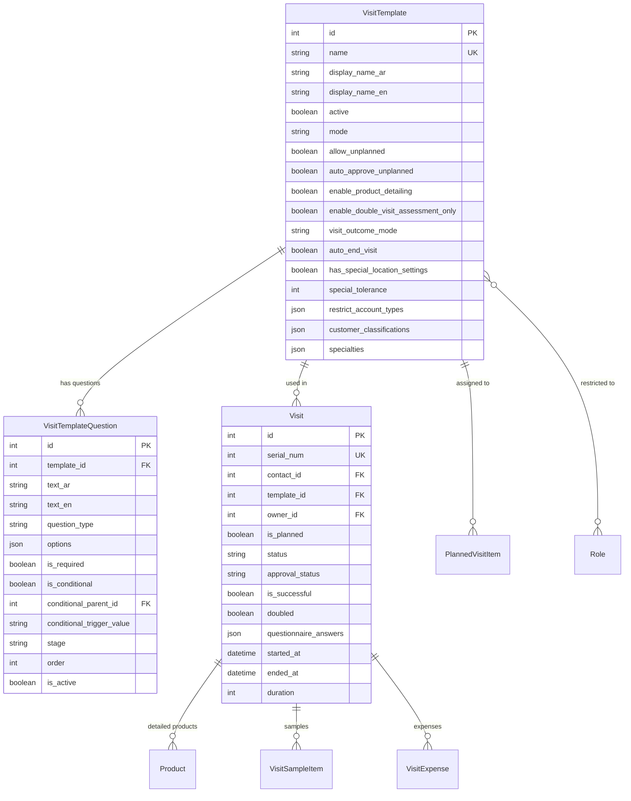

# Visit Template Data Model & Schema (هيكل ونموذج بيانات قوالب الزيارات)

> **Module**: `activities`  
> **Target Models**: `VisitTemplate`, `VisitTemplateQuestion`, `Visit`, `PlannedVisitItem`

---

## 1. Entity Relationship Diagram (ERD)

---

## 2. Field Specifications

### `VisitTemplate` Model Attributes
| Field | Type | Description |
|---|---|---|
| `name` | `CharField(100, unique=True)` | Internal slug / code identifier |
| `display_name_ar` | `CharField(150)` | Arabic display title |
| `display_name_en` | `CharField(150)` | English display title |
| `active` | `BooleanField(default=True)` | Active status switch |
| `mode` | `CharField(50, default='checkin_checkout')` | Mode (`checkin_checkout`, `normal`) |
| `allow_unplanned` | `BooleanField(default=True)` | Enable unplanned visits |
| `auto_approve_unplanned` | `BooleanField(default=True)` | Auto-approval for unplanned visits |
| `enable_product_detailing`| `BooleanField(default=True)` | Render product detailing section |
| `enable_double_visit_assessment_only` | `BooleanField(default=False)` | Assessment double visit toggle |
| `visit_outcome_mode` | `CharField(50, default='enabled_auto_approve_unsuccessful')` | Outcome mode |
| `auto_end_visit` | `BooleanField(default=False)` | Auto-end visit toggle |
| `has_special_location_settings` | `BooleanField(default=False)` | Special GPS settings toggle |
| `special_tolerance` | `PositiveIntegerField(default=300)` | Special GPS radius in meters |
| `restricted_roles` | `ManyToManyField(Role)` | Role constraints |
| `restrict_account_types` | `JSONField(default=list)` | Target account types (Clinic, Pharmacy, etc.) |
| `customer_classifications` | `JSONField(default=list)` | Target customer tiers |
| `specialties` | `JSONField(default=list)` | Target specialties |

### `VisitTemplateQuestion` Model Attributes
| Field | Type | Description |
|---|---|---|
| `template` | `ForeignKey(VisitTemplate, on_delete=CASCADE)` | Parent template |
| `text_ar` | `CharField(255)` | Question title (Arabic) |
| `text_en` | `CharField(255, blank=True)` | Question title (English) |
| `question_type` | `CharField(50, choices=...)` | `single_choice`, `multiple_choice`, `text`, `textarea`, `number`, `date`, `rating` |
| `options` | `JSONField(default=list)` | Options list: `[{'text_ar': ..., 'text_en': ..., 'value': ...}]` |
| `is_required` | `BooleanField(default=True)` | Mandatory validation flag |
| `is_conditional` | `BooleanField(default=False)` | Conditional display flag |
| `conditional_parent` | `ForeignKey('self', null=True)` | Triggering question |
| `conditional_trigger_value` | `CharField(255, blank=True)` | Value triggering visibility |
| `stage` | `CharField(50, default='all')` | `all`, `start_only`, `end_only` |
| `order` | `PositiveIntegerField(default=1)` | Display order index |
| `is_active` | `BooleanField(default=True)` | Active question switch |

### `Visit` Model Updates
- `detailed_products`: `ManyToManyField('catalog.Product', blank=True, related_name='detailed_in_visits')`
- `questionnaire_answers`: `JSONField(default=dict, blank=True)` (Stores question answers by question ID or title).
- `visit_outcome`: `CharField(max_length=50, blank=True, default='')`
