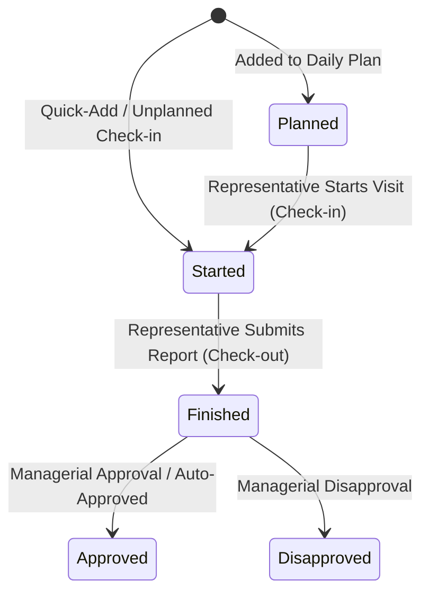

# Visit Templates Workflows & Lifecycle Integration (سير العمل وتكامل القوالب)

> **System**: WEA Pharma ERP  
> **Applies to**: Planned Visits, Unplanned Visits, Representative Check-in/Check-out, and Managerial Approvals

---

## 1. Lifecycle State Machine

### Lifecycle States Defined:
1. **Planned (`planned`)**: The visit is scheduled on a `PlannedVisitDay`. A template may be pre-assigned based on the target customer's account type (e.g. `Single visit (DR)` for clinic doctors; `Single visit (Pharmacy)` for pharmacies).
2. **Started / Check-in (`started`)**:
   - The representative arrives at the customer's location.
   - GPS coordinates and device accuracy are captured.
   - Haversine distance is calculated against customer's registered coordinates.
   - Template questions marked as `start_only` (e.g. `هل كان يوم ناجح ؟` or `Set an objective for the visit`) are presented and answered.
3. **Finished / Completion (`finished`)**:
   - Representative details products (`المنتجات المشروحة`) if `enable_product_detailing` is active.
   - Representative answers completion questions (and any conditional follow-ups).
   - Samples distributed (`VisitSampleItem`) are recorded.
   - Visit outcome (`زيارة ناجحة ؟`) is recorded.
   - Timestamp and duration are sealed.
4. **Approval (`approval_status`)**:
   - If template has `auto_approve_unplanned=True` and visit is unplanned, status transitions automatically to `approved`.
   - Otherwise, status transitions to `pending` awaiting Area Manager / Supervisor review.

---

## 2. Integration Entry Points

### Workflow A: Planned Visit Execution
1. Representative opens `/planned-visits/`.
2. Clicks `بدء الزيارة` on a planned visit item.
3. System routes to `/visits/create/?contact_id=<id>&planned_item_id=<id>&template_id=<template_id>`.
4. Template and customer context are locked to the planned record.
5. Upon saving, `PlannedVisitItem.is_executed` is set to `True` and linked to the resulting `Visit`.

### Workflow B: Unplanned Visit Creation (FAB & Visits List)
1. Representative clicks `+` Floating Action Button → `تسجيل زيارة خارج الخطة` or visits `/visits/create/`.
2. Selects customer via search or dropdown.
3. System filters the available templates according to the customer's `account_type`:
   - Doctors / Clinics → `Single visit (DR)`, `Coaching visit (DR)`, `Healthy day`.
   - Pharmacies → `Single visit (Pharmacy)`, `Coaching visit (Pharmacy)`, `Healthy day`.
   - Stores / Distributors → `Store & Distributor visit`.
4. Dynamically renders questions and product detailing controls.
5. Saves answers into `visit.questionnaire_answers` and links `detailed_products`.

### Workflow C: Visit Editing & Historical Preservation
1. When viewing a recorded visit at `/visits/<id>/`, representative or manager can edit feedback and answers via `/visits/<id>/edit/`.
2. Previously saved questionnaire answers are restored into their corresponding form inputs.
3. Modifications are validated against required fields without losing historical integrity.
