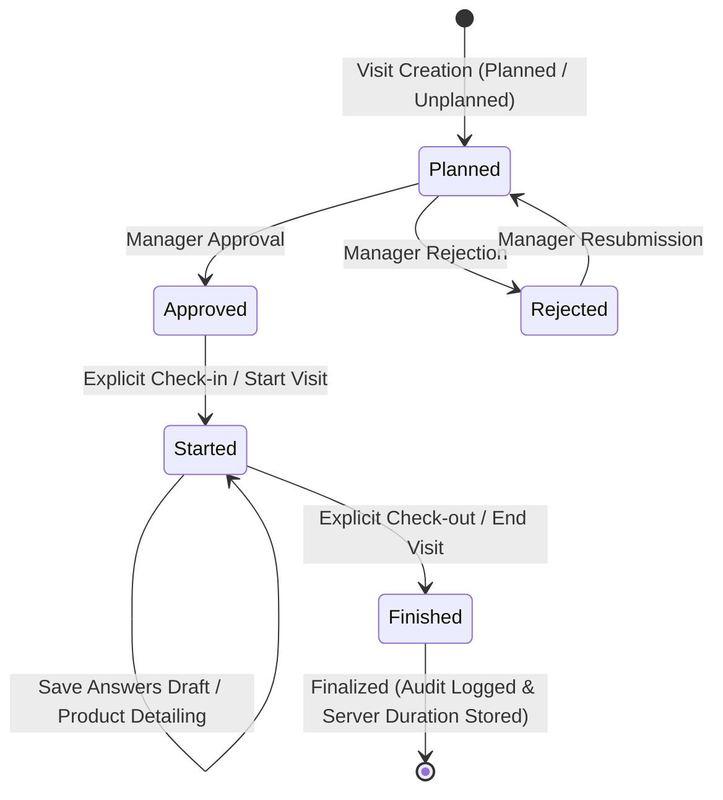

# Standardized Visit Workflow & Lifecycle State Machine

**Project:** WEA Pharma ERP  
**Module:** Activities Subsystem (`activities`)  
**Specification:** Unified Visit Lifecycle  

---

## 1. Overview & Core Principles

All visits in the ERP—whether **Planned** (initiated from a predefined visit plan day) or **Unplanned** (created ad-hoc from quick-add or floating shortcuts)—follow a **single, unified lifecycle state machine**.

The planned vs. unplanned distinction is preserved strictly as a business classification and reporting dimension (`is_planned=True/False`), but **does not create different approval, check-in, execution, or completion behaviors**.

---

## 2. Standardized Lifecycle State Diagram

---

## 3. Lifecycle States & Transitions

| State Name | Database `status` | Meaning | Allowed Actions | Authorized Roles |
| :--- | :--- | :--- | :--- | :--- |
| **Planned** (Created) | `planned` | Visit record created; pending managerial review or auto-approved (if manager/superuser). Cannot be started if pending approval. | `approve`, `reject`, `edit`, `delete` | Rep / Owner (create, edit), Manager / Superuser (approve, reject) |
| **Approved** | `planned` (`approval_status='approved'`) | Approved by manager. Ready for representative to visit the contact location. | `start` (Check-in) | Assigned Representative / Superuser |
| **Started** (In Progress) | `started` | Representative arrived at customer location, completed explicit Check-in. GPS coordinates & timestamp recorded. | `save_draft`, `save_answers`, `end` (Check-out) | Assigned Representative / Superuser |
| **Finished** (Completed) | `finished` | Representative completed questionnaire, detailed products, captured photo evidence (if required), and explicitly checked out. | `view`, `export`, managerial review | All authorized roles |

---

## 4. Detailed Step-by-Step Execution Rules

### Step 1: Visit Creation
- **Endpoint:** `POST /activities/visits/create/` (Canonical unified route).
- **Behavior:**
  - Creates the visit record first in `status='planned'`.
  - Sets `is_planned=True` if linked to a `PlannedVisitItem`, or `False` if ad-hoc.
  - Validates contact eligibility against the selected template's allowed account types (`restrict_account_types`).
  - Validates user role eligibility against `VisitTemplate.restricted_roles`.
  - Enforces representative assignment locking: non-managers cannot create visits owned by another representative.
  - Sets `approval_status='pending'` (unless manager/superuser creates it or approval is globally disabled in `LocationSettings`).
  - Records initial device GPS coordinates and snapshot.

### Step 2: Manager Approval
- **Endpoint:** `POST /activities/visits/<id>/action/approve/`
- **Rules:**
  - Representatives cannot start a visit while `approval_status == 'pending'`.
  - Dual-control anti-self-approval is strictly enforced: representatives and non-executives cannot approve their own visits.
  - Regional territorial scoping is enforced: managers can only approve visits within their assigned areas/sub-areas.

### Step 3: Explicit Start Visit (Check-in)
- **Endpoint:** `POST /activities/visits/<id>/action/start/`
- **Rules:**
  - Explicit action by the representative or superuser.
  - Guarded by `can_start_visit(visit, user)`.
  - Must have `approval_status == 'approved'`.
  - Validates device location against customer location within tolerance (unless GPS bypass is authorized).
  - Captures server-side `started_at = timezone.now()`.
  - Sets `status = 'started'`.

### Step 4: Questionnaire & Product Detailing
- **Endpoint:** `POST /activities/visits/<id>/` with `action='save_draft'` or `action='save_answers'`.
- **Rules:**
  - Status remains `started`.
  - Representatives can save partial answers without ending the visit.
  - Validates conditional question logic (`conditional_parent` and `conditional_trigger_value`).
  - Only active, sellable products can be selected for detailing (`Product.get_eligible_for_visits()`).

### Step 5: Explicit End Visit (Check-out)
- **Endpoint:** `POST /activities/visits/<id>/action/end/` or `POST /activities/visits/<id>/` with `action='complete'`.
- **Rules:**
  - Guarded by `can_end_visit(visit, user, answers=...)`.
  - Requires all mandatory template questions to be answered.
  - Explicit action by the representative: submitting an answer draft, closing a modal, or navigating away **never** automatically completes a visit.
  - Captures server-side `ended_at = timezone.now()`.
  - Computes duration **strictly on the server**: `duration = max(1, int((ended_at - started_at).total_seconds()))`.
  - Verifies photo evidence and final GPS coordinates.
  - Transitions `status = 'finished'`.
  - If linked to a `PlannedVisitItem`, updates `planned_item.is_executed = True`.
  - Writes an immutable record to `ApprovalAuditLog`.
