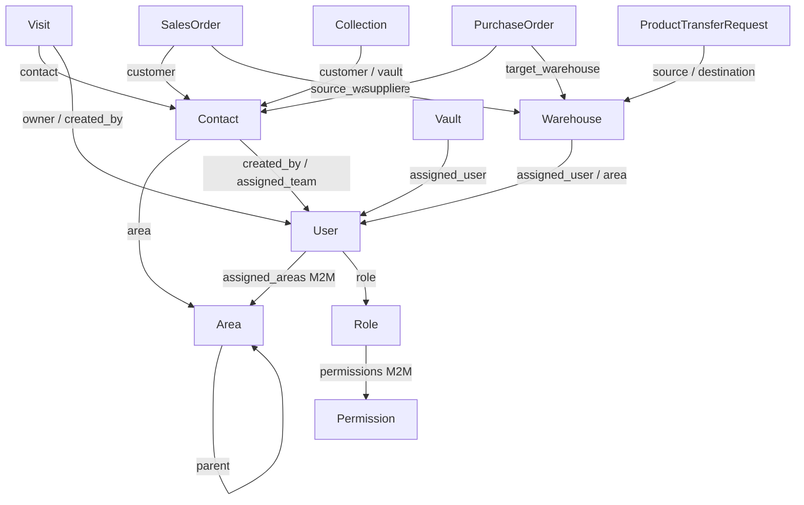

# Architecture (as implemented)

This document describes the running WEA Pharma ERP Django project. It does not invent extra layers.

## 1. Project structure

```text
config/                 # Django project: settings, root URLs, WSGI
accounts/               # Users, roles, permissions, SecurityAuditLog
master_data/            # Areas, company/settings, dashboard, geocoding
contacts/ catalog/ inventory/ purchases/ treasury/ sales/ activities/
templates/              # Django templates (APP_DIRS + templates/)
static/js/              # table_column_manager.js
media/                  # uploads (avatars, product images, visit evidence)
manage.py
```

`INSTALLED_APPS` order in `config/settings.py`: Django contrib, then the nine ERP apps above. `AUTH_USER_MODEL = 'accounts.User'`. Templates include `master_data.context_processors.company_context` and builtin tag library `master_data.templatetags.erp_tags`.

**Limitation:** `SECRET_KEY` historically lived in source. It now reads `DJANGO_SECRET_KEY` with an insecure development fallback. `DEBUG` defaults to `True`. `ALLOWED_HOSTS = ['*']`. Production must override these.

There is **no** DRF, Celery, Redis, or channels app.

## 2. Important models and relationships



- **Area:** `area_type` `governorate` (root, `parent=None`) or `subarea` (brick). Users may be assigned either; authorization walks to the root via `get_main_area` for managers, while representatives are scoped strictly to their assigned Brick(s) (`get_visit_eligible_contacts_queryset`, `can_user_access_contact_for_visit`).
- **Role:** five canonical keys: `superadmin`, `manager`, `accountant`, `rep`, `medical_rep`. Extra flags (`is_super`, `is_area_manager`, `is_rep`, …) still exist for compatibility.
- **Visit:** lifecycle `planned → started → finished` plus separate `approval_status` (`pending` / `approved` / `disapproved`), `requires_approval_due_to_distance`, and `waiting_for_reapproval` (triggered when a representative edits an already-approved visit). Tracks `distance`, `allowed_distance` (from `LocationSettings.tolerance` or `VisitTemplate.special_tolerance` when `allow_template_distance_override=True`), and `distance_discrepancy`.
- **SalesOrder:** `pending → manager_approval → preparing → delivered → invoiced` (also `rejected`, `cancelled`).
- **PurchaseOrder:** `pending → approved → picked → settled` (also `rejected`, `split`, `cancelled`).
- **ProductTransferRequest:** `pending → approved → transferred` (also `rejected`, `cancelled`). Approval/execute is SuperAdmin/accountant, not area managers.

Singleton settings rows (`get_or_create(id=1)`): `CompanyProfile`, `LocationSettings`, `SalesSettings`, `PurchaseSettings`, `UserSettings`.

## 3. App dependency boundaries

Allowed direction (keep it this way):

- `accounts` → `master_data.Area`, `inventory.Warehouse`, `treasury.Vault` (rep default resources)
- `contacts` → `master_data`, `accounts`, `sales.CustomerAccount`, `treasury.VendorAccount`
- `catalog` → `accounts` (created_by), inventory stock on detail
- `inventory` → `catalog`, `accounts.permissions`
- `purchases` / `sales` / `treasury` → `contacts`, `catalog`, `inventory`, `accounts`
- `activities` → `contacts`, `catalog`, `master_data`, `sales`/`purchases` FKs on `ApprovalAuditLog`
- `master_data` → `catalog.Product` (suggested products), `accounts` for audit on area changes

Do not import views across apps. Cross-app **writes** go through the owning app's service.

## 4. URL routing and aliases

Root: `config/urls.py`.

- `/admin/` Django admin
- `/auth/` and `/settings/` both include `accounts.urls` (login exists at `/auth/login/` which is `LOGIN_URL`)
- `/` and `/home/` both include `master_data.urls` (home is `name='home'`)
- `/activities/` **and** `path('', include('activities.urls'))` so `/visits/` and `/activities/visits/` both resolve
- Reference-ERP aliases: `/products/` → catalog, `/purchase-orders/` → purchases, vendor-payment paths → treasury, `/api/customers/search/` and `/api/v1/visits/contacts/list` → `customers_search_api`

**Caution:** duplicate *includes* mean the same view is reachable under multiple prefixes. Prefer reversing **named** URLs (`visits_list`, not a hardcoded path). Do not add a third alias without a documented consumer.

Django admin is branded for WEA Pharma. `SecurityAuditLog` admin is add/change/delete disabled.

## 5. Authentication and authorization

Session authentication. Decorators and helpers in `accounts/permissions.py`:

- `require_permission` / `RequirePermissionMixin`
- `require_super_admin` / `RequireSuperAdminMixin`
- `has_perm_or_admin`, `can_user_access_module`
- `get_scoped_queryset`, `can_user_access_object`
- Area helpers: `get_main_area`, `get_user_main_areas`, `get_user_managed_areas`, `get_user_managed_representatives`, `is_manager_eligible_for_user`

Permission catalog: `accounts/permission_registry.py`. Effective perms: role + user permissions, **only if** parent `module:<key>` is also assigned (SuperAdmin bypasses this and receives every registered codename).

Template visibility uses `` filters `has_permission`, `can_access_module`, `is_super_admin`, `is_manager`. That is UX only.

## 6. Where business logic belongs

| Kind | Location |
|---|---|
| HTTP, GET filters, pagination, messages | `*/views.py` (mostly function-based) |
| Visit GPS/start/end | `activities/services.py` |
| Sales order lifecycle, collections | `sales/services.py` |
| Purchase order lifecycle | `purchases/services.py` |
| Vault deposit/withdraw/transfer, vendor pay | `treasury/services.py` |
| Inter-warehouse transfer | `inventory/services.py` (`ProductTransferService`) |
| Rep warehouse/vault provisioning | `accounts/services.py` (`ensure_representative_resources`) |
| Excel helpers | `master_data/excel_utils.py`, `master_data/pagination_utils.py` |
| Forms | `activities/forms.py` (other apps often read `request.POST` in views) |

## 7. Templates and frontend

- Base: `templates/layouts/base.html` — RTL `<html lang="ar" dir="rtl">`, Tailwind CDN with `brand.500 = #27bebe`, Cairo, Material Symbols, Leaflet.
- Desktop: right sidebar (`lg+`). Mobile: overlay drawer from the right + bottom nav + FAB quick-add sheet.
- Shared partials: `templates/components/` (pagination, column picker, location picker, geographic selector, customer modal, active filters).
- JS: `static/js/table_column_manager.js` plus large inline scripts in visit/contact templates.

No SPA. No compiled frontend.

## 8. Database and transactions

Default engine: SQLite. Archived docs mentioned MySQL; **this checkout uses SQLite**. Production may use another engine if operators change `DATABASES` — do not assume SQLite-only types in new fields.

Use `@transaction.atomic` (already on transfer/sales/purchase/treasury services). Prefer `select_for_update()` when decrementing stock or vault balances. Use `select_related` / `prefetch_related` on list pages.

## 9. Integrations and jobs

- **Google Maps:** `GOOGLE_MAPS_API_KEY` env; geocoding proxy falls back to Nominatim.
- **Leaflet** for in-page maps.
- **openpyxl** for Excel import/export.
- **Management commands:** `setup_permissions`, `migrate_to_canonical_roles`, `backfill_representative_resources`, `setup_egypt_areas`, `import_excel_data`, `seed_activities`.
- **No** Celery beat / cron in-repo. `DataSyncConfig` stores a Google Sheet URL; `sync_data_trigger` currently stamps `last_synced_at` only (does not pull the sheet).

## 10. Audit logging

Two stores (do not collapse them):

1. `accounts.SecurityAuditLog` via `AuditLogService.log` — enterprise trail (auth, contacts, sales, purchases, treasury, areas).
2. `activities.ApprovalAuditLog` — visit/sales/purchase **workflow** history (approve/reject/status_changed).

See [`audit-logging.md`](audit-logging.md).

## 11. Cross-app workflows

**Visit:** unified creation at `/visits/create/` for both planned and unplanned visits (distance validation mandatory on creation for unplanned visits, not required on creation for planned visits; duplicate same-day visit confirmation via `visit_check_duplicate_api` / `confirm_duplicate=1`) → manager approval (`visit_action`) → `start_visit` → questionnaire & completion at `/visits/<pk>/` (`end_visit`, enforcing distance validation with direct manager/superadmin bypass or representative exception request + mandatory `bypass_reason`). Editing an approved visit as a representative invalidates approval (`approval_status='pending'`, `waiting_for_reapproval=True`). Bulk daily planned visit scheduling is supported at `/planned-visits/bulk-add/` (`planned_visits_bulk_add`). Full lifecycle events are rendered via `build_visit_timeline(visit)`.

**Sales:** create order (rep warehouse) → manager approval (`SalesSettings.require_manager_approval`) → warehouse prepare/deliver → invoice → `CustomerAccount` / `CustomerTransaction` → `Collection` into a vault.

**Purchases:** create → approve → pick (inward memo + stock) → settle (vendor ledger) → optional vendor payment from vault.

**Transfer:** rep requests same **main area** warehouses → SuperAdmin/accountant approve → atomic stock move + paired memos.

**Rep onboarding:** creating a `rep`/`medical_rep` user can auto-create warehouse + cash vault (`UserSettings`).

## 12. Constraints and caution

- URL alias duplication (prefix includes).
- `has_perm_or_admin` settings overrides can open visit/sales/purchase **module** access.
- `get_scoped_queryset` returns the **unfiltered** queryset for unknown `model_name` — always pass the documented model key.
- `Role.is_manager_role` also treats names like `ceo`, `admin`, `purchasingmanager` as managers.
- `is_accountant()` returns True for SuperAdmin (used as “financial override” in some branches).
- Hardcoded company defaults exist on `CompanyProfile` fields; treat as seed data, not secrets to commit further.
- `scratch/` contains one-off scripts and Playwright experiments; it is not an installed app.
